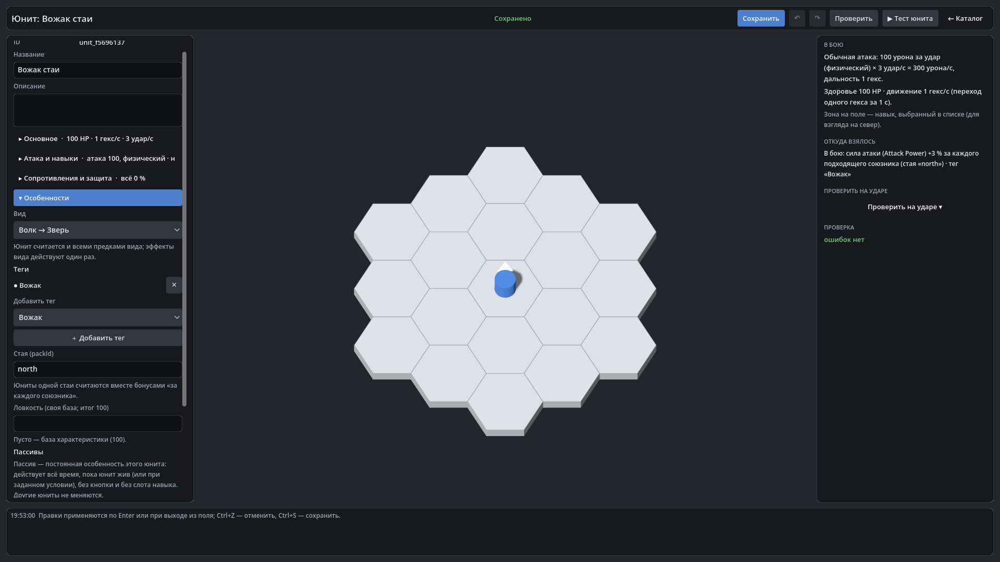

# HexTactics

Прототип тактической игры в реальном времени с тактической паузой на гексагональном поле
(Godot 4.7.2 .NET, C#). Техническое задание — [`docs/GAME_SPEC.md`](docs/GAME_SPEC.md) (часть 1, редакция 0.1) и
[`docs/GAME_SPEC_PART2.md`](docs/GAME_SPEC_PART2.md) (часть 2, редакция 0.2), [`docs/GAME_SPEC_PART3.md`](docs/GAME_SPEC_PART3.md)
(часть 3, редакция 0.3 — правила боя), [`docs/GAME_SPEC_PART4.md`](docs/GAME_SPEC_PART4.md) (часть 4, редакция 0.4 —
режим «Разработчик» и пользовательский контент), [`docs/GAME_SPEC_PART5.md`](docs/GAME_SPEC_PART5.md) (часть 5, редакция 0.5 —
урон и защита), [`docs/GAME_SPEC_PART6.md`](docs/GAME_SPEC_PART6.md) (часть 6, редакция 0.6 — конструктор боевой системы)
и [`docs/GAME_SPEC_PART7.md`](docs/GAME_SPEC_PART7.md) (часть 7, редакция 0.7 — сценарии: обычный бой, Tower Defense,
оборона, исследование; блок и автоатака; актуальная). План версий: часть 6 — v0.26.0–v0.31.0, часть 7 — v0.32.0–v0.39.0
(`docs/DECISIONS.md`, D-143, D-150).

**Текущая версия: v0.29.0** — ТЗ ч.6: «Происхождение и теги» — дерево видов (Лунный волк — это и Волк, и Зверь; эффекты
предков действуют один раз, потомок заменяет, отключает или дополняет их), общие теги с группами взаимоисключения и
повтором, стая (`packId`) и эффект «за каждого союзника» (вожак +3 % за волка своей стаи, пересчёт при гибели), реестр
характеристик со встроенной «Ловкостью» 100 (без выдуманных последствий). Предыдущая: v0.28.0 — индивидуальные пассивы и
единый движок модификаторов.
Список изменений — [`CHANGELOG.md`](CHANGELOG.md).



## Что есть сейчас

- Поле 12 × 10 = 120 правильных гексов **flat-top** (плоская сторона вверху, odd-q) с базой, зоной выставления,
  зонами появления и препятствиями (v0.6.0; до v0.5.0 включительно — pointy-top).
- Белый указатель взгляда у ребра гекса юнита; стрелки и маркеры приказов всегда поверх объектов сцены (v0.6.0).
- Ортографическая камера с возвышением 60°, поле целиком видно при 1920×1080, 1600×900 и 1366×768.
- Клетка под курсором определяется корректно и при наклонной камере (в т. ч. крайние клетки).
- Юниты (v0.2.0): три способа появления — на базе, в зоне на краю карты, прямым выставлением; проверки
  границ/проходимости/занятости с понятными сообщениями; выбор юнита щелчком; шесть направлений взгляда.
- Приказы (v0.3.0): удерживание ЛКМ на юните и протягивание прямой стрелки → ТД1; из последней ТД → ТД2, ТД3…;
  короткий жест внутри клетки — поворот без движения; Esc/ПКМ — отмена текущей стрелки.
- Путь и движение (v0.4.0): кратчайший путь A* в обход препятствий, подсветка всех 120 клеток при протягивании
  (зелёные/красные), запрет недостижимых ТД, тонкая линия фактического пути, движение по цепочке 2 гекса/с,
  остановка с причиной, если путь исчез.
- Тактическая пауза (v0.5.0): пробел останавливает игровое время; на паузе можно выбирать юнитов и строить цепочки ТД,
  после снятия исполнение продолжается без скачка.
- Приказы по ТЗ ч.2 (v0.7.0): протянуть ЛКМ от юнита → ТД1, дальше клики → ТД2, ТД3…; клик у ребра последней ТД —
  обязательный финальный взгляд, приказ применяется целиком; ПКМ/Esc — отмена черновика; на паузе — новый маршрут
  движущемуся юниту без рывка.
- Ростер (v0.8.0): внизу пять карточек оперативников; ЛКМ на карточке + протягивание на зелёную клетку базы/зоны
  выставления → юнит появляется и сразу тянется белая стрелка приказа; красная клетка, ПКМ, Esc — карточка возвращается.
  Выставленный юнит без взгляда не действует, пока не задан первый взгляд.
- Команда (v0.9.0): карточка «Команда» → клик по своему юниту (капитан) и остальным участникам → голубые стрелки от каждого;
  клик по клетке, вокруг которой помещается вся команда, — КТД1, дальше КТД2…; клик у ребра последней КТД — взгляд
  капитана, и вся команда идёт: капитан в КТД, остальные на соседние клетки.
- Команда (v0.10.0): этапы синхронны (у каждой КТД ждут всех), спутники смотрят как капитан или на 60° в сторону (выбор
  фиксируется при подтверждении), места выбираются так, чтобы никто не стоял на чужом пути, а если стоит — отходит.
- Движение (v0.11.0): 1 гекс/с; тело идёт по плавной кривой поверх технического гекс-пути — скругляет повороты внутри
  клеток пути, не задевает стены, проходит через центр каждой ТД; новый приказ на ходу или на паузе — без рывка. F3 —
  отладка движения.
- Бой (v0.12.0): у юнитов 100 HP; белая стрелка на враге — приказ атаки (взгляд на цель сам), юнит подходит и бьёт
  3 раза/с; погибший снимается с карты. «Мишень врага (T)» и «Стенд» — неподвижные враги для проверки (без ИИ).
- Навык (v0.13.0): «✦ Линейный удар (R)» — направление курсором, две клетки подсвечиваются серым, ЛКМ — удар 20 по
  врагам, стоящим там в момент удара.
- Навык в ТД (v0.14.0): короткий клик по ТД → «✦ Линейный удар» → красная стрелка от ТД → ЛКМ; у ТД — красный
  шестиугольник «✦1». Юнит доходит до ТД, бьёт один раз в выбранную сторону и сам продолжает маршрут.
- Два режима (v0.15.0): «Играть» и «Разработчик». Весь игровой контент — данные библиотеки (`docs/CONTENT_FORMAT.md`):
  встроенные типы гексов, юнит, навык и карта; свои объекты хранятся в `user://content`. Каталог разработчика:
  категории, поиск, копии, переименование, удаление со ссылками, Undo/Redo (`docs/EDITOR_GUIDE.md`).
- Редактор карт (v0.16.0): гексы ставятся кликом по пустой решётке, тип/высота/зона/комментарий слева, красная
  двухэтапная кнопка удаления, проверка и тестовые точки маршрута, сохранение с черновиками, «Тест карты»; сохранённая
  карта выбирается на стартовом экране.
- Редактор юнитов (v0.17.0): характеристики с проверкой ввода, сила атаки отдельно от скорости атак, навыки — ссылки на
  библиотеку, предпросмотр «В бою», «Тест юнита»; отряд для «Играть» выбирается на стартовом экране.
- Редактор навыков (v0.18.0): клик по гексу добавляет клетку в область, базовый юнит поворачивается на шесть сторон,
  у каждой клетки — свои эффекты или эффекты навыка с переопределениями; урон фиксированный или % от силы атаки, число
  попаданий и интервал, лечение, баффы/дебаффы с длительностью и политикой повтора, периодический урон/лечение;
  предпросмотр чисел по клеткам, «Тест навыка». В бою — все навыки юнита в меню ТД.
- Редактор типов гексов (v0.19.0): категория, проходимость, «можно ставить ТД», высота, цвет, значок; эффекты «пока на
  гексе» (урон/лечение N HP/с — ровно 10 HP за 2 с при любом FPS, на паузе ничего), «при входе»/«при выходе»; стороны;
  «Тест гекса»; свои типы ставятся в редакторе карт ссылкой на библиотеку.
- Импорт/экспорт (v0.20.0): один объект `.json` (с предупреждением, если он не самодостаточен) или пакет `.hxp` (ZIP с
  manifest, SHA-256 и всеми зависимостями); предпросмотр, проверка путей, файлов, сумм, ссылок и пределов до установки;
  «пропустить / заменить с резервной копией / копией с новым ID»; установка целиком или никак; старые схемы обновляются с
  резервной копией.
- Урон и защита (v0.21.0, ТЗ ч.5): любой урон — типизированное событие через один расчёт; сопротивления по слоям «все
  типы / семейство / подтип» с пробитием, чистый урон мимо R, полная или разделённая сила по площади; в игре числа защиты
  скрыты.
- Правила защиты и щиты (v0.22.0): категория «Правила защиты» с шаблонами и резюме словами, единый порядок иммунитет →
  поглощение/отражение → R → снижение → щиты → HP → ответный удар; ответ на ответ невозможен; в игре — только
  «невосприимчив» и «щит».
- «Механики» (v0.23.0): конструктор типа урона, наборы сопротивлений, песочница «Проверить на ударе» в редакторах правила,
  типа и юнита.
- «Сопротивления» без перегрузки (v0.24.0): секции юнита, короткая таблица, карточки защит, правило поверх юнита,
  отладка только в тесте.
- Виды и теги (v0.29.0): дерево видов, общие теги, стая и «за каждого союзника», реестр характеристик.
- Пассивы (v0.28.0): «Особенности» юнита — исходящий/получаемый урон, характеристики, R/A, правила; «Откуда взялось».
- Защита A (v0.27.0): очки защиты по слоям рядом с R, пробитие A, «Правила боя» с K, правила у карты.
- Единый реестр (v0.26.0): «＋ Новый тип урона…» в любом списке типа, группы по семействам, фильтры полей, «элемент»,
  замена ссылок или архив при удалении, живое обновление открытых редакторов.
- Минималистичная графика «базовых 3D-примитивов», тонкие бледные границы клеток.

Подробнее: [`docs/releases/v0.29.0/README.md`](docs/releases/v0.29.0/README.md) · управление — [`docs/CONTROLS.md`](docs/CONTROLS.md).

| Версия | Содержание | Архив |
|---|---|---|
| v0.29.0 | ТЗ ч.6: дерево видов, общие теги, стая и бонус «за каждого союзника», реестр характеристик | `release_archives/v0.29.0/` |
| v0.28.0 | ТЗ ч.6: пассивы юнита и единый движок модификаторов, «Особенности», «Откуда взялось», атакующий в песочнице | `release_archives/v0.28.0/` |
| v0.27.0 | ТЗ ч.6: защита A (очки, слои, пробитие, временная), K / (K + A) после R, «Правила боя» и правила карты | `release_archives/v0.27.0/` |
| v0.26.0 | ТЗ ч.6: единый реестр определений, создание типа из селектора, фильтры и группы списков, архив и замена ссылок | `release_archives/v0.26.0/` |
| v0.25.0 | ТЗ ч.5: сквозная проверка, UX-испытание пяти юнитов, приёмка §11, точка расширения для стихий | `release_archives/v0.25.0/` |
| v0.24.1 | исправление: длинный текст не расширяет каталог и панели редакторов шире окна (найдено проверкой v0.24.0) | `release_archives/v0.24.1/` |
| v0.24.0 | ТЗ ч.5: редактор юнита секциями, короткая таблица сопротивлений, карточки защит, правило поверх юнита, отладка теста | `release_archives/v0.24.0/` |
| v0.23.0 | ТЗ ч.5: «Механики» — свои типы урона, наборы сопротивлений с наследованием, «Проверить на ударе» с причинами | `release_archives/v0.23.0/` |
| v0.22.0 | ТЗ ч.5: правила защиты (иммунитет, поглощение, лечение, отражение, щиты, ответный удар), пределы реакций, «огонь 300 %» | `release_archives/v0.22.0/` |
| v0.21.0 | ТЗ ч.5: единый `DamageResolver`, типы урона, сопротивления −500…+500 %, область урона, миграция старого контента | `release_archives/v0.21.0/` |
| v0.20.0 | импорт/экспорт объектов и пакетов `.hxp`, предпросмотр, конфликты, транзакции, миграции с резервными копиями, пределы | `release_archives/v0.20.0/` |
| v0.19.1 | исправление: чистый выход без сбоя финализатора .NET после длинной сессии (найдено проверкой v0.19.0) | `release_archives/v0.19.1/` |
| v0.19.0 | редактор типов гексов: поверхности ±5 HP/с по логическому гексу, вход/выход, запрет ТД, значки, свои типы в редакторе карт | `release_archives/v0.19.0/` |
| v0.18.0 | редактор навыков: область из гексов, эффекты клеток, попадания с интервалами, лечение, баффы/дебаффы, тест | `release_archives/v0.18.0/` |
| v0.17.0 | редактор юнитов: характеристики, Attack Power, навыки-ссылки, предпросмотр, тест, выбор отряда | `release_archives/v0.17.0/` |
| v0.16.0 | редактор карт: решётка, гексы кликом, свойства, красное удаление, проверка, сохранение, тест, выбор карты | `release_archives/v0.16.0/` |
| v0.15.0 | стартовое меню «Играть»/«Разработчик», библиотека контента, каталог, Undo/Redo, встроенный контент как данные | `release_archives/v0.15.0/` |
| v0.14.1 | исправление: при меню ТД и прицеливании нет зелёно-красной подсветки — серая область навыка читается чисто | `release_archives/v0.14.1/` |
| v0.14.0 | навык в ТД: меню по клику на ТД, красная стрелка от ТД, шестиугольник «1», удар и продолжение маршрута | `release_archives/v0.14.0/` |
| v0.13.0 | навык «Линейный удар»: 2 гекса, 6 направлений, серое превью, 20 урона | `release_archives/v0.13.0/` |
| v0.12.0 | HP 100, смерть, приказ атаки, обычная атака 3/с, мишени | `release_archives/v0.12.0/` |
| v0.11.0 | 1 гекс/с, непрерывное положение, безопасное сглаживание поворотов, отладка движения (F3) | `release_archives/v0.11.0/` |
| v0.10.0 | синхронные этапы КТД, взгляды спутников, уступание прохода, 5 юнитов одновременно | `release_archives/v0.10.0/` |
| v0.9.0 | режим «Команда»: капитан, голубые стрелки, цепочка КТД, построение вокруг КТД | `release_archives/v0.9.0/` |
| v0.8.0 | нижний ростер, выставление перетаскиванием, юнит ждёт первого взгляда | `release_archives/v0.8.0/` |
| v0.7.0 | непрерывная прокладка ТД, финальный взгляд, отмена, замена маршрута на паузе | `release_archives/v0.7.0/` |
| v0.6.0 | flat-top поле, указатель взгляда у ребра, стрелки поверх сцены | `release_archives/v0.6.0/` |
| v0.5.0 | тактическая пауза, регрессионные проверки сборки | `release_archives/v0.5.0/` |
| v0.4.0 | A*, подсветка достижимости, движение по цепочке | `release_archives/v0.4.0/` |
| v0.3.0 | стрелки-приказы, цепочки ТД, поворот жестом | `release_archives/v0.3.0/` |
| v0.2.0 | юниты, 6 направлений, 3 способа появления | `release_archives/v0.2.0/` |
| v0.1.0 | карта 12×10, камера 60°, фундамент | `release_archives/v0.1.0/` |

## Запуск готовой сборки (Windows 10/11 x64)

1. Скачать `release_archives/vX.Y.Z/HexTactics_vX.Y.Z_windows_x64.zip` нужной версии (на GitHub: файл → *Download raw file*).
2. Проверить контрольную сумму (необязательно): `Get-FileHash .\HexTactics_vX.Y.Z_windows_x64.zip -Algorithm SHA256`
   и сравнить с файлом `.sha256` рядом.
3. Распаковать в любую папку и запустить `HexTactics.exe`. Установка .NET не нужна.
   `HexTactics.console.exe` запускает то же самое с окном консоли (лог).

Все прошлые версии лежат рядом в `release_archives/vX.Y.Z/` и запускаются независимо.

## Сборка из исходников

Нужно: [Godot 4.7.2 stable .NET](https://godotengine.org/download/archive/4.7.2-stable/), .NET SDK 8, Git, PowerShell 7 (для скриптов релиза).

```bash
git clone https://github.com/Natrium45634/TactickGame.git
cd TactickGame
dotnet build HexTactics.sln
dotnet test HexTactics.sln
```

Затем открыть `src/GodotClient/project.godot` в Godot 4.7.2 .NET и запустить (F5).

## Релиз и откат

```powershell
# собрать архив текущей версии (HEAD должен быть помечен тегом vX.Y.Z)
pwsh tools/build_release.ps1 -GodotPath "C:\Godot\Godot_v4.7.2-stable_mono_win64.exe"
# проверить архив (контрольная сумма, коммит тега, состав; -Run — запуск регрессионного сценария в самой сборке)
pwsh tools/verify_release.ps1 -Version 0.1.0 -Run
# распаковать старую версию в отдельную папку (текущая не меняется)
pwsh tools/restore_version.ps1 -Version 0.1.0
# получить исходники старой версии отдельным git worktree
pwsh tools/restore_version.ps1 -Version 0.1.0 -Mode Source
```

Каждая версия имеет неизменяемый Git-тег `vX.Y.Z`. Откат исходников вручную: `git checkout v0.1.0`
(или `git worktree add ../HexTactics_v0.1.0 v0.1.0`).

## Хранилище архивов и теги

- ZIP-архивы хранятся как обычные файлы Git в `release_archives/vX.Y.Z/` (каждый < 100 МБ — лимит GitHub).
  Git LFS не используется: среда, где собираются релизы, не может загружать объекты в LFS.
  Чтобы склонировать только исходники и скачивать архивы по требованию, используйте частичный клон:
  `git clone --filter=blob:limit=1m https://github.com/Natrium45634/TactickGame.git`.
- Релизные теги `vX.Y.Z` создаются при сборке, но облачная среда может публиковать только рабочую ветку.
  Точный коммит каждой версии записан в `release_archives/vX.Y.Z/BUILD_INFO.txt`; один раз выполните
  на своей машине, чтобы создать и опубликовать недостающие аннотированные теги (существующие теги не изменяются):

```powershell
pwsh tools/create_release_tags.ps1
git push origin --tags
```

## Документация

| Файл | Содержание |
|---|---|
| [`docs/GAME_SPEC.md`](docs/GAME_SPEC.md) … [`docs/GAME_SPEC_PART6.md`](docs/GAME_SPEC_PART6.md) | Техническое задание: части 1–6 (0.6 — актуальная) |
| [`docs/ARCHITECTURE.md`](docs/ARCHITECTURE.md) | Слои, координаты, формат карты, визуальные слои, камера, автоматизация |
| [`docs/DECISIONS.md`](docs/DECISIONS.md) | Принятые решения и допущения |
| [`docs/CONTROLS.md`](docs/CONTROLS.md) | Управление |
| [`docs/releases/`](docs/releases/) | Описание каждой версии |
| [`CLAUDE.md`](CLAUDE.md) | Правила работы для Claude Code |
