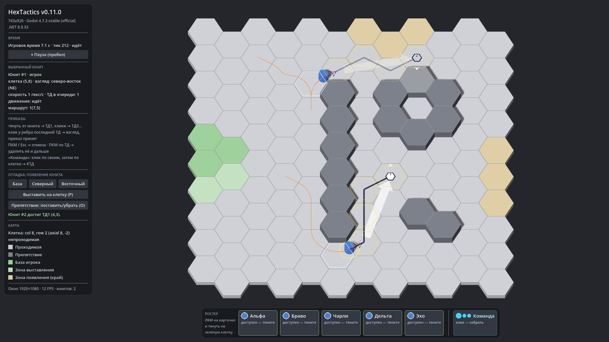

# HexTactics

Прототип тактической игры в реальном времени с тактической паузой на гексагональном поле
(Godot 4.7.2 .NET, C#). Техническое задание — [`docs/GAME_SPEC.md`](docs/GAME_SPEC.md) (часть 1, редакция 0.1) и
[`docs/GAME_SPEC_PART2.md`](docs/GAME_SPEC_PART2.md) (часть 2, редакция 0.2) и [`docs/GAME_SPEC_PART3.md`](docs/GAME_SPEC_PART3.md)
(часть 3, редакция 0.3 — актуальная, приоритетнее).

**Текущая версия: v0.11.0** — плавное движение по гекс-маршруту без среза углов, 1 гекс/с (ТЗ ч.3). Список изменений — [`CHANGELOG.md`](CHANGELOG.md).



## Что есть сейчас

- Поле 12 × 10 = 120 правильных гексов **flat-top** (плоская сторона вверху, odd-q) с базой, зоной выставления,
  зонами появления и препятствиями (v0.6.0; до v0.5.0 включительно — pointy-top).
- Белый указатель взгляда у ребра гекса юнита; стрелки и маркеры приказов всегда поверх объектов сцены (v0.6.0).
- Ортографическая камера с возвышением 60°, поле целиком видно при 1920×1080, 1600×900 и 1366×768.
- Клетка под курсором определяется корректно и при наклонной камере (в т. ч. крайние клетки).
- Юниты (v0.2.0): три способа появления — на базе, в зоне на краю карты, прямым выставлением; проверки
  границ/проходимости/занятости с понятными сообщениями; выбор юнита щелчком; шесть направлений взгляда.
- Приказы (v0.3.0): удерживание ЛКМ на юните и протягивание прямой стрелки → ТД1; из последней ТД → ТД2, ТД3…;
  короткий жест внутри клетки — поворот без движения; Esc/ПКМ — отмена текущей стрелки.
- Путь и движение (v0.4.0): кратчайший путь A* в обход препятствий, подсветка всех 120 клеток при протягивании
  (зелёные/красные), запрет недостижимых ТД, тонкая линия фактического пути, движение по цепочке 2 гекса/с,
  остановка с причиной, если путь исчез.
- Тактическая пауза (v0.5.0): пробел останавливает игровое время; на паузе можно выбирать юнитов и строить цепочки ТД,
  после снятия исполнение продолжается без скачка.
- Приказы по ТЗ ч.2 (v0.7.0): протянуть ЛКМ от юнита → ТД1, дальше клики → ТД2, ТД3…; клик у ребра последней ТД —
  обязательный финальный взгляд, приказ применяется целиком; ПКМ/Esc — отмена черновика; на паузе — новый маршрут
  движущемуся юниту без рывка.
- Ростер (v0.8.0): внизу пять карточек оперативников; ЛКМ на карточке + протягивание на зелёную клетку базы/зоны
  выставления → юнит появляется и сразу тянется белая стрелка приказа; красная клетка, ПКМ, Esc — карточка возвращается.
  Выставленный юнит без взгляда не действует, пока не задан первый взгляд.
- Команда (v0.9.0): карточка «Команда» → клик по своему юниту (капитан) и остальным участникам → голубые стрелки от каждого;
  клик по клетке, вокруг которой помещается вся команда, — КТД1, дальше КТД2…; клик у ребра последней КТД — взгляд
  капитана, и вся команда идёт: капитан в КТД, остальные на соседние клетки.
- Команда (v0.10.0): этапы синхронны (у каждой КТД ждут всех), спутники смотрят как капитан или на 60° в сторону (выбор
  фиксируется при подтверждении), места выбираются так, чтобы никто не стоял на чужом пути, а если стоит — отходит.
- Движение (v0.11.0): 1 гекс/с; тело идёт по плавной кривой поверх технического гекс-пути — скругляет повороты внутри
  клеток пути, не задевает стены, проходит через центр каждой ТД; новый приказ на ходу или на паузе — без рывка. F3 —
  отладка движения.
- Минималистичная графика «базовых 3D-примитивов», тонкие бледные границы клеток.

Подробнее: [`docs/releases/v0.11.0/README.md`](docs/releases/v0.11.0/README.md) · управление — [`docs/CONTROLS.md`](docs/CONTROLS.md).

| Версия | Содержание | Архив |
|---|---|---|
| v0.11.0 | 1 гекс/с, непрерывное положение, безопасное сглаживание поворотов, отладка движения (F3) | `release_archives/v0.11.0/` |
| v0.10.0 | синхронные этапы КТД, взгляды спутников, уступание прохода, 5 юнитов одновременно | `release_archives/v0.10.0/` |
| v0.9.0 | режим «Команда»: капитан, голубые стрелки, цепочка КТД, построение вокруг КТД | `release_archives/v0.9.0/` |
| v0.8.0 | нижний ростер, выставление перетаскиванием, юнит ждёт первого взгляда | `release_archives/v0.8.0/` |
| v0.7.0 | непрерывная прокладка ТД, финальный взгляд, отмена, замена маршрута на паузе | `release_archives/v0.7.0/` |
| v0.6.0 | flat-top поле, указатель взгляда у ребра, стрелки поверх сцены | `release_archives/v0.6.0/` |
| v0.5.0 | тактическая пауза, регрессионные проверки сборки | `release_archives/v0.5.0/` |
| v0.4.0 | A*, подсветка достижимости, движение по цепочке | `release_archives/v0.4.0/` |
| v0.3.0 | стрелки-приказы, цепочки ТД, поворот жестом | `release_archives/v0.3.0/` |
| v0.2.0 | юниты, 6 направлений, 3 способа появления | `release_archives/v0.2.0/` |
| v0.1.0 | карта 12×10, камера 60°, фундамент | `release_archives/v0.1.0/` |

## Запуск готовой сборки (Windows 10/11 x64)

1. Скачать `release_archives/vX.Y.Z/HexTactics_vX.Y.Z_windows_x64.zip` нужной версии (на GitHub: файл → *Download raw file*).
2. Проверить контрольную сумму (необязательно): `Get-FileHash .\HexTactics_vX.Y.Z_windows_x64.zip -Algorithm SHA256`
   и сравнить с файлом `.sha256` рядом.
3. Распаковать в любую папку и запустить `HexTactics.exe`. Установка .NET не нужна.
   `HexTactics.console.exe` запускает то же самое с окном консоли (лог).

Все прошлые версии лежат рядом в `release_archives/vX.Y.Z/` и запускаются независимо.

## Сборка из исходников

Нужно: [Godot 4.7.2 stable .NET](https://godotengine.org/download/archive/4.7.2-stable/), .NET SDK 8, Git, PowerShell 7 (для скриптов релиза).

```bash
git clone https://github.com/Natrium45634/TactickGame.git
cd TactickGame
dotnet build HexTactics.sln
dotnet test HexTactics.sln
```

Затем открыть `src/GodotClient/project.godot` в Godot 4.7.2 .NET и запустить (F5).

## Релиз и откат

```powershell
# собрать архив текущей версии (HEAD должен быть помечен тегом vX.Y.Z)
pwsh tools/build_release.ps1 -GodotPath "C:\Godot\Godot_v4.7.2-stable_mono_win64.exe"
# проверить архив (контрольная сумма, коммит тега, состав; -Run — запуск регрессионного сценария в самой сборке)
pwsh tools/verify_release.ps1 -Version 0.1.0 -Run
# распаковать старую версию в отдельную папку (текущая не меняется)
pwsh tools/restore_version.ps1 -Version 0.1.0
# получить исходники старой версии отдельным git worktree
pwsh tools/restore_version.ps1 -Version 0.1.0 -Mode Source
```

Каждая версия имеет неизменяемый Git-тег `vX.Y.Z`. Откат исходников вручную: `git checkout v0.1.0`
(или `git worktree add ../HexTactics_v0.1.0 v0.1.0`).

## Хранилище архивов и теги

- ZIP-архивы хранятся как обычные файлы Git в `release_archives/vX.Y.Z/` (каждый < 100 МБ — лимит GitHub).
  Git LFS не используется: среда, где собираются релизы, не может загружать объекты в LFS.
  Чтобы склонировать только исходники и скачивать архивы по требованию, используйте частичный клон:
  `git clone --filter=blob:limit=1m https://github.com/Natrium45634/TactickGame.git`.
- Релизные теги `vX.Y.Z` создаются при сборке, но облачная среда может публиковать только рабочую ветку.
  Точный коммит каждой версии записан в `release_archives/vX.Y.Z/BUILD_INFO.txt`; один раз выполните
  на своей машине, чтобы создать и опубликовать недостающие аннотированные теги (существующие теги не изменяются):

```powershell
pwsh tools/create_release_tags.ps1
git push origin --tags
```

## Документация

| Файл | Содержание |
|---|---|
| [`docs/GAME_SPEC.md`](docs/GAME_SPEC.md) | Техническое задание |
| [`docs/ARCHITECTURE.md`](docs/ARCHITECTURE.md) | Слои, координаты, формат карты, визуальные слои, камера, автоматизация |
| [`docs/DECISIONS.md`](docs/DECISIONS.md) | Принятые решения и допущения |
| [`docs/CONTROLS.md`](docs/CONTROLS.md) | Управление |
| [`docs/releases/`](docs/releases/) | Описание каждой версии |
| [`CLAUDE.md`](CLAUDE.md) | Правила работы для Claude Code |
