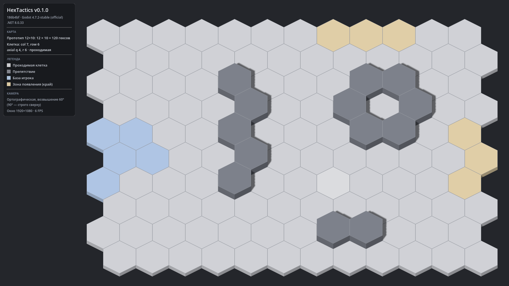

# HexTactics

Прототип тактической игры в реальном времени с тактической паузой на гексагональном поле
(Godot 4.7.2 .NET, C#). Техническое задание — [`docs/GAME_SPEC.md`](docs/GAME_SPEC.md).

**Текущая версия: v0.1.0** — карта и проект. Список изменений — [`CHANGELOG.md`](CHANGELOG.md).



## Что есть сейчас

- Поле 12 × 10 = 120 правильных гексов (pointy-top, odd-r) с базой игрока, зонами появления и препятствиями.
- Ортографическая камера с возвышением 60°, поле целиком видно при 1920×1080, 1600×900 и 1366×768.
- Клетка под курсором определяется корректно и при наклонной камере (в т. ч. крайние клетки).
- Минималистичная графика «базовых 3D-примитивов», тонкие бледные границы клеток.

Подробнее о версии: [`docs/releases/v0.1.0/README.md`](docs/releases/v0.1.0/README.md).

## Запуск готовой сборки (Windows 10/11 x64)

1. Скачать `release_archives/v0.1.0/HexTactics_v0.1.0_windows_x64.zip` (на GitHub: файл → *Download raw file*).
2. Проверить контрольную сумму (необязательно): `Get-FileHash .\HexTactics_v0.1.0_windows_x64.zip -Algorithm SHA256`
   и сравнить с `HexTactics_v0.1.0_windows_x64.zip.sha256`.
3. Распаковать в любую папку и запустить `HexTactics.exe`. Установка .NET не нужна.
   `HexTactics.console.exe` запускает то же самое с окном консоли (лог).

Все прошлые версии лежат рядом в `release_archives/vX.Y.Z/` и запускаются независимо.

## Сборка из исходников

Нужно: [Godot 4.7.2 stable .NET](https://godotengine.org/download/archive/4.7.2-stable/), .NET SDK 8, Git (+ Git LFS для архивов).

```bash
git clone https://github.com/Natrium45634/TactickGame.git
cd TactickGame
dotnet build HexTactics.sln
dotnet test HexTactics.sln
```

Затем открыть `src/GodotClient/project.godot` в Godot 4.7.2 .NET и запустить (F5).

## Релиз и откат

```powershell
# собрать архив текущей версии (HEAD должен быть помечен тегом vX.Y.Z)
pwsh tools/build_release.ps1 -GodotPath "C:\Godot\Godot_v4.7.2-stable_mono_win64.exe"
# проверить архив (контрольная сумма, коммит тега, состав; -Run — пробный запуск)
pwsh tools/verify_release.ps1 -Version 0.1.0 -Run
# распаковать старую версию в отдельную папку (текущая не меняется)
pwsh tools/restore_version.ps1 -Version 0.1.0
# получить исходники старой версии отдельным git worktree
pwsh tools/restore_version.ps1 -Version 0.1.0 -Mode Source
```

Каждая версия имеет неизменяемый Git-тег `vX.Y.Z`. Откат исходников вручную: `git checkout v0.1.0`
(или `git worktree add ../HexTactics_v0.1.0 v0.1.0`).

## Хранилище архивов

<!-- archive-storage -->
Архивы `release_archives/**` хранятся в Git LFS. Если после клонирования ZIP весит ~130 байт
(указатель LFS), выполните `git lfs install` и `git lfs pull`.

## Документация

| Файл | Содержание |
|---|---|
| [`docs/GAME_SPEC.md`](docs/GAME_SPEC.md) | Техническое задание |
| [`docs/ARCHITECTURE.md`](docs/ARCHITECTURE.md) | Слои, координаты, формат карты, визуальные слои, камера, автоматизация |
| [`docs/DECISIONS.md`](docs/DECISIONS.md) | Принятые решения и допущения |
| [`docs/CONTROLS.md`](docs/CONTROLS.md) | Управление |
| [`docs/releases/`](docs/releases/) | Описание каждой версии |
| [`CLAUDE.md`](CLAUDE.md) | Правила работы для Claude Code |
