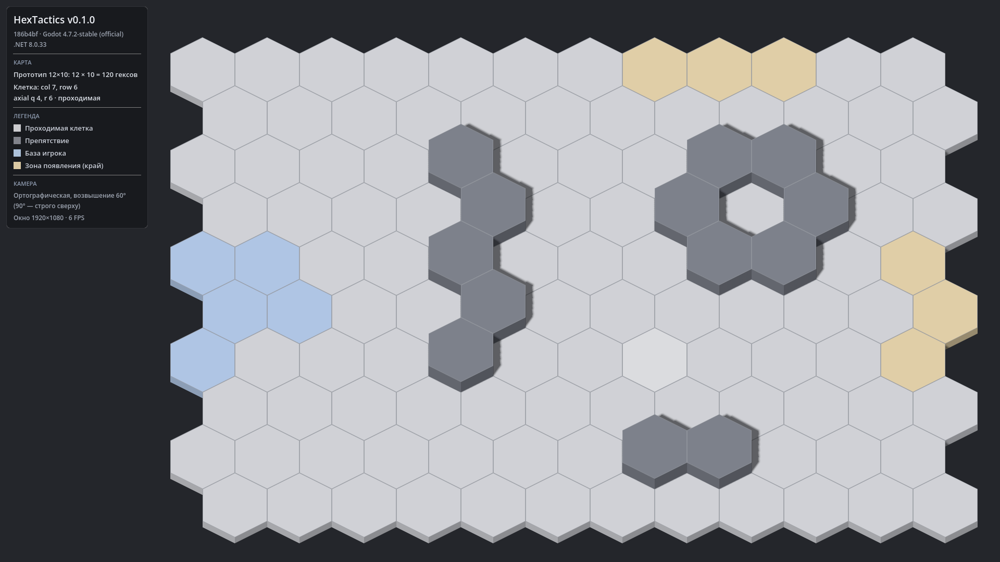

# HexTactics v0.1.0 — карта и проект

**Дата:** 2026-11-05 · **Тег:** `v0.1.0` · **Этап ТЗ:** 1, версия «карта и проект» (§1.1)
**Движок:** Godot 4.7.2 stable .NET (`4.7.2.stable.mono.official.ed1daf0bf`) · **.NET:** SDK 8.0.133, рантайм 8.0 (`net8.0`)
**Архив:** `release_archives/v0.1.0/HexTactics_v0.1.0_windows_x64.zip` (+ `.sha256`, `BUILD_INFO.txt` с коммитом и датой сборки)

## Функции

- Гексагональное поле **12 × 10 = 120** правильных гексов pointy-top, odd-r offset, без зазоров.
- Типы клеток из данных карты: проходимая, препятствие (поднятая колонна), база игрока (голубоватая),
  зона появления на краю (песочная). Признак проходимости хранится в модели.
- Ортографическая камера, **возвышение 60°** над плоскостью (90° — вид строго сверху); поле центрируется
  и вписывается в окно справа от панели HUD при любом размере окна.
- Тонкие бледные границы клеток (~1,5–2 px при 1920×1080, масштабируются вместе с полем).
- Наведение мыши: клетка под курсором подсвечивается мягкой полупрозрачной заливкой; в HUD — offset- и
  axial-координаты и тип клетки. Корректно для крайних клеток и с учётом наклона камеры.
- HUD: версия, коммит, версии Godot и .NET, легенда, размер окна и FPS.
- Автоматизация `--hx-*` для скриншотов и смоук-тестов.

## Ограничения

- Юнитов, приказов, поиска пути и паузы ещё нет (v0.2.0–v0.5.0).
- Зум и панорамирование камеры не реализованы (архитектура выбора клеток к ним готова).
- Графика — временные примитивы.

## Изменения

Первая версия. См. `CHANGELOG.md`.

## Проверено

- `dotnet test`: 38 тестов Core пройдено (offset ↔ cube для всех 120 клеток, соседи/симметрия, расстояние,
  раскладка и попадание в клетку у вершин и рёбер, границы карты, проходимость, парсер карты).
- Рендер из исходников под 1920×1080, 1600×900, 1366×768: поле видно целиком, HUD не перекрывает поле.
- Наведение на крайние клетки (0,9), (11,0), (11,9) и центральные распознаётся верно.
- Экспорт «Windows Desktop», запуск `HexTactics.exe` (Wine 9 + Mesa, без DirectInput) и скриншот сборки.
- `tools/verify_release.ps1 -Run`: контрольная сумма, коммит тега, состав ZIP, смоук-запуск.

## Запуск

Распаковать ZIP, запустить `HexTactics.exe` (Windows 10/11 x64, OpenGL 3.3). .NET устанавливать не нужно.

## Внутренняя архитектура

- `HexTactics.Core` (чистый C#): `HexCoord`, `OffsetCoord`, `HexDirection`, `HexLayout`, `PlaneVector`,
  `HexGrid`, `TileType`, `TileState`, `MapDefinition`, `MapParser`.
- `HexTactics` (Godot): `Main` (композиционный корень), `BoardView`, `HexFillLayer`, `HexMeshBuilder`,
  `CameraRig`, `BoardPicker`, `DebugHud`, `AutomationRunner`, шейдеры `tile`/`overlay`.
- Подробно: `docs/ARCHITECTURE.md` (состояние на v0.1.0 — в теге `v0.1.0`).

## Возврат к этой версии

- Сборка: `pwsh tools/restore_version.ps1 -Version 0.1.0` (распакует в `~/HexTactics_versions/v0.1.0`)
  или вручную распаковать ZIP из `release_archives/v0.1.0/`.
- Исходники: `git checkout v0.1.0` или `pwsh tools/restore_version.ps1 -Version 0.1.0 -Mode Source`.
