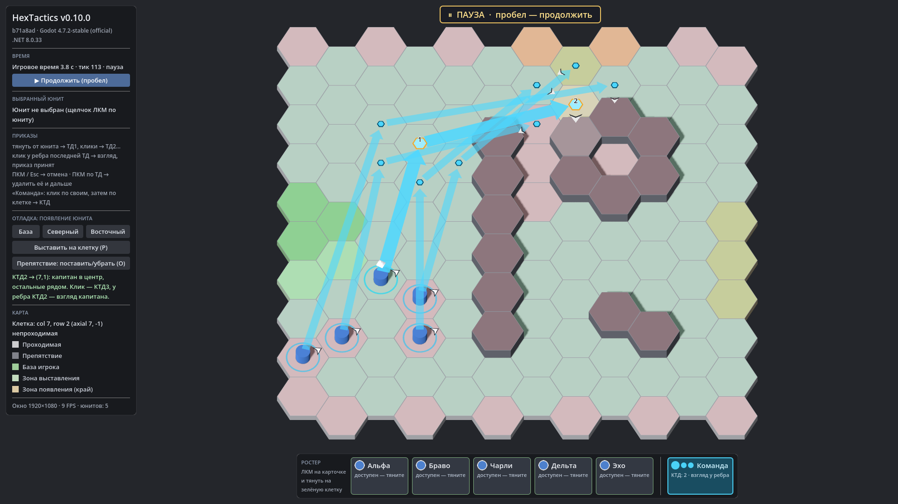

# HexTactics v0.10.0 — синхронная команда, взгляды спутников, уступание прохода

**Дата:** 2026-11-06 · **Тег:** `v0.10.0` · **ТЗ:** часть 2, §6.2, §6.3, §10, §12.12–12.13, §12.19 (план версий — DECISIONS D-033)
**Движок:** Godot 4.7.2 stable .NET · **.NET:** SDK 8.0.133, рантайм 8.0 (`net8.0`)
**Архив:** `release_archives/v0.10.0/HexTactics_v0.10.0_windows_x64.zip` (+ `.sha256`, `BUILD_INFO.txt`)

## Функции

- **Синхронные этапы.** Команда проходит КТД по порядку: пришедший на место у КТД ждёт остальных («на месте, ждёт
  остальных у КТД»), и только когда встали все, команда идёт к следующей КТД.
- **Взгляды спутников.** Каждый спутник смотрит как капитан или на 60° в сторону — не за спину капитану. Выбор делается
  один раз при подтверждении (seed симуляции + номер приказа + юнит), хранится в приказе и не меняется от наведения и FPS.
  У ребра последней КТД видно заранее, кто куда будет смотреть.
- **Без взаимных блокировок.** Места выбираются так, чтобы ждущий на месте не стоял на чужом пути (путь капитана, путь
  через КТД, через место другого спутника); затем — кратчайшие пути. Спутник, стоящий на следующей КТД, не получает
  клетку капитана.
- **Уступание прохода.** Если путь закрыт только своими, юнит ждёт; если долго — стоящий на пути отходит в сторону, ждёт,
  пока его пропустят, и возвращается на своё место со своим взглядом. Если отойти некуда, через 6 с — понятное сообщение
  «проход закрыт участниками команды», а не вечное ожидание.
- **Пять юнитов одновременно**: перекрёстные маршруты без захода в занятые клетки и без зависаний.
- **Взгляд у стены:** клик у ребра клетки срабатывает, даже если соседняя колонна препятствия закрывает этот край на экране.
- Ромб капитана белый и виден поверх голубых стрелок.

## Ограничения

- Полное планирование многих агентов (MAPF) не делается: в коридоре шириной в одну клетку построение может требовать
  отхода, которому некуда отойти, — тогда юнит честно сообщает о закрытом проходе.
- Команды больше 7 юнитов не нормированы (ТЗ §14.8). Атака и боевые механики — отдельное ТЗ.

## Проверено

- `dotnet test`: Core 59, Simulation 111 (+12: `GroupSyncTests`), Interaction 84 (+3: предпросмотр взглядов = сохранённые,
  выбор сектора у стены в одиночном и командном черновике), все зелёные.
- Регрессионный сценарий в собранной игре и в Windows-сборке: 72 проверки (`verify_release.ps1 -Run`).
- Визуально (1920×1080): предпросмотр взглядов пяти участников у КТД2 рядом со стеной, синхронное движение команды.

## Запуск

Распаковать ZIP, запустить `HexTactics.exe` (Windows 10/11 x64, OpenGL 3.3). Управление — `docs/CONTROLS.md`.

## Возврат к этой версии

- Сборка: `pwsh tools/restore_version.ps1 -Version 0.10.0`; исходники: `git checkout v0.10.0`.
- Предыдущая версия (команда без синхронности) — v0.9.0 (`pwsh tools/restore_version.ps1 -Version 0.9.0`).
