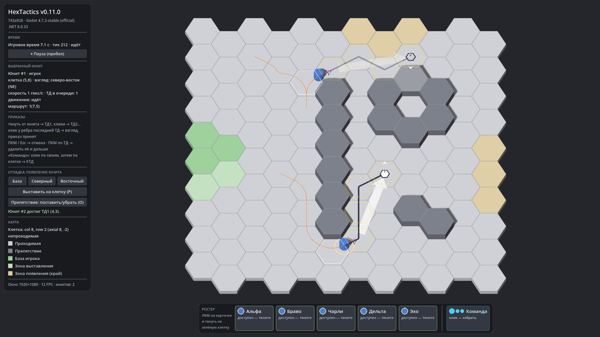

# HexTactics v0.11.0 — плавное движение по гекс-маршруту

**Дата:** 2026-11-06 · **Тег:** `v0.11.0` · **ТЗ:** часть 3, §2, §9.1–9.6 (план версий — DECISIONS D-062)
**Движок:** Godot 4.7.2 stable .NET · **.NET:** SDK 8.0.133, рантайм 8.0 (`net8.0`)
**Архив:** `release_archives/v0.11.0/HexTactics_v0.11.0_windows_x64.zip` (+ `.sha256`, `BUILD_INFO.txt`)

## Функции

- **Скорость 1 гекс/с.** Время маршрута = число переходов / скорость (три перехода — ровно 3 игровые секунды при
  любой частоте кадров); сглаживание не ускоряет юнита.
- **Плавная траектория.** Технический путь A* по гексам и занятость прежние, а тело юнита скругляет повороты внутри
  поворотной клетки — без ломаной «центр–центр» и без резких разворотов на границах.
- **Безопасность.** Каждый переход проверяется по всей длине кривой с учётом радиуса тела: тело не задевает клетки вне
  пути (стену у внутреннего угла — тоже) и проходит клетки пути строго по порядку. Если кривая не проходит проверку —
  движение через центры.
- **ТД — якоря.** Юнит проходит через центр каждой ТД в заданном порядке, конечная клетка — тоже.
- **Одно правило гекса.** Логический гекс меняется, когда тело пересекает общее ребро; нарисованное положение, выбор юнита
  и занятость не расходятся.
- **Без рывков.** Новый приказ во время движения или на паузе подхватывает траекторию с текущей точки.
- **F3 — отладка движения:** технический путь, логический гекс, кривая шага, пройденный след.

## Ограничения

- Видимая стрелка приказа по-прежнему прямая (ТЗ ч.3 §2.1); тонкая линия технического маршрута — через центры клеток.
- Юнит, ожидающий освобождения клетки посреди маршрута, стоит в точке ожидания на кривой (не обязательно в центре).

## Проверено

- `dotnet test`: Core 95 (+36: `StepGeometryTests` — все 30 сочетаний поворотов при заблокированных соседях, откат,
  перестройка, радиус тела), Simulation 121 (+10: `MotionTests`, приёмочные §9.1–9.6), Interaction 84 — все зелёные;
  тесты частей 1–2 переведены на 1 гекс/с.
- Регрессионный сценарий в собранной игре и в Windows-сборке: 80 проверок (`verify_release.ps1 -Run`), в том числе три
  перехода за 3,000 игровой секунды и совпадение нарисованного и логического гекса.
- Визуально (1920×1080, F3): дуги вокруг конца стены, проход через ТД.

## Запуск

Распаковать ZIP, запустить `HexTactics.exe` (Windows 10/11 x64, OpenGL 3.3). Управление — `docs/CONTROLS.md`.

## Возврат к этой версии

- Сборка: `pwsh tools/restore_version.ps1 -Version 0.11.0`; исходники: `git checkout v0.11.0`.
- Предыдущая версия (движение по прямым через центры, 2 гекс/с) — v0.10.0.
