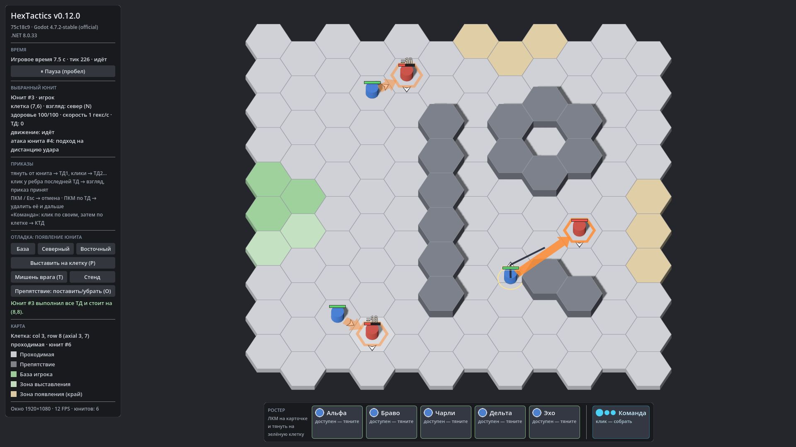

# HexTactics v0.12.0 — здоровье, смерть, приказ атаки

**Дата:** 2026-11-06 · **Тег:** `v0.12.0` · **ТЗ:** часть 3, §3, §4, §7, §9.7–9.11 (план версий — DECISIONS D-062)
**Движок:** Godot 4.7.2 stable .NET · **.NET:** SDK 8.0.133, рантайм 8.0 (`net8.0`)
**Архив:** `release_archives/v0.12.0/HexTactics_v0.12.0_windows_x64.zip` (+ `.sha256`, `BUILD_INFO.txt`)

## Функции

- **100 HP**, скорость 1 гекс/с, обычная атака **3 удара/с** у каждого юнита — своего и врага. Урон 10 и дальность
  1 гекс — временные значения прототипа (`PROTOTYPE_DEFAULT`) из `data/balance.json`.
- **Смерть:** при 0 HP юнит сразу перестаёт действовать; в конце тика он снимается с карты и освобождает клетку.
- **Приказ атаки:** белая стрелка на живого врага — вместо ТД; взгляд выбирать не нужно, юнит сразу поворачивается к цели
  (и на паузе, без урона до снятия паузы). ТД, поставленные до этого, проходятся первыми.
- **Подход и удары:** юнит идёт к ближайшей свободной клетке рядом с целью (не в её клетку) и бьёт раз в 1/3 с; первый удар
  через интервал. Цель погибла — атака закончена; подойти некуда — «цель недостижима», юнит ждёт.
- **Мишени для проверки:** «Мишень врага (T)» и «Стенд» — неподвижные враги без ИИ.
- Полоски здоровья, всплывающий урон, оранжевая стрелка атаки с кольцом цели.

## Ограничения

- Урон и дальность обычной атаки, броня, лечение, ИИ, агро и автопоиск целей не заданы автором — не вводятся (§11).
- Групповая атака командой не выполняется (§4.1 п.5).

## Проверено

- `dotnet test`: Core 95, Simulation 133 (+12: `CombatTests`), Interaction 84 (тесты атаки из стрелки, в т. ч. на паузе) —
  все зелёные.
- Регрессионный сценарий в собранной игре и в Windows-сборке: 92 проверки (`verify_release.ps1 -Run`), в том числе атака
  мишени на паузе без урона, подход и уничтожение цели.
- Визуально (1920×1080): атака мишени, полоски здоровья, урон.

## Запуск

Распаковать ZIP, запустить `HexTactics.exe` (Windows 10/11 x64, OpenGL 3.3). Управление — `docs/CONTROLS.md`.

## Возврат к этой версии

- Сборка: `pwsh tools/restore_version.ps1 -Version 0.12.0`; исходники: `git checkout v0.12.0`.
- Предыдущая версия (без боя) — v0.11.0.
