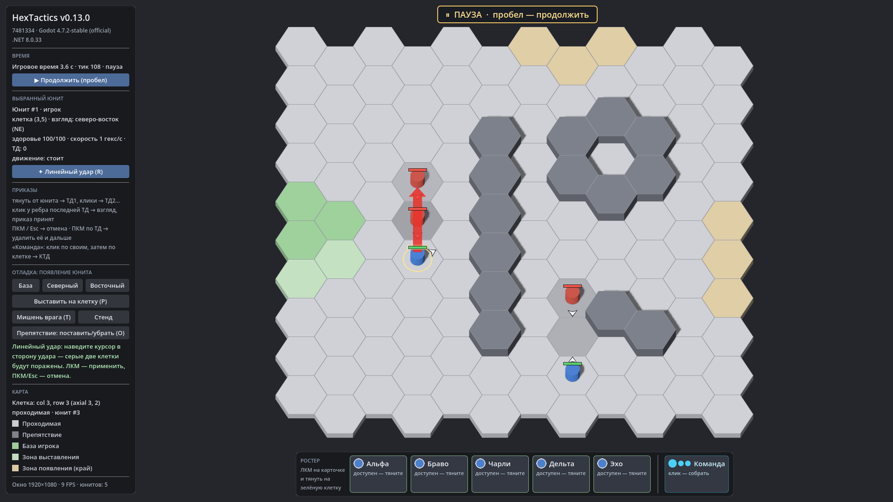

# HexTactics v0.13.0 — навык «Линейный удар»

**Дата:** 2026-11-06 · **Тег:** `v0.13.0` · **ТЗ:** часть 3, §5, §7, §9.12–9.14, §9.21 (план версий — DECISIONS D-062)
**Движок:** Godot 4.7.2 stable .NET · **.NET:** SDK 8.0.133, рантайм 8.0 (`net8.0`)
**Архив:** `release_archives/v0.13.0/HexTactics_v0.13.0_windows_x64.zip` (+ `.sha256`, `BUILD_INFO.txt`)

## Функции

- **«Линейный удар»** (временное название): две клетки перед юнитом — на расстоянии 1 и 2 по одному из шести направлений.
  Не круг и не боковые сектора; клетки за краем поля не учитываются.
- **Серое превью**: при прицеливании две клетки подсвечиваются серым (отдельно от зелёно-красной подсветки движения),
  красная стрелка показывает направление.
- **20 урона один раз** каждому живому врагу, который стоит в этих клетках в момент удара; ушедший — не получает, пришедший —
  получает. Союзники не страдают, препятствия не мешают, нет стоимости, перезарядки и времени каста (поля на будущее).
- **Применение:** «✦ Линейный удар (R)» у выбранного юнита → курсор → ЛКМ; ПКМ/Esc отменяют только прицеливание. Удар
  происходит, когда юнит стоит в центре клетки; на паузе — после её снятия. Юнит поворачивается в сторону удара.

## Ограничения

- Назначение навыка на ТД (клик по ТД, иконка, красный шестиугольник «1») — v0.14.0.
- Стоимость, перезарядка, время каста, урон союзникам, блокировка препятствиями — открытые вопросы ТЗ (§11).

## Проверено

- `dotnet test`: Core 95, Simulation 140 (+7: `SkillTests`), Interaction 88 (+4: `SkillAimTests`) — все зелёные.
- Регрессионный сценарий в собранной игре и в Windows-сборке: 105 проверок (`verify_release.ps1 -Run`), в том числе
  прицеливание настоящей клавишей R на паузе без урона и удар по двум врагам после её снятия.
- Визуально (1920×1080): прицеливание с серой областью и красной стрелкой, урон двум мишеням.

## Запуск

Распаковать ZIP, запустить `HexTactics.exe` (Windows 10/11 x64, OpenGL 3.3). Управление — `docs/CONTROLS.md`.

## Возврат к этой версии

- Сборка: `pwsh tools/restore_version.ps1 -Version 0.13.0`; исходники: `git checkout v0.13.0`.
- Предыдущая версия (без навыков) — v0.12.0.
