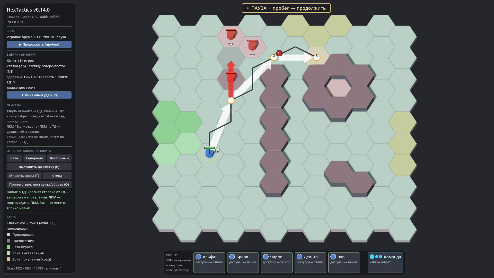

# HexTactics v0.14.0 — навык в точке маршрута

**Дата:** 2026-11-06 · **Тег:** `v0.14.0` · **ТЗ:** часть 3, §6, §7, §9.15–9.21 (план версий — DECISIONS D-062; последняя версия плана ч.3)
**Движок:** Godot 4.7.2 stable .NET · **.NET:** SDK 8.0.133, рантайм 8.0 (`net8.0`)
**Архив:** `release_archives/v0.14.0/HexTactics_v0.14.0_windows_x64.zip` (+ `.sha256`, `BUILD_INFO.txt`)

## Функции

- **Меню ТД:** короткий клик ЛКМ по центру маркера ТД (черновой или уже принятой у выбранного юнита) открывает рядом
  панель «✦ Линейный удар» (и «✕», если навык уже назначен). Новая ТД при этом не появляется; клик мимо, ПКМ, Esc
  закрывают только меню. Перетаскивание от ТД и непрерывная прокладка ТД работают как раньше; клик у ребра последней ТД —
  по-прежнему финальный взгляд.
- **Красная стрелка от ТД:** после клика по иконке направление выбирается курсором вокруг ТД; две клетки на расстоянии
  1 и 2 **от этой ТД** подсвечиваются серым. ЛКМ — принять, ПКМ/Esc — отменить только навык (следующая ПКМ — черновик).
- **Красный шестиугольник «✦1»** у ТД — одно назначенное применение. Серые клетки: ярче — у ТД под курсором или с
  открытым меню, бледнее — остальные назначенные; после удара значок и зона исчезают.
- **Исполнение:** юнит приходит в центр ТД, поворачивается в сторону удара, наносит 20 урона врагам, стоящим в двух
  клетках в этот тик, и **сам продолжает маршрут** (задержка — один тик). На последней ТД после удара поворачивается к
  финальному взгляду. Каждый навык срабатывает ровно один раз; погибший юнит или удалённая ТД — удара нет.
- **Транзакционность:** в черновике навык применяется вместе с приказом; на принятом маршруте — только подтверждением
  направления, отмена прицеливания маршрут не меняет. Удаление ТД удаляет только её навык.

## Ограничения

- Один навык на ТД; стоимость, перезарядка, время каста, урон союзникам — открытые вопросы ТЗ (§11).
- КТД командного приказа навыков не несут — меню по ним не открывается (ТЗ ч.3 §6 описывает только собственный маршрут юнита).

## Проверено

- `dotnet test`: Core 95, Simulation 148 (+8: `WaypointSkillTests`), Interaction 96 (+8: `WaypointSkillInputTests`) — все зелёные.
- Регрессионный сценарий в собранной игре и в Windows-сборке: 132 проверки (`verify_release.ps1 -Run`), в том числе
  меню ТД через настоящие кнопки, «✕», повторное назначение на паузе без урона, удар из ТД1 по врагу в 2 клетках
  (враг в 3-й клетке не задет), продолжение до ТД2 и финальный взгляд, отсутствие повторного удара.
- Визуально (1920×1080): меню у ТД, красная стрелка от ТД, значок «✦1», приглушённая серая зона, удар и продолжение маршрута.

## Запуск

Распаковать ZIP, запустить `HexTactics.exe` (Windows 10/11 x64, OpenGL 3.3). Управление — `docs/CONTROLS.md`.

## Возврат к этой версии

- Сборка: `pwsh tools/restore_version.ps1 -Version 0.14.0`; исходники: `git checkout v0.14.0`.
- Предыдущая версия (навык только с юнита) — v0.13.0.
