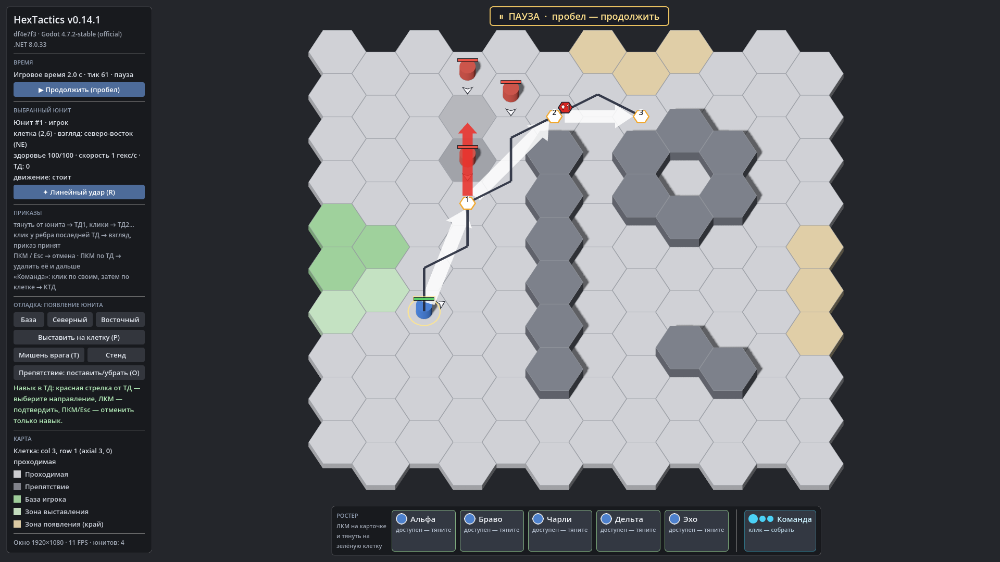

# HexTactics v0.14.1 — исправление подсветки при навыке в ТД

**Дата:** 2026-11-06 · **Тег:** `v0.14.1` · **ТЗ:** часть 3, §6.4 (исправление v0.14.0; DECISIONS D-079)
**Движок:** Godot 4.7.2 stable .NET · **.NET:** SDK 8.0.133, рантайм 8.0 (`net8.0`)
**Архив:** `release_archives/v0.14.1/HexTactics_v0.14.1_windows_x64.zip` (+ `.sha256`, `BUILD_INFO.txt`)

## Исправлено

- Пока открыто меню ТД или выбирается направление навыка от ТД черновика, поле больше не закрашено зелёно-красной
  подсветкой движения. Серая область «Линейного удара» теперь читается чисто и не смешивается с ней (ТЗ ч.3 §6.4);
  в v0.14.0 серые клетки на зелёном/красном фоне выглядели серо-зелёными/розоватыми, а зелёный цвет подсказывал
  постановку ТД, хотя клик в этих состояниях её не ставит.
- После отмены прицеливания (ПКМ/Esc) черновик и его подсветка возвращаются; при обычном наведении на ТД черновика
  подсветка движения сохраняет приоритет (D-079).

Все функции v0.14.0 без изменений: меню по короткому клику на ТД, красная стрелка от ТД, шестиугольник «✦1», удар
в ТД с продолжением маршрута — см. [`../v0.14.0/README.md`](../v0.14.0/README.md).

## Проверено

- `dotnet test`: Core 95, Simulation 148, Interaction 96 — все зелёные (правила не менялись — исправление только в клиенте).
- Регрессионный сценарий в собранной игре и в Windows-сборке: 145 проверок (`verify_release.ps1 -Run`) — сценарий
  v0.14.0 (132) + подсветка скрыта при меню и прицеливании и возвращается после отмены.
- Визуально (1920×1080): прицеливание от ТД1 с чистой серой областью, значок «✦1» у ТД2.

## Запуск

Распаковать ZIP, запустить `HexTactics.exe` (Windows 10/11 x64, OpenGL 3.3). Управление — `docs/CONTROLS.md`.

## Возврат к этой версии

- Сборка: `pwsh tools/restore_version.ps1 -Version 0.14.1`; исходники: `git checkout v0.14.1`.
- Предыдущая версия — v0.14.0 (та же функциональность, подсветка движения при прицеливании от ТД не скрывалась).
