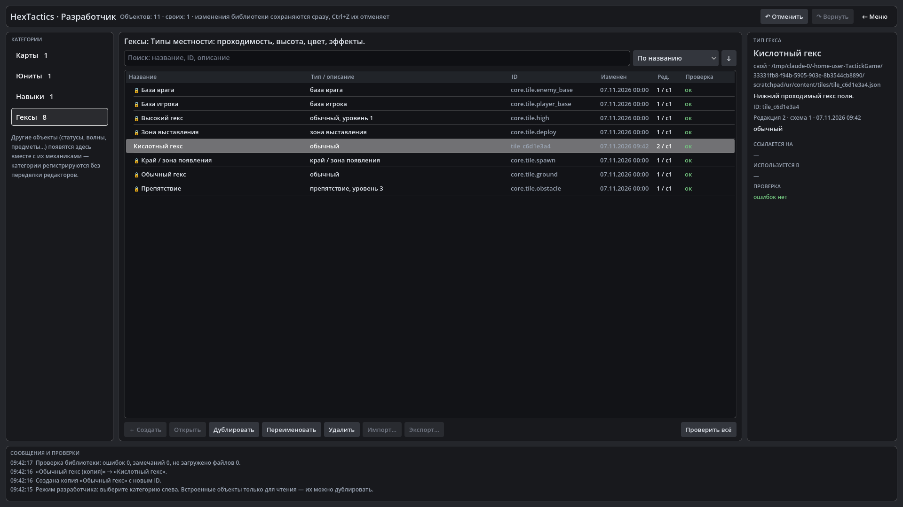

# HexTactics v0.15.0 — «Играть» и «Разработчик», библиотека контента

**Дата:** 2026-11-07 · **Тег:** `v0.15.0` · **ТЗ:** часть 4, §2, §3.3, §8.1–8.2, §9 (план версий — DECISIONS D-080: строка
v0.12.0 плана ч.4 → v0.15.0)
**Движок:** Godot 4.7.2 stable .NET · **.NET:** SDK 8.0.133, рантайм 8.0 (`net8.0`)
**Архив:** `release_archives/v0.15.0/HexTactics_v0.15.0_windows_x64.zip` (+ `.sha256`, `BUILD_INFO.txt`)

## Функции

- **Стартовое меню**: «▶ Играть» (бой частей 1–3), «✎ Разработчик» (мастерская контента), «Выход». Из боя — «← Главное
  меню» с подтверждением. В режиме разработчика игра в фоне не работает.
- **Каталог разработчика**: категории «Карты», «Юниты», «Навыки», «Гексы» строятся из реестра; список объектов с ID, датой,
  ревизией, версией схемы и результатом проверки; поиск, сортировка; свойства, ссылки и «используется в» справа;
  сообщения внизу. Дублирование (в том числе встроенных 🔒), переименование без смены ID, удаление с подтверждением и
  запретом удалять используемое, «Проверить всё».
- **Undo/Redo**: Ctrl+Z, Ctrl+Y / Ctrl+Shift+Z и кнопки — для операций каталога (удалённый объект возвращается).
- **Библиотека контента**: общий формат объектов с устойчивыми ID и версиями схем (`docs/CONTENT_FORMAT.md`), проверка
  значений и ссылок, хранилище `user://content` с атомарной записью, корзиной, черновиками, копиями и журналом.
- **Игра строится из данных**: карта «Прототип», юнит «Оперативник» и навык «Линейный удар» — встроенные объекты
  библиотеки, а не код или отдельные файлы баланса. Поведение боя не изменилось.

## Ограничения

- Редакторы появятся по плану: карт — v0.16.0, юнитов — v0.17.0, навыков — v0.18.0, типов гексов — v0.19.0; импорт/экспорт
  — v0.20.0. Сейчас «Создать» и «Открыть» неактивны (с подсказкой), свои объекты получаются копированием встроенных.

## Проверено

- `dotnet test`: Core 98, Simulation 153, Interaction 96, Content 43 (новые), Editor 10 (новые) — все зелёные.
- Регрессионный сценарий в собранной игре и в Windows-сборке (`verify_release.ps1 -Run`): 174 проверки — весь сценарий
  v0.14.1 через настоящую кнопку «Играть» на карте из библиотеки, выход в меню, каталог (копия встроенного типа гекса,
  переименование, Ctrl+Z/Ctrl+Y, удаление и его отмена, поиск, все категории); второй запуск с той же папкой
  пользователя — 5 проверок: сохранённый объект на месте, игра запускается.
- Визуально (1920×1080): стартовое меню, каталог разработчика.

## Запуск

Распаковать ZIP, запустить `HexTactics.exe` (Windows 10/11 x64, OpenGL 3.3). Управление — `docs/CONTROLS.md`, режим
разработчика — `docs/EDITOR_GUIDE.md`. Свои объекты хранятся в `%APPDATA%\Godot\app_userdata\HexTactics\content`.

## Возврат к этой версии

- Сборка: `pwsh tools/restore_version.ps1 -Version 0.15.0`; исходники: `git checkout v0.15.0`.
- Предыдущая версия (без меню и библиотеки) — v0.14.1. Папку пользовательского контента она не читает и не меняет.
