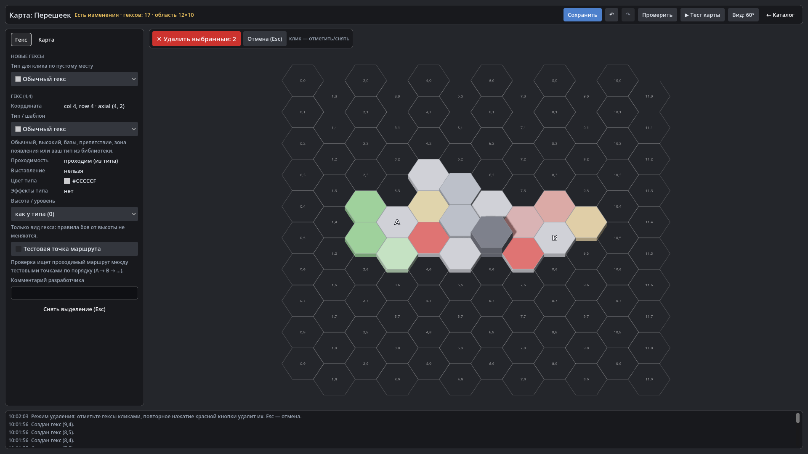

# HexTactics v0.16.0 — редактор карт

**Дата:** 2026-11-07 · **Тег:** `v0.16.0` · **ТЗ:** часть 4, §4, §2.1, §3.2–3.3, §8.1, §12.1 (план версий — D-080: строка
v0.13.0 плана ч.4 → v0.16.0)
**Движок:** Godot 4.7.2 stable .NET · **.NET:** SDK 8.0.133, рантайм 8.0 (`net8.0`)
**Архив:** `release_archives/v0.16.0/HexTactics_v0.16.0_windows_x64.zip` (+ `.sha256`, `BUILD_INFO.txt`)

## Функции

- **Пустая решётка**: «Разработчик» → «Карты» → «＋ Создать» открывает область 12 × 10 flat-top — бледные контуры и
  координаты, но ни одного настоящего гекса. ЛКМ по пустому месту создаёт ровно один гекс и показывает его настройки
  слева; ЛКМ по гексу выбирает его. Пустые места непроходимы и не принимают ТД.
- **Свойства гекса**: тип из библиотеки (обычный, высокий, базы игрока и врага, препятствие, зона выставления,
  край/зона появления, свои), проходимость и выставление из типа, высота, номер/название зоны, тестовая точка, комментарий.
- **Красная «✕ Удалить гексы»**: первое нажатие — выбор (счётчик на кнопке), второе — удаление всех отмеченных одним
  действием; Esc и пустой выбор ничего не удаляют; Ctrl+Z возвращает гексы с типами. Связанная тестовая точка — сводка и
  подтверждение, без висячих ссылок.
- **Карта**: название, описание, база, размер области; «Проверить» (типы, края зон, места выставления, маршрут между
  тестовыми точками, размер экрана); «Сохранить» (Ctrl+S) только без ошибок; встроенная карта — копией.
- **Черновики** сохраняются сами и предлагаются к восстановлению при следующем входе; выход с изменениями —
  «Сохранить / Не сохранять / Отмена». Undo/Redo для всех правок.
- **«▶ Тест карты»** — бой на временной копии в той же игре; «← Вернуться в редактор» — назад к прежнему состоянию.
- **Выбор карты** для «Играть» на стартовом экране: сохранённая карта сразу играется.
- Камера редактора: колесо — масштаб, средняя кнопка / пробел+перетаскивание — сдвиг, вид 60° или строго сверху.

## Ограничения

- Редакторы юнитов, навыков и типов гексов — v0.17.0–v0.19.0; импорт/экспорт — v0.20.0. Свои типы гексов пока
  получаются копированием встроенных в каталоге (копия сразу доступна в списке типов редактора карт).
- Размещённые юниты и сценарные ссылки на карте появятся вместе с их механиками; сейчас связи гекса — тестовые точки.

## Проверено

- `dotnet test`: Core 98, Simulation 153, Interaction 96, Content 44, Editor 21 (+11: `MapEditorTests` — приёмочные
  §12.1 п.3–9) — все зелёные.
- Регрессионный сценарий в собранной игре и в Windows-сборке: 224 проверки — весь сценарий v0.15 и редактор карт через
  настоящие кнопки (создание, типы, двухэтапное удаление, Ctrl+Z, Esc, связи, сохранение, тест карты и возврат, игра на
  сохранённой карте с отказом ТД на пустом месте); второй запуск с той же папкой — 13 проверок (карта и её гексы на месте).
- Визуально (1920×1080): редактор с островом из гексов разных типов, тестовые точки, режим удаления.

## Запуск

Распаковать ZIP, запустить `HexTactics.exe` (Windows 10/11 x64, OpenGL 3.3). Управление — `docs/CONTROLS.md`, редактор —
`docs/EDITOR_GUIDE.md`.

## Возврат к этой версии

- Сборка: `pwsh tools/restore_version.ps1 -Version 0.16.0`; исходники: `git checkout v0.16.0`.
- Предыдущая версия — v0.15.0 (каталог без редакторов). Сохранённые карты v0.16.0 она видит в каталоге (схема та же),
  но не знает поля `testPoints`: если переименовать или скопировать карту в v0.15.0, тестовые точки в копии пропадут.
