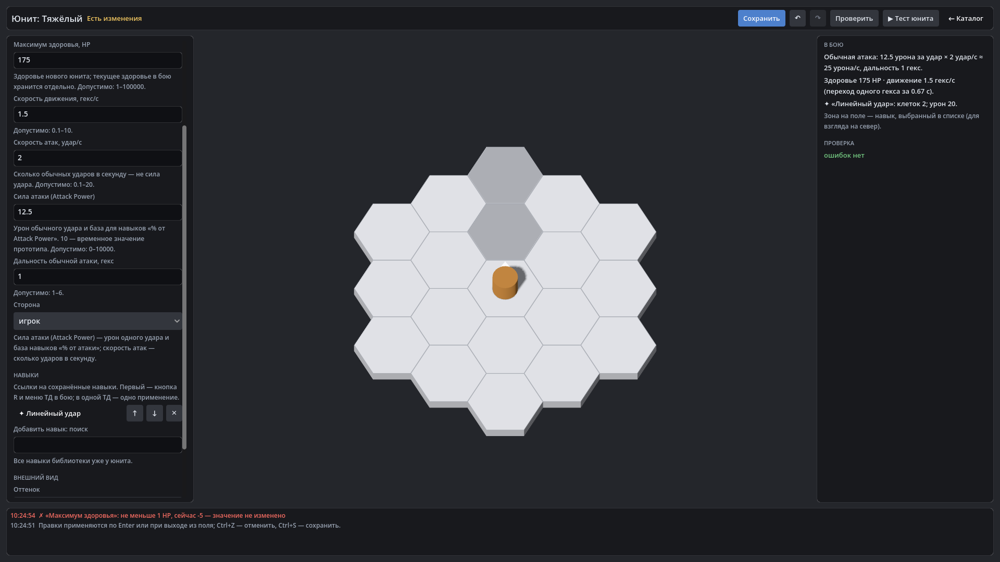

# HexTactics v0.17.0 — редактор юнитов

**Дата:** 2026-11-07 · **Тег:** `v0.17.0` · **ТЗ:** часть 4, §5, §12.2 п.10–11 (план версий — D-080: строка v0.14.0 плана ч.4 →
v0.17.0)
**Движок:** Godot 4.7.2 stable .NET · **.NET:** SDK 8.0.133, рантайм 8.0 (`net8.0`)
**Архив:** `release_archives/v0.17.0/HexTactics_v0.17.0_windows_x64.zip` (+ `.sha256`, `BUILD_INFO.txt`)

## Функции

- **Редактор юнитов**: название, описание; максимум здоровья (100), скорость движения (1 гекс/с), скорость атак
  (3 удара/с), **сила атаки — Attack Power** (10), дальность, сторона; оттенок и размер модели. Подсказки, единицы и
  допустимые диапазоны у каждого поля.
- **Ввод с проверкой**: −5 HP, нулевая скорость, «быстро» вместо числа, дробное здоровье — отклоняются с пояснением,
  значение не меняется; ссылка на отсутствующий навык не даёт сохранить.
- **Навыки — ссылки** на библиотеку: поиск, добавление, порядок ↑/↓ (первый — кнопка R и меню ТД), удаление; зона
  навыка на поле предпросмотра.
- **«В бою»**: урон за удар × удары в секунду ≈ урон в секунду — сила атаки отдельно от скорости атак.
- **«▶ Тест юнита»** — бой на «Прототипе», юнит — карточка «Альфа»; **«Отряд»** на стартовом экране — пять карточек
  из выбранного юнита.
- Бой: характеристики, навыки, оттенок и размер — из определения юнита; здоровье и урон дробные (12,5 за удар точно).

## Ограничения

- Навыки создаются в редакторе навыков (v0.18.0); пока доступен «Линейный удар» и его копии из каталога.
- Защита, сопротивления, энергия, стоимость выставления — не вводятся до появления механик (ТЗ ч.4 §5.1).

## Проверено

- `dotnet test`: Core 98, Simulation 155 (+2), Interaction 96, Content 44, Editor 35 (+14: `UnitEditorTests`) — все зелёные.
- Регрессионный сценарий в собранной игре и в Windows-сборке: 258 проверок — сценарий v0.16 и редактор юнитов через
  настоящие элементы (отказ −5 HP и «быстро», 175 HP / 1,5 гекс/с / 2 удара/с / сила 12,5, навык с Ctrl+Z/Ctrl+Y,
  сохранение, тест: 175 HP и три гекса ровно за 2,0 с игрового времени, «Играть» с выбранным отрядом); второй запуск —
  20 проверок (значения юнита после перезапуска).
- Визуально (1920×1080): редактор юнита с предпросмотром и зоной навыка.

## Запуск

Распаковать ZIP, запустить `HexTactics.exe` (Windows 10/11 x64, OpenGL 3.3). Управление — `docs/CONTROLS.md`, редакторы —
`docs/EDITOR_GUIDE.md`.

## Возврат к этой версии

- Сборка: `pwsh tools/restore_version.ps1 -Version 0.17.0`; исходники: `git checkout v0.17.0`.
- Предыдущая версия — v0.16.0 (без редактора юнитов). Сохранённые юниты она видит в каталоге (схема та же).
