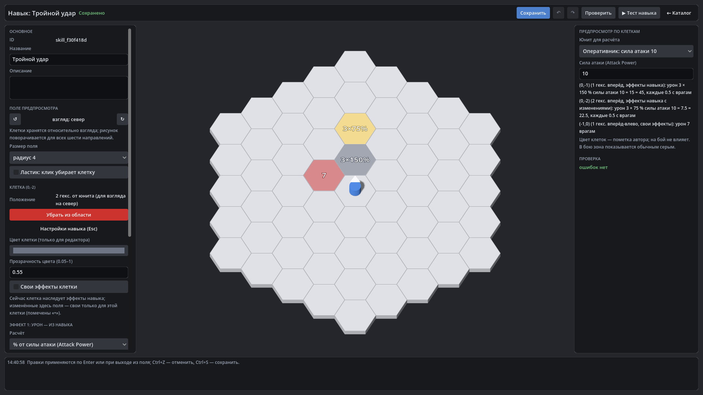

# HexTactics v0.18.0 — редактор навыков

**Дата:** 2026-11-07 · **Тег:** `v0.18.0` · **ТЗ:** часть 4, §6, §12.2 п.12–20 (план версий — D-080: строка v0.15.0 плана ч.4 →
v0.18.0)
**Движок:** Godot 4.7.2 stable .NET · **.NET:** SDK 8.0.133, рантайм 8.0 (`net8.0`)
**Архив:** `release_archives/v0.18.0/HexTactics_v0.18.0_windows_x64.zip` (+ `.sha256`, `BUILD_INFO.txt`)

## Функции

- **Редактор навыков**: ровное поле flat-top гексов, в центре — базовый юнит с белым указателем взгляда. ЛКМ по пустому
  гексу — клетка входит в область и открываются её настройки; ЛКМ по клетке — выбрать; «Убрать из области» или «Ластик».
  ↺/↻ (Q/E) — поворот юнита: рисунок навыка перестраивается для всех шести направлений (клетки хранятся относительно
  взгляда, поворот — формулой, без отражения).
- **Каждая клетка — свои характеристики**: свои эффекты или эффекты навыка с переопределением отдельных полей (метка «•» и
  «↺ как у навыка»); цвет и прозрачность — пометка автора, на бой не влияет; подпись на поле («3×150%», «7», «+10»).
- **Эффекты** — данные, исполняет единый `EffectResolver`:
  - урон: фиксированный или **% от силы атаки** источника; **число попаданий** и **интервал** в игровых секундах;
  - лечение: фиксированное или % от силы атаки / максимума здоровья источника, не выше максимума;
  - бафф и дебафф скорости движения, силы атаки или скорости атак (проценты или фиксированная величина), длительность,
    повтор `refresh` / `stack` / `replace` / `ignore`, безопасные минимумы;
  - периодический урон/лечение N HP/с; цели — враги, союзники, сам, все.
- **Исполнение**: одно действие с несколькими попаданиями; цели — на момент каждого удара; юнит ждёт в ТД до последнего
  удара и идёт дальше; пауза замораживает таймеры; удаление ТД отменяет оставшиеся удары.
- **Предпросмотр по клеткам**: «урон 3 × 150 % силы атаки 10 = 15 = 45, каждые 0.5 с врагам».
- **«▶ Тест навыка»**; в бою меню ТД показывает все навыки юнита, всплывают числа урона и лечения, видны статусы.
- «Линейный удар» — обычные данные редактора (две клетки, фиксированные 20, одно попадание), поведение прежнее.

## Ограничения

- Контроль, отбрасывание, телепорт, щиты, вызовы, стоимость, перезарядка — не реализованы (ТЗ ч.4 §6.3, §6.2).
- Эффекты типов гексов (периодические ±5 HP/с на клетке) и редактор типов гексов — v0.19.0; импорт/экспорт — v0.20.0.
- Переключателя «строго сверху» в редакторе навыков нет: камера редактора смотрит под 60°, рисунок читается (D-105).

## Проверено

- `dotnet test`: Core 98, Simulation 170 (+15: `SkillEffectsTests`), Interaction 96, Content 45 (+1), Editor 43
  (+8: `SkillEditorTests`) — все зелёные.
- Регрессионный сценарий в собранной игре и в Windows-сборке: 343 проверки — сценарий v0.17 и редактор навыков через
  настоящие элементы: «Линейный удар» как данные (2 клетки по 20), поворот на все шесть направлений, новый навык
  «Тройной удар» (база 3 × 150 % каждые 0,5 с, клетка дальше — 75 %, своя клетка — фикс. 7 и красный цвет), отказ
  «0 попаданий», Ctrl+Z/Ctrl+Y, сохранение; тест: враги в трёх клетках теряют 45, 22,5 и 7 HP; навык добавлен юниту
  «Тяжёлый» (сила 12,5) и выбран из меню ТД в «Играть»: юнит доходит до ТД, бьёт три раза (−56,25 и −28,125) и идёт до
  ТД2. Второй запуск — 29 проверок (клетки, цвет и числа после перезапуска).
- Визуально (1920×1080): редактор навыка с выбранной клеткой и предпросмотром.

## Запуск

Распаковать ZIP, запустить `HexTactics.exe` (Windows 10/11 x64, OpenGL 3.3). Управление — `docs/CONTROLS.md`, редакторы —
`docs/EDITOR_GUIDE.md`, формат эффектов — `docs/CONTENT_FORMAT.md`.

## Возврат к этой версии

- Сборка: `pwsh tools/restore_version.ps1 -Version 0.18.0`; исходники: `git checkout v0.18.0`.
- Предыдущая версия — v0.17.0. Навыки с лечением, баффами, дебаффами и периодическими эффектами она помечает ошибкой
  (неизвестный тип) и не исполняет; у урона новые поля (`formula`, `hits`, `interval`, `overrides` клеток) для неё —
  лишь предупреждения, урон считается как фиксированный `amount`. Файлы при этом не изменяются; точное поведение — v0.18.0+.
