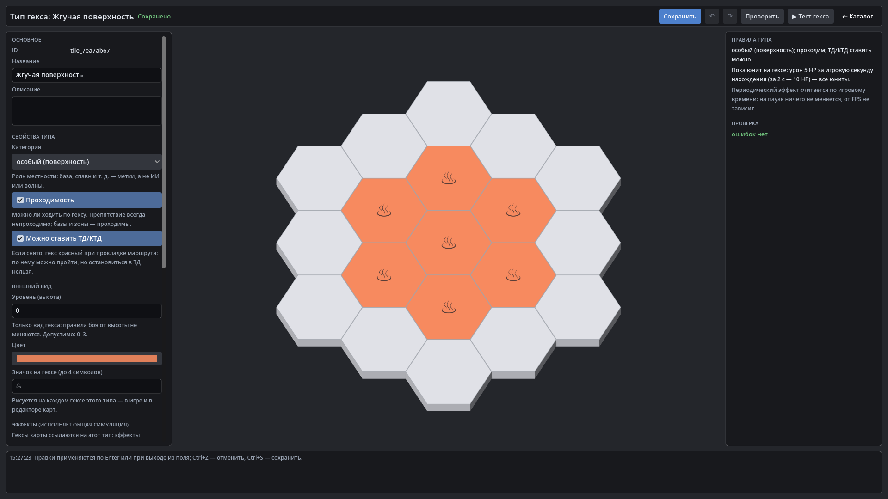

# HexTactics v0.19.0 — редактор типов гексов

**Дата:** 2026-11-07 · **Тег:** `v0.19.0` · **ТЗ:** часть 4, §7, §12.3 п.21–23 (план версий — D-080: строка v0.16.0 плана ч.4 →
v0.19.0)
**Движок:** Godot 4.7.2 stable .NET · **.NET:** SDK 8.0.133, рантайм 8.0 (`net8.0`)
**Архив:** `release_archives/v0.19.0/HexTactics_v0.19.0_windows_x64.zip` (+ `.sha256`, `BUILD_INFO.txt`)

## Функции

- **Редактор типов гексов** («Гексы»): категория (новая «особый (поверхность)»), проходимость, **«Можно ставить ТД/КТД»**,
  уровень, цвет, **значок** на гексе; эффекты с полями для гексов; предпросмотр типа среди обычных гексов; правила
  словами; **«▶ Тест гекса»** (блок перед базой «Прототипа» становится этим типом).
- **Поверхности** (§7.2): «Жгучая» — урон 5 HP за игровую секунду нахождения, «Целебная» — лечение 5 HP/с, не выше
  максимума. Создаются в редакторе, работают в игре через общий `EffectResolver`; гексы карты только ссылаются на тип.
- **Логический гекс**: считается гекс, в котором юнит числится (смена — при пересечении ребра), поэтому за 2 игровые
  секунды — ровно 10 HP при любом FPS и сглаживании, без двойного начисления на поворотах; на паузе — ничего.
- **При входе / при выходе**: урон, лечение, бафф, дебафф (например, замедление на 3 с), периодический статус на время;
  **«На кого действует»**: все, только юниты игрока, только враги.
- **Запрет ТД**: тип без «Можно ставить ТД/КТД» красный при прокладке ТД и КТД, но маршрут через него проходит.
- **Редактор карт**: свои типы — в списках с цветом, правила типа в панели гекса; значки типов видны на поле в игре и в
  редакторах.
- Числа непрерывного урона/лечения всплывают раз в игровую секунду (в v0.18.0 — каждый тик).

## Ограничения

- Поштучного переопределения эффектов у гекса карты нет: правила меняются у типа и после сохранения действуют на всех
  картах (D-110). Радиус действия поверхности и «аура, пока стоишь» для баффов не вводятся (D-107).
- Импорт/экспорт объектов и пакетов, конфликты ID, миграции с резервными копиями — v0.20.0.

## Проверено

- `dotnet test`: Core 98, Simulation 182 (+12: `TileEffectsTests`), Interaction 98 (+2), Content 48 (+3), Editor 48
  (+5: `TileEditorTests`) — все зелёные.
- Регрессионный сценарий в собранной игре и в Windows-сборке: 404 проверки — сценарий v0.18 и: «Жгучая поверхность» через
  настоящие элементы (отказ −5 HP/с и значка из 5 букв, Ctrl+Z/Ctrl+Y, сохранение), тест гекса: ровно −10 HP за 60 тиков,
  на паузе без изменений; «Целебная поверхность»; новая карта «Поверхности» с обоими типами по ссылке; тест карты: юнит
  заходит на жгучий гекс (−10 за 2 с логического нахождения), на целебный (+), уходит (лечение прекращается),
  возвращается (не выше 100). Второй запуск — 38 проверок (типы, значок, эффекты и карта после перезапуска).
- Визуально (1920×1080): редактор гекса, редактор карт со своими типами, бой на поверхности.

## Запуск

Распаковать ZIP, запустить `HexTactics.exe` (Windows 10/11 x64, OpenGL 3.3). Управление — `docs/CONTROLS.md`, редакторы —
`docs/EDITOR_GUIDE.md`, формат — `docs/CONTENT_FORMAT.md`.

## Возврат к этой версии

- Сборка: `pwsh tools/restore_version.ps1 -Version 0.19.0`; исходники: `git checkout v0.19.0`.
- Предыдущая версия — v0.18.0. Типы гексов с эффектами она помечает ошибкой («эффект здесь не поддерживается») и не
  использует; у типов без эффектов поля `icon` и `waypoints` ей неизвестны (значка и запрета ТД нет). Файлы при этом не
  изменяются.
