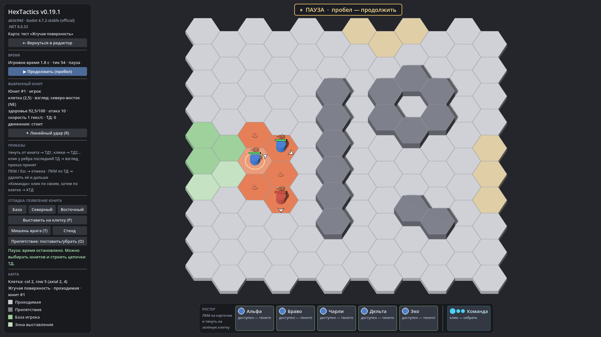

# HexTactics v0.19.1 — исправление выхода

**Дата:** 2026-11-07 · **Тег:** `v0.19.1` · **Основа:** v0.19.0 (ТЗ ч.4 §7 — редактор типов гексов)
**Движок:** Godot 4.7.2 stable .NET · **.NET:** SDK 8.0.133, рантайм 8.0 (`net8.0`)
**Архив:** `release_archives/v0.19.1/HexTactics_v0.19.1_windows_x64.zip` (+ `.sha256`, `BUILD_INFO.txt`)

## Что исправлено

Проверка Windows-сборки v0.19.0 под Wine: все проверки сценария проходили, но после длинной сессии (редакторы и тесты)
процесс при выходе падал с `AccessViolationException` в `GodotObject.Finalize` — сборщик мусора .NET финализировал
обёртки уже ненужных ресурсов Godot во время остановки движка. Теперь каждый выход («Выход» в меню, закрытие окна,
`--hx-quit`) сначала выполняет сборку мусора и финализаторы, пока движок работает (`AppExit`, D-112). Воспроизведение:
v0.19.0 — 3 сбоя из 3 запусков сценария, v0.19.1 — 0 из 3.

Функции — как в [v0.19.0](../v0.19.0/README.md): редактор типов гексов, поверхности ±5 HP/с по логическому гексу,
эффекты при входе/выходе, «Можно ставить ТД/КТД», значки, свои типы в редакторе карт.

## Проверено

- `dotnet test`: Core 98, Simulation 182, Interaction 98, Content 48, Editor 48 — все зелёные.
- Регрессионный сценарий в Windows-сборке под Wine: 404 проверки, код выхода 0; второй запуск — 38 проверок.

## Возврат к этой версии

- Сборка: `pwsh tools/restore_version.ps1 -Version 0.19.1`; исходники: `git checkout v0.19.1`.
- Предыдущая — v0.19.0 (те же функции, сбой при выходе после длинной сессии). Данные пользователя совместимы.
