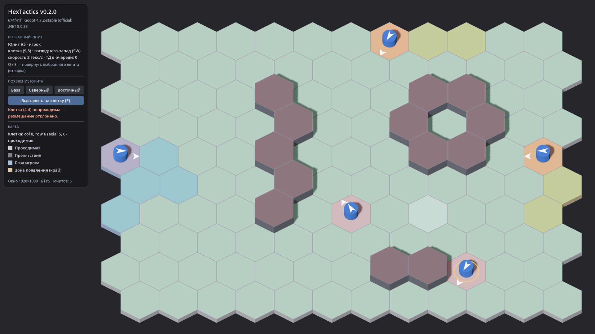

# HexTactics v0.2.0 — юниты и появление

**Дата:** 2026-11-05 · **Тег:** `v0.2.0` · **Этап ТЗ:** 1, версия «юниты и появление» (§1.1)
**Движок:** Godot 4.7.2 stable .NET (`4.7.2.stable.mono.official.ed1daf0bf`) · **.NET:** SDK 8.0.133, рантайм 8.0 (`net8.0`)
**Архив:** `release_archives/v0.2.0/HexTactics_v0.2.0_windows_x64.zip` (+ `.sha256`, `BUILD_INFO.txt` с коммитом и датой сборки)

## Функции

- **Юнит**: уникальный ID, сторона, логическая клетка (один юнит — один гекс), направление взгляда (ровно 6
  дискретных направлений, часть данных), скорость (2 гекса/с по умолчанию), очередь приказов (пока пустая).
- **Три способа появления** (ТЗ §4), каждый можно вызвать независимо:
  1. **База игрока** — кнопка «База»: первая свободная клетка базы из данных карты;
  2. **Зона на краю** — кнопки «Северный», «Восточный»: первая свободная клетка выбранной зоны;
  3. **Прямое выставление** — «Выставить на клетку (P)», затем щелчок по клетке. В режиме все 120 клеток мягко
     подсвечены: зелёные — можно поставить, красные — нельзя.
- **Проверки** для всех способов: в пределах поля, проходима, свободна. При конфликте — понятное сообщение
  («Клетка (6,6) занята юнитом #4 — размещение отклонено, никто не перемещён»), ничего не удаляется и не переносится.
- **Выбор юнита**: короткий щелчок ЛКМ по корпусу или клетке юнита; щелчок по пустому месту снимает выбор.
  Дрожание руки до 8 px — всё ещё щелчок. Выбранный юнит отмечен тонким кольцом.
- **Направление взгляда** видно однозначно: белый «дротик» на крышке и стрелка на земле к соседнему гексу.
  Отладочный поворот выбранного юнита: Q / E.
- Панель HUD: сведения о выбранном юните, кнопки появления, сообщения, клетка под курсором (с юнитом).

## Ограничения

- Приказы движения, стрелки, точки движения и поворот жестом — в v0.3.0; путь, подсветка достижимости и движение — v0.4.0;
  пауза — v0.5.0.
- Q/E — временный отладочный поворот (не входит в итоговую схему управления).
- Стоимость выставления, противники, бой — вне этапа 1.

## Изменения относительно v0.1.0

- Новые сборки `HexTactics.Simulation` и `HexTactics.Interaction` (чистый C#), добавлены в решение и тесты.
- Core: юниты, состояние игры с картой занятости, правила появления, заготовка очереди приказов.
- Клиент: юниты, выбор, HUD появления, слой подсветки проходимости, ввод через автомат.
- Карта, камера, границы клеток и HUD v0.1.0 сохранены без изменений поведения.

## Проверено

- `dotnet test`: 72 теста (Core 38, Simulation 26, Interaction 8): три способа появления, отказ вне поля / на
  препятствии / на занятой клетке без изменений состояния, заполненные зона и база, уникальные ID, сторона,
  шесть направлений и поворот без перемещения, направление по умолчанию к центру, события, атомарная занятость,
  щелчок/дрожание/выбор/снятие выбора, режим выставления (успех, отказы, выход по Esc/ПКМ).
- Сценарий мыши в собранной игре (`--hx-script`): появление на базе и в обеих зонах, прямое выставление,
  щелчки по препятствию и по занятой клетке (сообщения об отказе), выбор юнита щелчком.
- Отрисовка всех шести направлений взгляда — визуальная проверка крупным планом.
- Экспорт «Windows Desktop» и смоук-запуск `HexTactics.console.exe` (`tools/verify_release.ps1 -Run`).

## Запуск

Распаковать ZIP, запустить `HexTactics.exe` (Windows 10/11 x64, OpenGL 3.3). .NET устанавливать не нужно.

## Внутренняя архитектура

- Core: `UnitId`, `Side`, `UnitState`, `GameState`, `Waypoint`, `OrderQueue`, `SpawnRules`/`SpawnRequest`/`SpawnError`.
- Simulation: `GameSimulation` (`Spawn`, `SetFacing`, `DrainEvents`), `SimulationSettings`, события.
- Interaction: `InputStateMachine` (`Idle`, `UnitSelected`, `Placement`), `PointerSample`, обратная связь.
- Клиент: `UnitView`, `UnitsView` (+ выбор лучом), `PointerInput`, `UiText`.
- Подробно: `docs/ARCHITECTURE.md` (в теге `v0.2.0`), решения D-013…D-017 в `docs/DECISIONS.md`.

## Возврат к этой версии

- Сборка: `pwsh tools/restore_version.ps1 -Version 0.2.0` или вручную распаковать ZIP из `release_archives/v0.2.0/`.
- Исходники: `git checkout v0.2.0` или `pwsh tools/restore_version.ps1 -Version 0.2.0 -Mode Source`.
- Предыдущая версия: v0.1.0 (`release_archives/v0.1.0/`).
