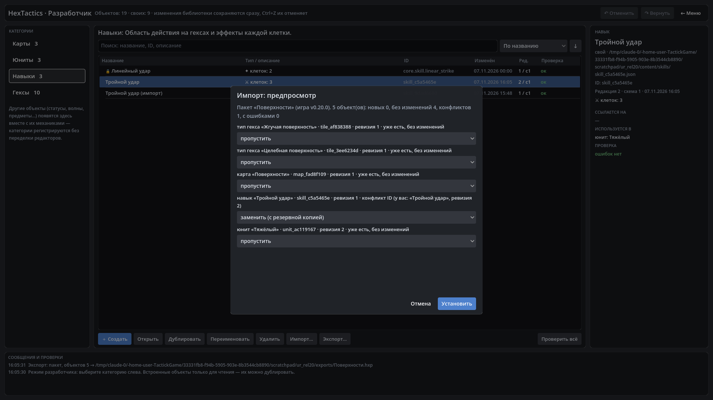

# HexTactics v0.20.0 — импорт и экспорт контента

**Дата:** 2026-11-07 · **Тег:** `v0.20.0` · **ТЗ:** часть 4, §8, §12.3 п.24–32 (план версий — D-080: строка v0.17.0 плана ч.4 →
v0.20.0; последняя версия плана части 4)
**Движок:** Godot 4.7.2 stable .NET · **.NET:** SDK 8.0.133, рантайм 8.0 (`net8.0`)
**Архив:** `release_archives/v0.20.0/HexTactics_v0.20.0_windows_x64.zip` (+ `.sha256`, `BUILD_INFO.txt`)

## Функции

- **Экспорт объекта** в `.json` (та же схема, что и в библиотеке — все поля: клетки навыка, переопределения, цвета,
  интервалы, ссылки, метаданные). Если объекту нужны другие ваши объекты, окно прямо говорит, что файл не самодостаточен.
- **Экспорт пакета** `.hxp` — ZIP с `manifest.json` (версия формата и игры, объекты, ревизии, версии схем, SHA-256, нужные
  встроенные объекты); зависимости отмеченных объектов собираются автоматически.
- **Импорт** с предпросмотром до любых изменений: объекты, ревизии, статусы «новый / без изменений / конфликт ID / ошибки»,
  итог. Проверка размеров, распаковки, опасных путей, допустимых файлов (только JSON), manifest, контрольных сумм, схем,
  значений, типов эффектов и ссылок.
- **Конфликт ID**: «пропустить» (по умолчанию), «заменить (с резервной копией)», «копией с новым ID» (ссылки внутри пакета
  переходят на копию). Встроенные объекты не заменяются.
- **Транзакционная установка**: всё выбранное или ничего; при сбое — откат с восстановлением из резервных копий.
- **Миграции** старых схем при загрузке — с копией оригинала в `backups`; файл новее поддерживаемой схемы не трогается.
- **Пределы**: стоимость навыка (≤ 1024 применений эффектов), пакет ≤ 32 МБ / 512 файлов / 64 МБ распаковки; понижаются
  файлом `limits.json`.

## Ограничения

- В пакетах нет пользовательских изображений и звуков — таких ресурсов пока нет в данных (D-113).
- Импорт добавляет объекты в библиотеку; удаление импортированного — обычным «Удалить» с проверкой ссылок.

## Проверено

- `dotnet test`: Core 98, Simulation 182, Interaction 98, Content 65 (+17: `TransferTests`), Editor 50 (+2:
  `TransferModelTests`) — все зелёные.
- Windows-сборка под Wine, три запуска: регрессия — 433 проверки (сценарий v0.19 и экспорт карты «Поверхности» с юнитом
  пакетом из 5 объектов, навыка в JSON; импорт того же пакета — 5 без изменений, без выбора ничего не ставится; после
  изменения навыка — конфликт: копии навыка и юнита со ссылкой на копию, затем замена с резервной копией; несуществующий
  файл отклонён); второй запуск — 41 (всё после перезапуска); **третий — чистая папка пользователя** импортирует пакет первого
  запуска (5 новых объектов), играет на импортированной карте импортированным юнитом (175 HP) и теряет HP на импортированной
  жгучей поверхности — 15 проверок.
- Визуально (1920×1080): окна экспорта и предпросмотра импорта.

## Запуск

Распаковать ZIP, запустить `HexTactics.exe` (Windows 10/11 x64, OpenGL 3.3). Управление — `docs/CONTROLS.md`, редакторы и
импорт/экспорт — `docs/EDITOR_GUIDE.md`, форматы — `docs/CONTENT_FORMAT.md`, миграции — `docs/MIGRATIONS.md`.

## Возврат к этой версии

- Сборка: `pwsh tools/restore_version.ps1 -Version 0.20.0`; исходники: `git checkout v0.20.0`.
- Предыдущая — v0.19.1 (без импорта/экспорта). Пользовательские данные совместимы (схемы не менялись); папки `exports` и
  `packs` она просто не использует.
