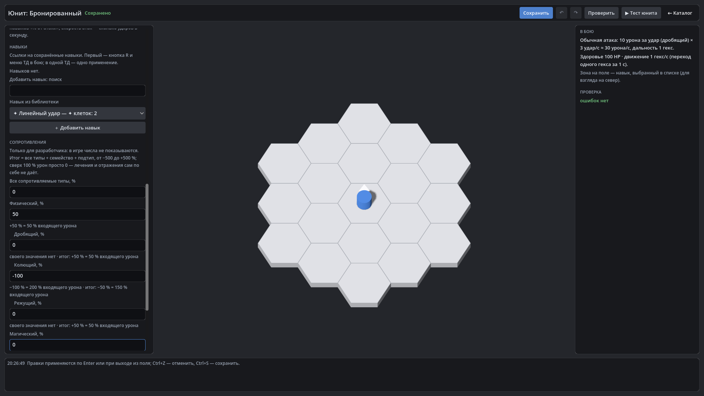

# HexTactics v0.21.0 — типы урона и сопротивления

**Дата:** 2026-11-07 · **Тег:** `v0.21.0` · **ТЗ:** часть 5 (`docs/GAME_SPEC_PART5.md`), §2–§5, §7, §8, §9.5, приёмка §11.1–§11.2,
п.29–31, 36, 44 (план версий — D-119: строка v0.18.0 плана ч.5 → v0.21.0)
**Движок:** Godot 4.7.2 stable .NET · **.NET:** SDK 8.0.133, рантайм 8.0 (`net8.0`)
**Архив:** `release_archives/v0.21.0/HexTactics_v0.21.0_windows_x64.zip` (+ `.sha256`, `BUILD_INFO.txt`)

## Функции

- **Единый расчёт урона**: обычная атака, навыки, поверхности гексов и периодические статусы передают типизированное
  событие в один `DamageResolver` — одинаковые числа при одинаковых данных.
- **Типы урона**: физический (колющий, режущий, дробящий), магический, чистый; тип — природа удара, форма (одна цель или
  область) — отдельно. Смешанный удар (12 режущего + 8 магического) — две части, каждая со своей защитой.
- **Сопротивления −500…+500 %** по слоям «все типы + семейство + подтип + временное», пробитие только положительного R,
  урон × max(0, 1 − R/100). Свыше 100 % — 0 урона, без лечения и отражения. Чистый урон мимо R.
- **Редактор юнита**: тип урона и область обычной атаки, секция «Сопротивления» с расшифровкой, итогом по слоям и резюме.
- **Навыки и гексы**: тип урона у эффектов, «полная сила / разделить между целями», пробитие, баффы/дебаффы сопротивления.
- **В игре защита скрыта**: только последствия боя.
- **Миграция**: навыки, гексы и юниты частей 3–4 обновляются до схемы 2 с резервной копией; прежние числа по незащищённой
  цели не меняются (старые поверхности — «прямой эффект HP», прежние HP/с для любой цели).

## Ограничения

- Иммунитеты, поглощение, отражения, щиты, плоское снижение, предел урона — v0.22.0; категория «Механики» и свои типы
  урона — v0.23.0; прогрессивная секция сопротивлений с поиском и профилями — v0.24.0.
- Стихии не определяются (следующая часть ТЗ).

## Проверено

- `dotnet test`: Core 98, Simulation 207 (+25: `DamageResolverTests`), Interaction 98, Content 71 (+5: `DamageContentTests`, +1
  встроенные типы), Editor 53 (+3) — все зелёные.
- Windows-сборка под Wine, три запуска: регрессия — 461 проверка (сценарий v0.20 и: юнит «Бронированный» в редакторе
  юнита — физический +50 %, колющий −100 % (итог −50 %), отказ 600 %, дробящая обычная атака; в тесте режущий «Линейный
  удар» 20 снимает с него 10 HP, а карточка юнита не показывает сопротивлений; тип урона эффекта в редакторе навыка; тип
  урона в правилах гекса); второй запуск — 46; импорт пакета на чистую установку — 15.

## Запуск

Распаковать ZIP, запустить `HexTactics.exe` (Windows 10/11 x64, OpenGL 3.3). Управление — `docs/CONTROLS.md`, редакторы —
`docs/EDITOR_GUIDE.md`, форматы — `docs/CONTENT_FORMAT.md`, миграции — `docs/MIGRATIONS.md`.

## Возврат к этой версии

- Сборка: `pwsh tools/restore_version.ps1 -Version 0.21.0`; исходники: `git checkout v0.21.0`.
- Предыдущая — v0.20.0. Файлы навыков, гексов и юнитов схемы 2 она не загрузит («версия схемы новее») и не изменит;
  оригиналы схемы 1 лежат в `backups/<время>-migration-schema1/` — их можно вернуть для работы в v0.20.0.
