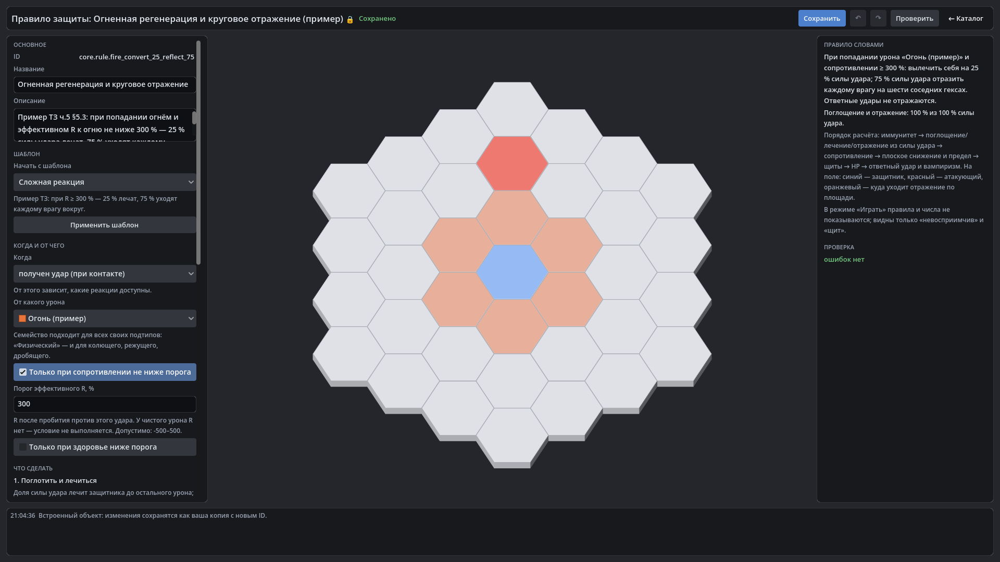

# HexTactics v0.22.0 — правила защиты, щиты и реакции

**Дата:** 2026-11-07 · **Тег:** `v0.22.0` · **ТЗ:** часть 5 (`docs/GAME_SPEC_PART5.md`), §4, §5, §6.3–§6.4, §8.3, §9.1, §9.3,
§9.5, приёмка §11.3 п.16–27, 33, §11.5 (план версий — D-119: строка v0.19.0 плана ч.5 → v0.22.0)
**Движок:** Godot 4.7.2 stable .NET · **.NET:** SDK 8.0.133, рантайм 8.0 (`net8.0`)
**Архив:** `release_archives/v0.22.0/HexTactics_v0.22.0_windows_x64.zip` (+ `.sha256`, `BUILD_INFO.txt`)

## Функции

- **Правила защиты** — новая категория «Правила защиты»: «когда → от какого урона → при условии → что сделать».
  Реакции: иммунитет к урону, поглотить долю, поглотить и лечиться, поглотить в щит, отразить часть урона (атакующему или
  каждому/поровну юнитам вокруг), плоское снижение, предел урона за удар, ответный удар, вампиризм, иммунитет к статусам.
  Условия — тип/семейство/тег, порог эффективного R, здоровье ниже порога; приоритет, перезарядка, лимит срабатываний.
- **Одна цепочка расчёта**: иммунитет → поглощения и отражения из силы удара D0 (по приоритету, каждое правило — только
  остаток) → сопротивление → плоское снижение → предел → щиты → HP → ответный удар и вампиризм. Ответный удар не
  отражается снова — два «зеркала» не зацикливаются; пределы событий документированы (D-128).
- **«Огонь 300 %»** (пример автора): удар огнём 40 по юниту с R огня 300 % и встроенным правилом — лечение 10, по 30
  каждому соседнему врагу, HP не теряется; при 98/100 — лечение 2, отражение 30; без врагов доля исчезает. Без правила
  R = 300 % даёт только 0 урона.
- **Конструктор правила**: шаблоны, реакции по «когда», «Дополнительно ▾», правило словами, сумма долей «из 100 %»,
  схема на поле.
- **Редактор юнита — «Особые защиты и реакции»**: правила-ссылки с резюме, щиты (название, прочность, принимаемый урон,
  порядок).
- **Запрет лечения** — дебафф «получаемое лечение»; иммунитет к статусам — правило «накладывается статус».
- **В игре** — только «невосприимчив» и «щит» без чисел и причин.
- Исправлено: сообщение «… атакует …» показывало скорость атаки по умолчанию, а не атакующего; предпросмотр баффа
  сопротивления говорил «% скорости движения» вместо «п.п. сопротивления».

## Ограничения

- Категория «Механики» (свои типы урона, профили сопротивлений, «Проверить на ударе») — v0.23.0; прогрессивная секция
  «Сопротивления» с поиском и шаблонами — v0.24.0.
- Длительность и износ щитов, ответ на ответ, стихии — не вводятся (ТЗ ч.5 §4.5, §5.5, §13).

## Проверено

- `dotnet test`: Core 98, Simulation 224 (+17: `DefenseRulesTests`), Interaction 98, Content 78 (+7: `DefenseContentTests`),
  Editor 59 (+6: `DefenseRuleEditorTests`) — все зелёные.
- Windows-сборка под Wine, три запуска: регрессия — 515 проверок (сценарий v0.21 и: резюме встроенного правила; новое
  правило «Шипы» из шаблона «Ответный удар», отказ 900 %; «Огненный страж» — R огня 300 %, правило-пример, щит 15 против
  магического, отказ прочности −5; «Поджигатель» — огненная обычная атака 40, 0,5 удар/с; в бою режущий удар доводит
  стража до 80, каждый огненный удар лечит его на 10 (80 → 90 → 100) и бьёт по 30 атакующего и соседнего оперативника
  (100 → 70 → 40), юнит в двух гексах не задет, карточка стража не показывает ни R, ни правил, ни щита); второй запуск —
  54; импорт пакета на чистую установку — 15.

## Запуск

Распаковать ZIP, запустить `HexTactics.exe` (Windows 10/11 x64, OpenGL 3.3). Управление — `docs/CONTROLS.md`, редакторы —
`docs/EDITOR_GUIDE.md`, форматы — `docs/CONTENT_FORMAT.md`, миграции — `docs/MIGRATIONS.md`.

## Возврат к этой версии

- Сборка: `pwsh tools/restore_version.ps1 -Version 0.22.0`; исходники: `git checkout v0.22.0`.
- Предыдущая — v0.21.0. Юнитов схемы 3 и правил защиты она не загрузит («версия схемы новее» / неизвестная категория) и не
  изменит; оригиналы юнитов схемы 2 лежат в `backups/<время>-migration-schema2/`.
