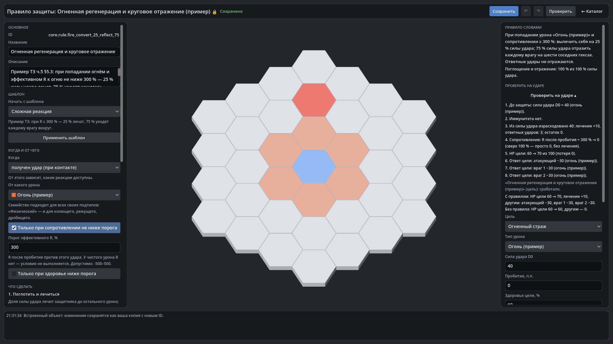

# HexTactics v0.23.0 — «Механики»

**Дата:** 2026-11-07 · **Тег:** `v0.23.0` · **ТЗ:** часть 5 (`docs/GAME_SPEC_PART5.md`), §6.1–§6.5, §9.1, §9.5, приёмка §11.5
п.35–40 (план версий — D-119: строка v0.20.0 плана ч.5 → v0.23.0)
**Движок:** Godot 4.7.2 stable .NET · **.NET:** SDK 8.0.133, рантайм 8.0 (`net8.0`)
**Архив:** `release_archives/v0.23.0/HexTactics_v0.23.0_windows_x64.zip` (+ `.sha256`, `BUILD_INFO.txt`)

## Функции

- **«Механики»** — одна позиция каталога с первым экраном из трёх действий: «Типы урона», «Правила защиты», «Наборы
  сопротивлений»; новые разделы появятся там через реестр.
- **Свой тип урона**: «На основе физического / магического / чистого / Новое семейство» → название, цвет, значок;
  «Подробнее» — семейство, явная стратегия (подтип наследует), теги, кто использует тип. Тип сразу есть во всех списках.
- **Наборы сопротивлений**: таблица R с необязательной основой (без циклов); у юнита — наборы ссылкой плюс свои значения,
  видно «из набора» / «своё», сброс, «Сохранить как набор».
- **«Проверить на ударе»** в редакторах правила, типа урона и юнита: удар в отдельной песочнице — стадии с точными числами,
  причины по каждому правилу, «с правилом / без правила»; несохранённые правки проверяются, библиотека и матч не меняются.

## Ограничения

- Полная прогрессивная секция «Сопротивления» (сворачиваемые группы, поиск, «показать ненулевые», шаблоны, карточки правил,
  отладка тестового запуска) — v0.24.0.

## Проверено

- `dotnet test`: Core 98, Simulation 224, Interaction 98, Content 81 (+3: `ProfileContentTests`), Editor 67 (+8:
  `MechanicsTests`) — все зелёные.
- Windows-сборка под Wine, три запуска: регрессия — 581 проверка (сценарий v0.22 и: экран «Механики»; тип «Плазма» на основе
  магического с тегами и ударом в песочнице; набор «Маг в латах» на основе «Бронированного», отказ 700 %; песочница
  встроенного правила — лечение 10, «без правила 60 → 60», при пробитии 50 — «R после пробития = 250 %, порог 300 % не
  достигнут»; юнит «Латник» с набором — унаследованное, своё 0, сброс, плазма 40 → 16, в бою режущий удар снимает 10,
  карточка ничего о наборе не говорит); второй запуск — 61; импорт пакета на чистую установку — 15.

## Запуск

Распаковать ZIP, запустить `HexTactics.exe` (Windows 10/11 x64, OpenGL 3.3). Управление — `docs/CONTROLS.md`, редакторы —
`docs/EDITOR_GUIDE.md`, форматы — `docs/CONTENT_FORMAT.md`, миграции — `docs/MIGRATIONS.md`.

## Возврат к этой версии

- Сборка: `pwsh tools/restore_version.ps1 -Version 0.23.0`; исходники: `git checkout v0.23.0`.
- Предыдущая — v0.22.0. Юнитов схемы 4, своих типов урона в категории и наборов сопротивлений она не загрузит/не покажет
  и не изменит; оригиналы юнитов схемы 3 лежат в `backups/<время>-migration-schema3/`.
