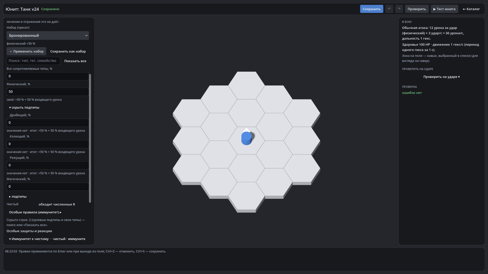

# HexTactics v0.24.0 — «Сопротивления» без перегрузки

**Дата:** 2026-11-08 · **Тег:** `v0.24.0` · **ТЗ:** часть 5 (`docs/GAME_SPEC_PART5.md`), §7.1–§7.5, приёмка §11.5 (план версий —
D-119: строка v0.21.0 плана ч.5 → v0.24.0)
**Движок:** Godot 4.7.2 stable .NET · **.NET:** SDK 8.0.133, рантайм 8.0 (`net8.0`)
**Архив:** `release_archives/v0.24.0/HexTactics_v0.24.0_windows_x64.zip` (+ `.sha256`, `BUILD_INFO.txt`)

## Функции

- **Редактор юнита секциями**: «Основное», «Атака и навыки», «Сопротивления», «Дополнительно» — открыта одна, остальные
  показывают резюме одной строкой. Танк: «Создать» → HP → «Сопротивления» → «Физический» 50 → «Сохранить».
- **Короткая таблица**: группы и всё ненулевое; подтипы — «▸ подтипы»; свои типы — поиском (название, тег, семейство) или
  «Показать все»; у чистого урона — переход к особым правилам вместо числа.
- **Карточки защит**: правила и щиты одной строкой, раскрываются на месте; итог «Сильные стороны / слабости / реакции».
- **Правило прямо из юнита**: шаблон или «Изменить копию» открывают редактор правила поверх юнита; после сохранения правило
  у юнита, несохранённые правки юнита на месте; общее правило не меняется.
- **Копирование защиты** из другого юнита — одним шагом отмены.
- **Отладка защиты** — только в тестовом запуске из редактора, явно помечена; в обычной игре её нет.

## Ограничения

- UX-испытание пяти разных юнитов, сквозная проверка сохранения/импорта/миграций всех видов части 5 — v0.25.0.

## Проверено

- `dotnet test`: Core 98, Simulation 224, Interaction 98, Content 81, Editor 73 (+6: `ResistanceUxTests`) — все зелёные.
- Windows-сборка под Wine, три запуска: регрессия — 641 проверка (все прежние сценарии v0.17–v0.23 идут через секции
  инспектора; новый: «Танк v24» — физический +50 в «Сопротивлениях», подтипы по «▸», поиск «Плазма» сужает таблицу,
  «Показать все»; «Особые правила» у чистого → шаблон «Иммунитет» поверх юнита с типом «чистый» → возврат, правило у
  юнита; правило-пример из меню, «Изменить копию» с порогом 200 % (встроенное осталось 300 %); щит 50; копирование защиты
  из «Латника» и Ctrl+Z; в тесте отладка выключена, включается и показывает «физический +50 %», «Щит 50/50»; в обычной игре
  кнопки отладки нет); второй запуск — 67; импорт пакета на чистую установку — 15.

## Запуск

Распаковать ZIP, запустить `HexTactics.exe` (Windows 10/11 x64, OpenGL 3.3). Управление — `docs/CONTROLS.md`, редакторы —
`docs/EDITOR_GUIDE.md`, форматы — `docs/CONTENT_FORMAT.md`, миграции — `docs/MIGRATIONS.md`.

## Возврат к этой версии

- Сборка: `pwsh tools/restore_version.ps1 -Version 0.24.0`; исходники: `git checkout v0.24.0`.
- Предыдущая — v0.23.0. Схемы данных не менялись: всё, что создано в v0.24.0, открывается и в v0.23.0.
