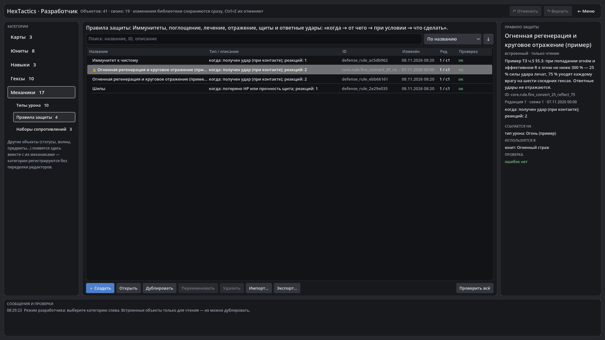

# HexTactics v0.24.1 — исправление ширины панелей

**Дата:** 2026-11-08 · **Тег:** `v0.24.1` · **Основа:** v0.24.0 (ТЗ ч.5 §7, план версий D-119)
**Движок:** Godot 4.7.2 stable .NET · **.NET:** SDK 8.0.133, рантайм 8.0 (`net8.0`)
**Архив:** `release_archives/v0.24.1/HexTactics_v0.24.1_windows_x64.zip` (+ `.sha256`, `BUILD_INFO.txt`)

## Исправлено

- Сквозная проверка v0.24.0 под Wine (окно 1600 × 900) показала: в категории «Правила защиты» длинное описание над списком
  расширяло каталог шире окна, и кнопки «↶ Отменить / ↷ Вернуть / ← Меню» уходили за край. Теперь описание категории
  переносится, строка состояния и заголовок объекта в редакторах обрезаются многоточием (полный текст — в подсказке);
  кнопки справа доступны при любой ширине окна.
- Новая проверка автоматизации `expect:on-screen` — кнопки верхних панелей целиком в окне (все категории «Механик»,
  редактор встроенного правила с длинным названием).

Всё остальное — как в v0.24.0 (секции юнита, короткая таблица сопротивлений, карточки защит, правило поверх юнита, отладка
теста).

## Проверено

- `dotnet test`: Core 98, Simulation 224, Interaction 98, Content 81, Editor 73 — все зелёные.
- Windows-сборка под Wine (1600 × 900), три запуска: регрессия — 649 проверок (сценарий v0.24 полностью, включая «← Меню» из
  «Правил защиты», и проверки «в пределах окна» во всех категориях «Механик» и в редакторе встроенного правила); второй
  запуск — 67; импорт пакета на чистую установку — 15.

## Запуск

Распаковать ZIP, запустить `HexTactics.exe` (Windows 10/11 x64, OpenGL 3.3). Управление — `docs/CONTROLS.md`, редакторы —
`docs/EDITOR_GUIDE.md`.

## Возврат к этой версии

- Сборка: `pwsh tools/restore_version.ps1 -Version 0.24.1`; исходники: `git checkout v0.24.1`.
- Схемы данных не менялись: v0.24.0 и v0.24.1 открывают одни и те же файлы.
