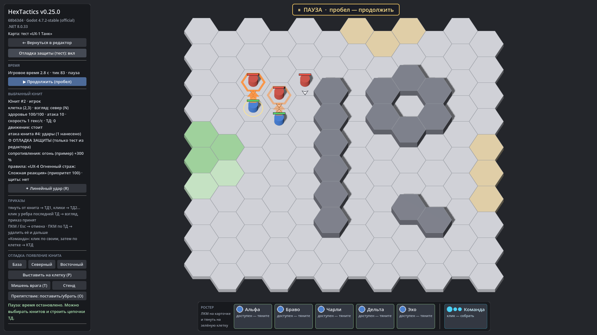

# HexTactics v0.25.0 — завершение части 5: сквозная проверка, UX, готовность к стихиям

**Дата:** 2026-11-08 · **Тег:** `v0.25.0` · **ТЗ:** часть 5 (`docs/GAME_SPEC_PART5.md`), §7.5, §11 (вся приёмка), §12 (строка
v0.22.0 → v0.25.0, D-119), §13.4 · последняя версия плана части 5
**Движок:** Godot 4.7.2 stable .NET · **.NET:** SDK 8.0.133, рантайм 8.0 (`net8.0`)
**Архив:** `release_archives/v0.25.0/HexTactics_v0.25.0_windows_x64.zip` (+ `.sha256`, `BUILD_INFO.txt`)

## Что сделано

- **Сквозная проверка**: свой тип урона, набор сопротивлений с основой, правило защиты с ответом этим типом и юнит со всем
  этим переживают перезапуск, экспорт и импорт на чистую установку — отчёт «Проверить на ударе» по пяти ударам совпадает
  символ в символ; неизвестный обработчик и отсутствующая зависимость отклоняются, ничего не записав; юнит части 3 (схема 1)
  открывается со схемой 4 и прежними числами; каждое действие правила защиты проверено от реестра до симуляции.
- **UX-испытание пяти юнитов** (`docs/UX_TRIALS.md`): танк — 6 действий, сложная огненная защита — 12, без «Механик» и JSON;
  тестовый бой пяти юнитов: реакции срабатывают сами, игрок управляет только приказами.
- **Приёмка §11** — 48 пунктов, каждый привязан к автотесту и/или шагу сценария (`docs/ACCEPTANCE_PART5.md`).
- **Готовность к стихиям** (§13.4): именованный этап до D0 (`IDamageStage`) — пустой в этой редакции; разделы «Механик»,
  реакции и типы расширяются через реестры. Сами стихии не вводятся.
- Автоматизация надёжнее: после смены редактора шаги ждут новый экран.

## Проверено

- `dotnet test`: Core 98, Simulation 231 (+7: `Part5AcceptanceTests`), Interaction 98, Content 81, Editor 80 (+7:
  `Part5EndToEndTests`, `ResistanceUxTests.P39`) — 588, все зелёные.
- Windows-сборка под Wine (1600 × 900), три запуска: регрессия — **694 проверки** (все сценарии v0.5–v0.25 подряд и
  UX-испытание с боем пяти юнитов: «Застрельщик» и «Маг» падают, «Страж» и «Танк» не теряют HP, «Призрак» не тронут);
  второй запуск — **71** (сохранённое после перезапуска); чистая установка — **27** (импорт двух пакетов — ч.4 «Поверхности» и
  ч.5 «Защита» — и удар песочницей по импортированному «Латнику»: 100 → 80).

## Запуск

Распаковать ZIP, запустить `HexTactics.exe` (Windows 10/11 x64, OpenGL 3.3). Управление — `docs/CONTROLS.md`, редакторы —
`docs/EDITOR_GUIDE.md`, форматы — `docs/CONTENT_FORMAT.md`, миграции — `docs/MIGRATIONS.md`.

## Возврат к этой версии

- Сборка: `pwsh tools/restore_version.ps1 -Version 0.25.0`; исходники: `git checkout v0.25.0`.
- Схемы данных с v0.24.0 не менялись: v0.24.x открывает файлы v0.25.0.
