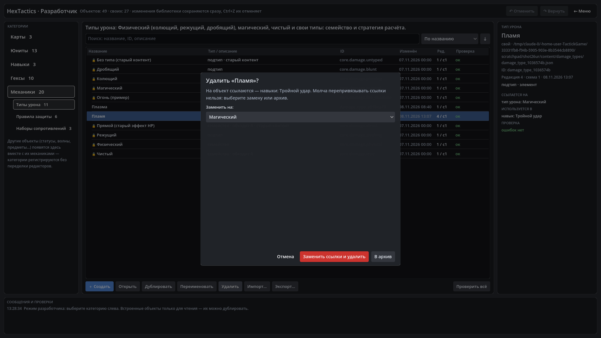

# HexTactics v0.26.0 — единый реестр определений: свой тип сразу везде

**Дата:** 2026-11-08 · **Тег:** `v0.26.0` · **ТЗ:** часть 6 (`docs/GAME_SPEC_PART6.md`), §2 (реестр, селекторы, зависимости),
§12.1 (P6-01…P6-08), §13 (строка v0.23.0 → v0.26.0, D-143) · первая версия плана части 6
**Движок:** Godot 4.7.2 stable .NET · **.NET:** SDK 8.0.133, рантайм 8.0 (`net8.0`)
**Архив:** `release_archives/v0.26.0/HexTactics_v0.26.0_windows_x64.zip` (+ `.sha256`, `BUILD_INFO.txt`)

## Что сделано

- **Свой тип прямо из списка.** В любом списке «Тип урона» последний пункт — «＋ Новый тип урона…»: основа → название, цвет,
  флажок «Категория: элемент» → «Сохранить» → «← Назад». Новый тип уже выбран в исходном поле, несохранённые правки
  исходного редактора на месте.
- **Сразу везде.** Библиотека объявляет каждое изменение, все селекторы берут варианты из одного каталога: навыки, обычная
  атака, эффекты гексов, временные R, условия и ответы правил защиты, щиты, таблица сопротивлений юнита, песочница — даже
  в уже открытом редакторе. Юнит без своего значения для нового магического типа наследует магическое R.
- **Понятные списки.** Группы по семействам («Физический», «Магический», свои, «Чистый» — последним), подпись
  «Огонь · элемент (свой)»; поле получает только подходящие типы (семейство — только семейства, «сопротивление к» — только
  учитывающие R); служебные и архивные типы не предлагаются, пока не выбраны.
- **Удаление без разрушения.** Используемый объект: диалог со списком пользователей → «Заменить ссылки и удалить»
  (совместимая замена во всех пользователях разом, одна отмена всё возвращает) или «В архив» (ссылки работают, в новых
  выборах скрыт, «Вернуть из архива» — в подробностях).
- **Файлы новых версий не теряют данных.** Неизвестные поля загружаются с замечанием, не действуют и записываются обратно.
- Стихийной матрицы нет: «элемент» — только метка для списков; расчёт — как у семейства.

## Проверено

- `dotnet test`: Core 98, Simulation 231, Interaction 98, Content 81, Editor 90 (+10: `RegistrySyncTests` — P6-01…P6-08,
  неизвестные поля, откат замены) — 598, все зелёные.
- Windows-сборка под Wine (1600 × 900), три запуска: регрессия — **@SMOKE@ проверок** (все сценарии v0.5–v0.25 подряд и
  сценарий v0.26: «Огонь» из селектора навыка «Тройной удар», он же в правиле защиты, гексе «Жгучая поверхность» и у
  «Латника» с наследованным магическим 60 %, переименование в «Пламя», удаление → архив → возврат); второй запуск —
  **@RESTART@** («Пламя» с семейством и пользователем, навык после перезапуска); чистая установка — **@CLEAN@**.
- Карта приёмки части 6 — `docs/ACCEPTANCE_PART6.md`.

## Запуск

Распаковать ZIP, запустить `HexTactics.exe` (Windows 10/11 x64, OpenGL 3.3). Управление — `docs/CONTROLS.md`, редакторы —
`docs/EDITOR_GUIDE.md`, форматы — `docs/CONTENT_FORMAT.md`, миграции — `docs/MIGRATIONS.md`.

## Возврат к этой версии

- Сборка: `pwsh tools/restore_version.ps1 -Version 0.26.0`; исходники: `git checkout v0.26.0`.
- Версии схем не менялись. v0.25.0 открывает файлы v0.26.0, но не знает полей `archived` и `classification`: архивный
  объект там снова в списках, а пересохранение объекта в v0.25.0 эти поля теряет.
