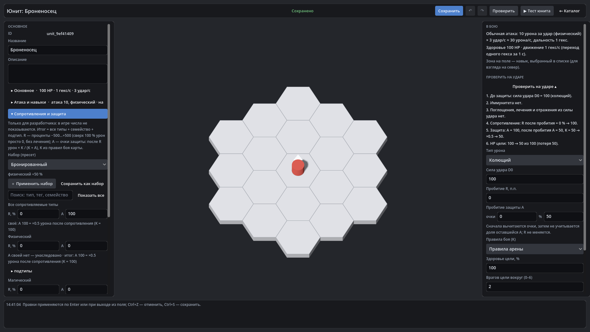

# HexTactics v0.27.0 — защита A: отдельно от сопротивления, с пробитием и правилами боя

**Дата:** 2026-11-08 · **Тег:** `v0.27.0` · **ТЗ:** часть 6 (`docs/GAME_SPEC_PART6.md`), §3 (защита A), §8 (стадия 7), §9.4–9.5,
§12.2 (P6-09…P6-19), §13 (строка v0.24.0 → v0.27.0, D-143)
**Движок:** Godot 4.7.2 stable .NET · **.NET:** SDK 8.0.133, рантайм 8.0 (`net8.0`)
**Архив:** `release_archives/v0.27.0/HexTactics_v0.27.0_windows_x64.zip` (+ `.sha256`, `BUILD_INFO.txt`)

## Что сделано

- **Защита A — очки, а не проценты.** У юнита и в профилях — по слоям «все типы / семейство / тип»; в таблице одна строка
  «R, % | A». После сопротивления урон умножается на `K / (K + A)`: A = 100 при K = 100 — вдвое меньше; каждое следующее
  очко даёт меньше. Отрицательный итог (после дебаффа) считается 0, чистый урон A не учитывает.
- **Одна стадия в общем расчёте:** конверсии → R → **A** → плоское снижение → предел → щиты → HP. Пробития R и A
  независимы и видны отдельно в «Проверить на ударе».
- **Пробитие A** у обычной атаки и у эффекта урона навыка (очки, затем %), **временная A** — бафф/дебафф «защита A».
- **«Правила боя»** — новая категория «Механик»: K защиты и свой K для семейства, таблица «A → множитель», проверка удара с
  несохранённым K. Карта выбирает правила; новая — стандартные, старая — совместимые.
- **Старый контент не меняется:** юниты получают A = 0 (схема 5), профили — пустую таблицу A (схема 2); множитель защиты
  при A = 0 — ровно 1 при любом K.
- В игре числа A не показываются; временная защита — словом «броня»; отладка тестового запуска показывает A.

## Проверено

- `dotnet test`: Core 98, Simulation 250 (+19: `ArmorTests`), Interaction 98, Content 90 (+9: `ArmorContentTests`),
  Editor 95 (+5: `ArmorEditorTests`) — 631, все зелёные.
- Windows-сборка под Wine (1600 × 900), три запуска: регрессия — **773 проверки** (все сценарии v0.5–v0.26 и сценарий
  v0.27: «Правила арены» с K 50 и магическим K 200; «Броненосец» с A 100, отказ A −5, песочница с пробитием A и выбором
  правил; бой в тестовом запуске юнита — 20 вместо 40; карта «Арена брони» с этими правилами — 26,667); второй запуск —
  **83** («Правила арены» с обоими K, A «Броненосца», правила карты); чистая установка — **27**.
- Карта приёмки части 6 — `docs/ACCEPTANCE_PART6.md` (P6-01…P6-19).

## Запуск

Распаковать ZIP, запустить `HexTactics.exe` (Windows 10/11 x64, OpenGL 3.3). Управление — `docs/CONTROLS.md`, редакторы —
`docs/EDITOR_GUIDE.md`, форматы — `docs/CONTENT_FORMAT.md`, миграции — `docs/MIGRATIONS.md`.

## Возврат к этой версии

- Сборка: `pwsh tools/restore_version.ps1 -Version 0.27.0`; исходники: `git checkout v0.27.0`.
- Юниты схемы 5 и профили схемы 2 v0.26.0 и раньше не загружает (файлы не трогаются); перед откатом сохраните папку
  `user://content` — v0.27.0 снова откроет её без потерь.
