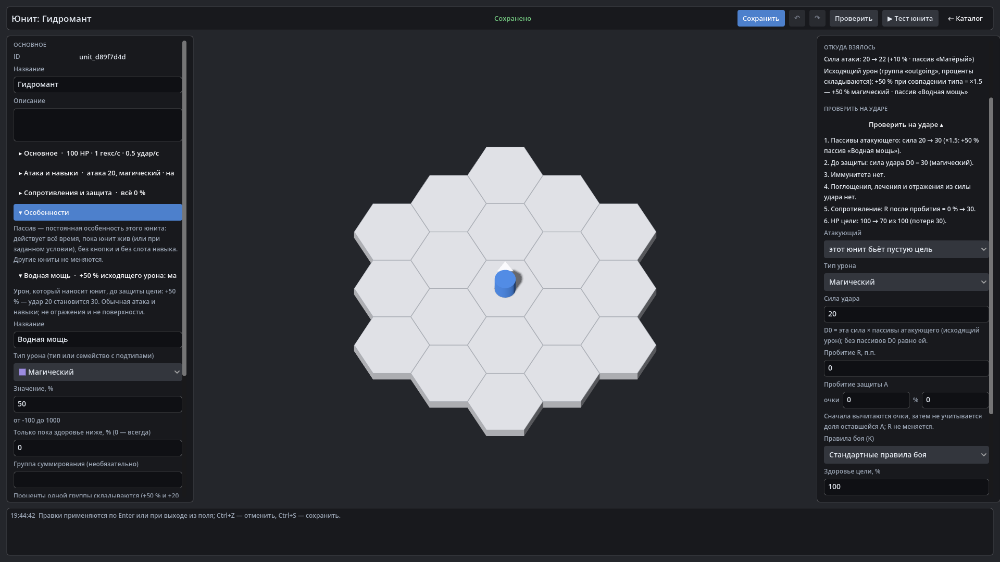

# HexTactics v0.28.0 — пассивы юнита и единый движок модификаторов

**Дата:** 2026-11-08 · **Тег:** `v0.28.0` · **ТЗ:** часть 6 (`docs/GAME_SPEC_PART6.md`), §4 (пассивы), §8 (стадии 2 и 8), §9.2,
§11, §12.3 (P6-20…P6-22, P6-26, P6-30, P6-31), §13 (строка v0.25.0 → v0.28.0, D-143)
**Движок:** Godot 4.7.2 stable .NET · **.NET:** SDK 8.0.133, рантайм 8.0 (`net8.0`)
**Архив:** `release_archives/v0.28.0/HexTactics_v0.28.0_windows_x64.zip` (+ `.sha256`, `BUILD_INFO.txt`)

## Что сделано

- **«Особенности» юнита** — индивидуальные постоянные пассивы из шаблонов: усилить исходящий урон, снизить получаемый
  урон, изменить характеристику (% или число), сопротивление ± п.п., защита A ± очки / %, подключить правило защиты;
  условие «пока здоровье ниже N %», группа суммирования.
- **Один движок модификаторов** для боя и редактора: исходящие проценты — до D0 (удар 20 → 30 при +50 %), входящие — после
  R, A и плоского снижения (40 → 30 при −25 %); проценты одной группы складываются, группы перемножаются; урон не
  становится лечением.
- **«Откуда взялось»**: база, итог и каждый источник — «Сила атаки: 20 → 22 (+10 % · пассив «Матёрый»)»; «В бою» — итоговые
  числа.
- **Песочница**: выбор атакующего; в редакторе юнита — «этот юнит бьёт пустую цель» для проверки несохранённых пассивов.
- Старые юниты — схема 6 без пассивов, числа те же. В игре пассивы числами не показываются.

## Проверено

- `dotnet test`: Core 98, Simulation 257 (+7: `PassiveDamageTests`), Interaction 98, Content 96 (+6:
  `PassiveContentTests`), Editor 98 (+3: `PassiveEditorTests`) — 647, все зелёные.
- Windows-сборка под Wine (1600 × 900), три запуска: регрессия — **@SMOKE@ проверок** (все сценарии v0.5–v0.27 и сценарий
  v0.28: «Гидромант» с пассивами «Водная мощь» +50 % магического и «Матёрый» +10 % силы, отказ +5000 %, «откуда взялось»,
  песочница «20 → 30», бой в тестовом запуске — 22 × 1,5 × 0,5 = 16,5 по «Броненосцу»); второй запуск — **@RESTART@**;
  чистая установка — **@CLEAN@**.
- Карта приёмки — `docs/ACCEPTANCE_PART6.md`.

## Запуск

Распаковать ZIP, запустить `HexTactics.exe` (Windows 10/11 x64, OpenGL 3.3). Управление — `docs/CONTROLS.md`, редакторы —
`docs/EDITOR_GUIDE.md`, форматы — `docs/CONTENT_FORMAT.md`, миграции — `docs/MIGRATIONS.md`.

## Возврат к этой версии

- Сборка: `pwsh tools/restore_version.ps1 -Version 0.28.0`; исходники: `git checkout v0.28.0`.
- Юниты схемы 6 v0.27.0 и раньше не загружает (файлы не трогаются); сохраните `user://content` перед откатом.
