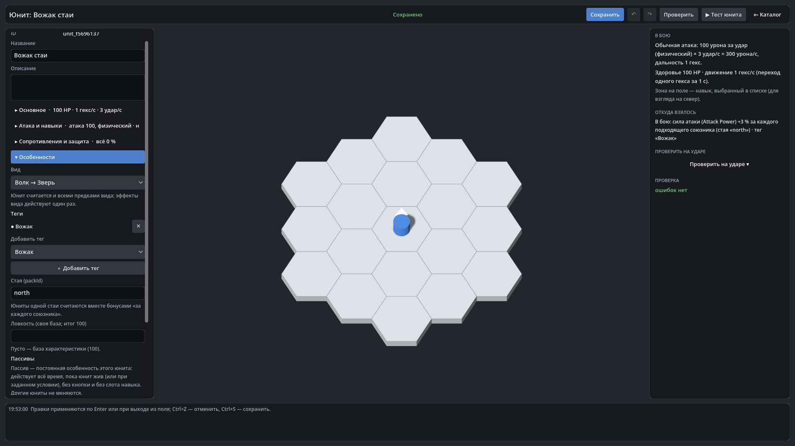

# HexTactics v0.29.0 — дерево видов, общие теги, стая, реестр характеристик

**Дата:** 2026-11-08 · **Тег:** `v0.29.0` · **ТЗ:** часть 6 (`docs/GAME_SPEC_PART6.md`), §5 (виды, теги, стая, характеристики),
§9.1–9.3, §12.3 (P6-23…P6-25, P6-27…P6-29, P6-32), §13 (строка v0.26.0 → v0.29.0, D-143)
**Движок:** Godot 4.7.2 stable .NET · **.NET:** SDK 8.0.133, рантайм 8.0 (`net8.0`)
**Архив:** `release_archives/v0.29.0/HexTactics_v0.29.0_windows_x64.zip` (+ `.sha256`, `BUILD_INFO.txt`)

## Что сделано

- **«Происхождение и теги»** — новая группа каталога: «Дерево видов» и «Теги».
- **Дерево видов**: один родитель, без циклов; потомок считается всеми предками; эффекты предков действуют один раз, эффект
  потомка с тем же ключом заменяет, отключает или дополняет их («−50 % Слизи и −25 % Металлической слизи = −75 %»).
- **Общие теги**: категория, эффекты (или просто метка), допустимые виды, нужные и несовместимые теги, группа
  взаимоисключения с политикой, повтор «один раз / до N».
- **Стая**: поле «Стая (packId)» и эффект «за каждого подходящего союзника» — вожак +3 % силы за каждого другого живого
  волка своей стаи; пересчёт при появлении и гибели, без опроса каждого кадра; определение юнита не меняется.
- **Реестр характеристик**: встроенная «Ловкость» (100) и свои; меняются пассивами и тегами, на бой без механики не влияют.
- **Юнит → «Особенности»**: вид, теги-чипы (действует или нет — и почему), стая, своя база характеристик, пассивы; «Откуда
  взялось» называет вид, тег или пассив.

## Проверено

- `dotnet test`: Core 98, Simulation 257, Interaction 98, Content 103 (+7: `OriginContentTests`), Editor 100 (+2:
  `OriginEditorTests`) — 656, все зелёные.
- Windows-сборка под Wine (1600 × 900), три запуска: регрессия — **860 проверок** (все сценарии v0.5–v0.28 и сценарий
  v0.29: дерево «Зверь → Волк → Лунный волк», теги «Вожак» и «Матёрый», юниты стаи «north» и чужой волк «south»,
  «Ловкость: 100 → 110»; в тестовом запуске атака вожака 100 одного и 112 с четырьмя волками своей стаи); второй запуск —
  **91**; чистая установка — **27**.
- Карта приёмки — `docs/ACCEPTANCE_PART6.md` (P6-01…P6-32).

## Запуск

Распаковать ZIP, запустить `HexTactics.exe` (Windows 10/11 x64, OpenGL 3.3). Управление — `docs/CONTROLS.md`, редакторы —
`docs/EDITOR_GUIDE.md`, форматы — `docs/CONTENT_FORMAT.md`, миграции — `docs/MIGRATIONS.md`.

## Возврат к этой версии

- Сборка: `pwsh tools/restore_version.ps1 -Version 0.29.0`; исходники: `git checkout v0.29.0`.
- Юниты схемы 7 v0.28.0 и раньше не загружает (файлы не трогаются); виды, теги и характеристики ей неизвестны — сохраните
  `user://content` перед откатом.
