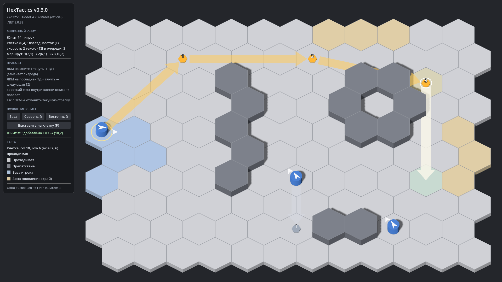

# HexTactics v0.3.0 — управление приказами

**Дата:** 2026-11-05 · **Тег:** `v0.3.0` · **Этап ТЗ:** 1, версия «управление приказами» (§1.1)
**Движок:** Godot 4.7.2 stable .NET (`4.7.2.stable.mono.official.ed1daf0bf`) · **.NET:** SDK 8.0.133, рантайм 8.0 (`net8.0`)
**Архив:** `release_archives/v0.3.0/HexTactics_v0.3.0_windows_x64.zip` (+ `.sha256`, `BUILD_INFO.txt` с коммитом и датой сборки)

## Функции

- **Зажатие ЛКМ на юните и протягивание** (ТЗ §5.1): после смещения больше 8 px появляется прямая стрелка-приказ от
  центра клетки юнита к курсору; ширина тела стрелки — половина стороны гекса. Цвет стрелки и заливка курсорной клетки
  показывают, можно ли поставить ТД.
- **ТД1**: отпускание над допустимым гексом, отличным от исходного → точка движения в центре гекса; протягивание из
  юнита **заменяет** невыполненную очередь.
- **Цепочки**: зажатие на **последней** ТД и протягивание → ТД2, ТД3… без лимита; номера `1, 2, 3…` на маркерах.
  Источник нового сегмента — предыдущая ТД. Между точками приказов — толстые прямые стрелки (намерение, не путь).
- **Поворот без движения** (§5.2): у юнита без ТД короткий направленный жест внутри его клетки и отпускание там же →
  поворот в одно из 6 направлений по вектору в плоскости карты (не по экранному углу). Отпускание у центра — без изменений.
- **Предпросмотр направления**: во время протягивания юнит предварительно поворачивается к цели (модель не меняется).
- **Отмена**: Esc или ПКМ во время протягивания — текущая стрелка отменяется, существующие ТД не меняются.
- **Ясные визуальные роли**: источник — жёлтая заливка, курсорная клетка — зелёная/красная, ТД — маркеры с номерами;
  выбранный юнит — янтарная цепочка, остальные — бледные.
- **Нельзя** создать ТД вне поля, на препятствии, на клетке другого юнита (сообщение, очередь без изменений).
- Щелчок по маркеру ТД выделяет её; HUD показывает маршрут выбранного юнита. Панель HUD прокручивается в маленьком окне.

## Ограничения

- Юниты ещё **не двигаются** — создаются только приказы (движение по цепочке — v0.4.0).
- Проверка наличия пути, подсветка всех 120 клеток, обход препятствий и тонкая линия фактического пути — v0.4.0.
  До этого предпросмотр взгляда — по прямой гекс-линии (D-021).
- Удаление/перестроение ТД, продолжение цепочки из промежуточной ТД — отдельный этап (D-019).
- Пауза — v0.5.0.

## Изменения относительно v0.2.0

- Core: `WaypointRules`, `OrderMode`, `HexLine`; `GameState.FindWaypoint`.
- Simulation: `IssueMoveOrder`, `RotateInPlace`, `CommandAnchor`, события `OrderIssued`, `OrderRejected`.
- Interaction: новые состояния и `DragPreview`; конструктор принимает `HexLayout` (миграция описана в DECISIONS).
- Клиент: `OrdersView` (стрелки, маркеры ТД), предпросмотр направления, сообщения, прокрутка HUD, шаги автоматизации
  `press/move/release/drag`.
- Все функции v0.2.0 (появление, выбор, режим выставления) сохранены.

## Проверено

- `dotnet test`: 112 тестов (Core 41, Simulation 38, Interaction 33). Сценарии мыши в автомате: ТД1 → ТД2 → ТД3 строго по
  порядку и с номерами 1-2-3; замена очереди из юнита; поворот во все 6 сторон без перемещения; снап к ближайшему из 6
  направлений по плоскости; мёртвая зона; поворот запрещён при наличии ТД; микродвижение = щелчок; отпускание вне поля,
  на препятствии и на занятой клетке; Esc и ПКМ не трогают прежние ТД; ТД не из последней — отказ; щелчок по ТД;
  протягивание от другого юнита выбирает его; предпросмотр направления не меняет модель.
- Сценарий в собранной игре (`--hx-script`, события мыши через входной конвейер Godot): цепочка из 3 ТД, поворот жестом,
  отказ протягивания из ТД1, активная стрелка в кадре.
- Отрисовка в 1920×1080, 1366×768 и 1280×600 (прокрутка HUD).
- Экспорт «Windows Desktop», смоук-запуск `HexTactics.console.exe` (`tools/verify_release.ps1 -Run`).

## Запуск

Распаковать ZIP, запустить `HexTactics.exe` (Windows 10/11 x64, OpenGL 3.3). .NET устанавливать не нужно.

## Внутренняя архитектура

- Поток: `PointerInput` (Godot) → `PointerSample` → `InputStateMachine` → `GameSimulation.IssueMoveOrder/RotateInPlace`
  → `GameState.OrderQueue`; `OrdersView` и `UnitsView` читают модель и `DragPreview` каждый кадр.
- Подробно: `docs/ARCHITECTURE.md` §7–7.1, решения D-018…D-023.

## Возврат к этой версии

- Сборка: `pwsh tools/restore_version.ps1 -Version 0.3.0` или вручную распаковать ZIP из `release_archives/v0.3.0/`.
- Исходники: `git checkout v0.3.0` или `pwsh tools/restore_version.ps1 -Version 0.3.0 -Mode Source`.
- Предыдущие версии: v0.2.0, v0.1.0 (`release_archives/`).
