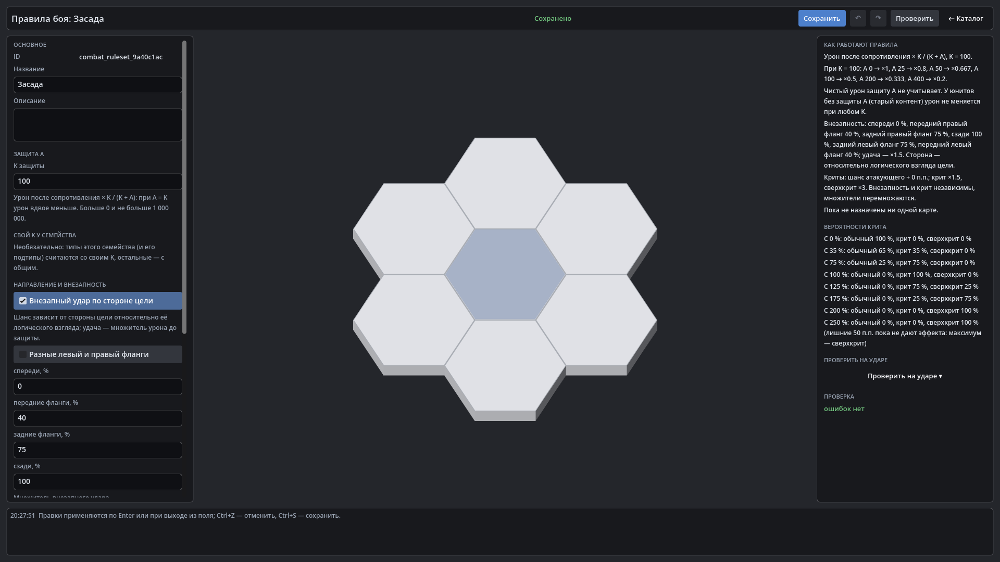

# HexTactics v0.30.0 — внезапный удар по стороне цели, крит и сверхкрит

**Дата:** 2026-11-08 · **Тег:** `v0.30.0` · **ТЗ:** часть 6 (`docs/GAME_SPEC_PART6.md`), §6 (направление и внезапность),
§7 (крит и сверхкрит), §8 (стадия конвейера), §9.5, §10.3, §12.4 (P6-33…P6-46), §13 (строка v0.27.0 → v0.30.0, D-143)
**Движок:** Godot 4.7.2 stable .NET · **.NET:** SDK 8.0.133, рантайм 8.0 (`net8.0`)
**Архив:** `release_archives/v0.30.0/HexTactics_v0.30.0_windows_x64.zip` (+ `.sha256`, `BUILD_INFO.txt`)

## Что сделано

- **Внезапный удар по стороне цели**: шесть сторон относительно **логического** взгляда защищающегося — спереди 0 %,
  передние фланги 25 %, задние 75 %, сзади 100 % (явное предположение ТЗ), успех — ×1,5. Сторона — геометрия гексов, не
  экран и не анимация; поверхность, периодический урон, отражение и удар без атакующего внезапными не бывают.
- **Крит и сверхкрит**: шанс в процентных пунктах складывается из правил, юнита («Шанс крита») и эффектов «шанс крита ±
  п.п.»; 35 → 35 % крита, 100 → крит всегда, 125 → 75 % крита и 25 % сверхкрита, 200 → сверхкрит всегда, лишнее
  показывается и пока не действует. Множители ×1,5 и ×2,25; внезапность и крит перемножаются до защиты
  (20 × 1,5 × 2,25 = 67,5).
- **Воспроизводимые броски**: бросок — функция ключа попадания, а не генератор с состоянием; пауза, стрелки, камера, FPS и
  перерисовка ничего не бросают, тот же бой даёт те же числа. Навыки: «Может быть критическим», бросок на попадание или на
  серию, на каждую цель области или общий.
- **«Правила боя» → «Направление и внезапность», «Критические удары»**: флажки, симметричный пресет с «Разные левый и
  правый фланги», множители, базовый шанс, таблица вероятностей. Шаблоны «невосприимчив к критам» и «невосприимчив к
  внезапным ударам» — у юнита, вида и тега.
- **Песочница**: «Сторона цели» и «Исход (только для проверки)» — стадии «Внезапность: … → 75 % → бросок → да, ×1.5» и
  «Крит: шанс … → сверхкрит ×2.25».
- **Совместимость**: новый набор правил — без бонусов, встроенные стандартные — с ними, совместимые — без; карта, выбравшая
  стандартные правила в v0.27–v0.29, переходит на совместимые; в режиме «Играть» шансы не показываются.

## Проверено

- `dotnet test`: Core 98, Simulation 272 (+15: `SurpriseCritTests`), Interaction 98, Content 107 (+4:
  `CritRulesContentTests`), Editor 103 (+3: `CritRulesEditorTests`) — 678, все зелёные.
- Windows-сборка под Wine (1600 × 900), три запуска: регрессия — **906 проверок** (860 + 46: сценарий длиннее предела командной строки Windows идёт двумя запусками подряд с одной папкой пользователя, D-164) (все сценарии v0.5–v0.29 и сценарий
  v0.30: правила «Засада» — фланги 40 % зеркально, 150 % отклонено, сверхкрит ×3; «Каменный страж» невосприимчив к
  внезапности; «Убийца» с шансом крита 200 п.п.; песочница — задний правый фланг 75 %, внезапный сверхкрит, D0 = 67,5; в
  тестовом запуске на совместимых правилах прототипа удар 10, на «Арене засады» со стандартными правилами — 22,5; карточка в
  игре без шансов); второй запуск — **95**; чистая установка — **27**.
- Карта приёмки — `docs/ACCEPTANCE_PART6.md` (P6-01…P6-46).

## Запуск

Распаковать ZIP, запустить `HexTactics.exe` (Windows 10/11 x64, OpenGL 3.3). Управление — `docs/CONTROLS.md`, редакторы —
`docs/EDITOR_GUIDE.md`, форматы — `docs/CONTENT_FORMAT.md`, миграции — `docs/MIGRATIONS.md`.

## Возврат к этой версии

- Сборка: `pwsh tools/restore_version.ps1 -Version 0.30.0`; исходники: `git checkout v0.30.0`.
- Юниты схемы 8, карты схемы 2 и правила боя схемы 2 v0.29.0 и раньше не загружает (файлы не трогаются) — сохраните
  `user://content` перед откатом. Карта, перешедшая на совместимые правила, на них и остаётся.
