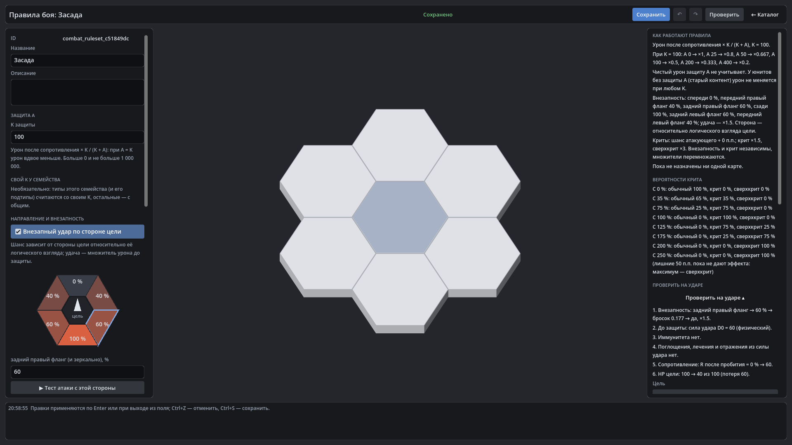

# HexTactics v0.31.0 — полный редактор части 6, тестовый стенд, сквозная проверка «Вода»

**Дата:** 2026-11-08 · **Тег:** `v0.31.0` · **ТЗ:** часть 6 (`docs/GAME_SPEC_PART6.md`), §6.3–6.4, §9.2, §9.5, §10.3, §11,
§12.5 (P6-47…P6-55), §13 (строка v0.28.0 → v0.31.0, D-143) — **часть 6 завершена**
**Движок:** Godot 4.7.2 stable .NET · **.NET:** SDK 8.0.133, рантайм 8.0 (`net8.0`)
**Архив:** `release_archives/v0.31.0/HexTactics_v0.31.0_windows_x64.zip` (+ `.sha256`, `BUILD_INFO.txt`)

## Что сделано

- **Стороны на рисунке**: шестиугольник в «Правилах боя» — шанс и оттенок каждой стороны цели, щелчок выбирает сторону; её
  шанс правится рядом, «▶ Тест атаки с этой стороны» открывает расчёт удара с неё.
- **1000 бросков крита** теми же детерминированными бросками, что в бою, рядом с ожиданиями по формуле.
- **Тестовый стенд**: seed бросков, «Проверить 100 событий» (внезапные, криты, сверхкриты, потеря HP), «Сбросить тест».
- **Исключения внезапности**: «только удар с соседнего гекса»; шанс внезапного удара атакующего ± п.п. (пассив, вид, тег).
- **Тег многим юнитам** из редактора тега — с проверкой всех до записи; сводка «Особенностей»: вид, теги, активные эффекты.
- **Слова ударов в игре**: «Внезапно!», «Крит!», «Сверхкрит!» — без раскрытия шансов.
- **Сквозная проверка части 6**: своя «Вода» → тег «Гидромант» +50 % → юнит и навык → пакет → чистая библиотека — те же
  числа урона (30 обычной атакой, 15 навыком).

## Проверено

- `dotnet test`: Core 98, Simulation 274 (+2: `SurpriseCritTests`), Interaction 98, Content 111 (+4: `Part6EndToEndTests`), Editor 109
  (+6: `FullEditorTests`) — 690, все зелёные.
- Windows-сборка под Wine (1600 × 900): регрессия — **960 проверок** (860 + 100: два запуска подряд с одной папкой пользователя, D-164) (все сценарии v0.5–v0.30 и сценарий v0.31: «Вода»,
  тег «Гидромант», «Водный маг» с видом, тремя тегами, пассивом, R и A без JSON — 20 × 1,5 = 30 в тестовом запуске;
  назначение тега «Убийце»; сторона на шестиугольнике 60 % с тестом, 100 событий — 60 внезапных, 1000 бросков; «Сверхкрит!»
  на «Арене засады» без «%» в карточке; экспорт «Вода.hxp»); второй запуск — **102** (поиск сужает список перед выбором «Убийцы» ниже края окна, D-169); чистая установка — **35**
  («Вода.hxp» → «Водный маг» бьёт на те же 30).
- Карта приёмки — `docs/ACCEPTANCE_PART6.md` (P6-01…P6-55, часть 6 закрыта).

## Запуск

Распаковать ZIP, запустить `HexTactics.exe` (Windows 10/11 x64, OpenGL 3.3). Управление — `docs/CONTROLS.md`, редакторы —
`docs/EDITOR_GUIDE.md`, форматы — `docs/CONTENT_FORMAT.md`, миграции — `docs/MIGRATIONS.md`.

## Возврат к этой версии

- Сборка: `pwsh tools/restore_version.ps1 -Version 0.31.0`; исходники: `git checkout v0.31.0`.
- Схемы те же, что в v0.30.0. v0.30.0 не знает операции «шанс внезапного удара» (такой пассив — ошибка проверки) и не
  читает «только с соседнего гекса» (поле сохраняется, внезапность — с любой дистанции).
