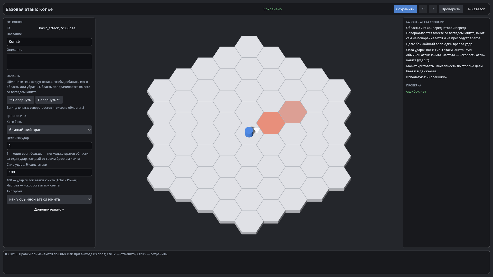

# HexTactics v0.32.0 — автоматическая базовая атака в своей области

**Дата:** 2026-11-09 · **Тег:** `v0.32.0` · **ТЗ:** часть 7 (`docs/GAME_SPEC_PART7.md`), §8 (автоатака), §9.2, §10, §12.5
(M7-43…M7-50), §13 (строка v0.29.0 → v0.32.0, D-150)
**Движок:** Godot 4.7.2 stable .NET · **.NET:** SDK 8.0.133, рантайм 8.0 (`net8.0`)
**Архив:** `release_archives/v0.32.0/HexTactics_v0.32.0_windows_x64.zip` (+ `.sha256`, `BUILD_INFO.txt`)

## Что сделано

- **Базовая атака** — новый вид «Механики» → «Базовые атаки»: своя область гексов вокруг юнита (не навыка), кого бить
  (ближайшего, слабейшего, по порядку гексов), сколько целей за удар, сила в % силы атаки, свой тип урона или тип обычной
  атаки. Встроенная — «Передний гекс».
- **Автоатака**: без приказа юнит сам бьёт врагов в своей области, повёрнутой по его взгляду, с частотой «скорости атак»
  (3 — три удара в секунду); не поворачивается к врагу и не преследует его; без врага удар не тратится; пауза не даёт
  «догоняющих» ударов; явный приказ атаки главнее и без лишнего удара. Удар — тем же конвейером урона: A, R, криты,
  внезапность, реакции.
- **Редактор области** на гекс-поле, как у навыка: щелчок добавляет или убирает гекс, поворот поля показывает, как область
  поворачивается со взглядом. У юнита — «Автоатака включена», «Базовая атака» и строка «В бою»: «Базовая атака: 3 удар/с ·
  передний гекс · 1 враг · 10 урона до защиты».
- **«Автоатака юнитов»** в редакторе карт: автоатака действует только там, где автор её включил, — прежние бои не меняются.
- Шаг автоматизации `row:` прокручивает длинный список до щелчка (D-169).

## Проверено

- `dotnet test`: Core 98, Simulation 282 (+8: `BasicAttackTests`), Interaction 98, Content 115 (+4: `BasicAttackContentTests`),
  Editor 112 (+3: `BasicAttackEditorTests`) — 705, все зелёные.
- Windows-сборка под Wine (1600 × 900): регрессия — **996 проверок** (860 + 136: два запуска подряд, D-164) (все сценарии v0.5–v0.31 и сценарий v0.32: «Копьё»
  — передний и второй передний гексы на гекс-поле, поворот поля не меняет сохранённую область; «Копейщик» 3 удара/с; на
  прототипе без автоатаки — ни одного удара; на «Арене копий» — враг в двух гексах впереди 100 → 70 за секунду, враг сзади
  цел, юнит не повернулся и не сдвинулся; повёрнутый на юг — бьёт заднего); второй запуск — **107**; чистая
  установка — **35**.
- Карта приёмки — `docs/ACCEPTANCE_PART7.md` (M7-43…M7-50, M7-53, M7-55).

## Запуск

Распаковать ZIP, запустить `HexTactics.exe` (Windows 10/11 x64, OpenGL 3.3). Управление — `docs/CONTROLS.md`, редакторы —
`docs/EDITOR_GUIDE.md`, форматы — `docs/CONTENT_FORMAT.md`, миграции — `docs/MIGRATIONS.md`.

## Возврат к этой версии

- Сборка: `pwsh tools/restore_version.ps1 -Version 0.32.0`; исходники: `git checkout v0.32.0`.
- Юниты схемы 9 v0.31.0 не загружает (файлы не трогаются); базовые атаки ей неизвестны; флажок карты «Автоатака юнитов»
  сохраняется и не действует.
