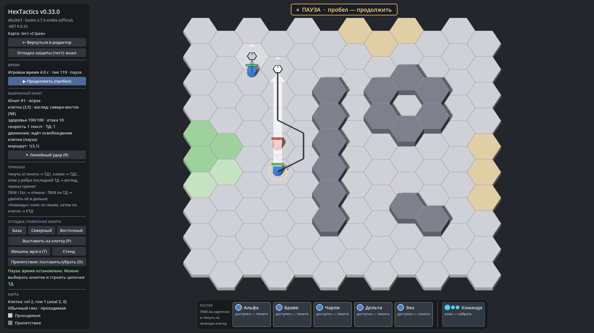

# HexTactics v0.33.0 — блок: удержание врагов на их гексах

**Дата:** 2026-11-09 · **Тег:** `v0.33.0` · **ТЗ:** часть 7 (`docs/GAME_SPEC_PART7.md`), §7 (блок), §10, §11.2, §12.5
(M7-36…M7-42, M7-57), §13 (строка v0.30.0 → v0.33.0, D-150)
**Движок:** Godot 4.7.2 stable .NET · **.NET:** SDK 8.0.133, рантайм 8.0 (`net8.0`)
**Архив:** `release_archives/v0.33.0/HexTactics_v0.33.0_windows_x64.zip` (+ `.sha256`, `BUILD_INFO.txt`)

## Что сделано

- **Блок**: стоящий юнит со свободными слотами удерживает идущего врага на соседнем гексе. Враг остаётся на своём гексе
  (два юнита в одном гексе невозможны) и идёт дальше, когда блок снят: блокер ушёл или погиб, враг не рядом или
  остановился, блок уменьшился (самые новые связи отпускаются первыми). У врага один блокер; блок 0 — никого.
- **«Блок»** — характеристика общего реестра (база 0): одно поле у юнита в «Атака и навыки», итог с пассивами и тегами,
  строка «В бою»; бафф/дебафф «блок» — целыми слотами на время.
- В игре над удержанным врагом — слово «блок»; блок не защищает и не наносит урон, атаки работают как раньше.

## Проверено

- `dotnet test`: Core 98, Simulation 288 (+6: `BlockTests`), Interaction 98, Content 117 (+2: `BlockContentTests`), Editor 113
  (+1: `BlockEditorTests`) — 714, все зелёные.
- Windows-сборка под Wine (1600 × 900): регрессия — **1011 проверок** (860 + 151: два запуска подряд, D-164) (все сценарии v0.5–v0.32 и сценарий v0.33: «Страж» с
  блоком 1; в тестовом запуске два оперативника идут мимо — первый удержан на своём гексе, второй дошёл до цели);
  второй запуск — **108**; чистая установка — **35**.
- Карта приёмки — `docs/ACCEPTANCE_PART7.md` (M7-36…M7-50, M7-53, M7-55, M7-57).

## Запуск

Распаковать ZIP, запустить `HexTactics.exe` (Windows 10/11 x64, OpenGL 3.3). Управление — `docs/CONTROLS.md`, редакторы —
`docs/EDITOR_GUIDE.md`, форматы — `docs/CONTENT_FORMAT.md`, миграции — `docs/MIGRATIONS.md`.

## Возврат к этой версии

- Сборка: `pwsh tools/restore_version.ps1 -Version 0.33.0`; исходники: `git checkout v0.33.0`.
- Схемы те же, что в v0.32.0: v0.32.0 откроет файлы, но не знает характеристики «Блок» (своё значение юнита сохранится и не
  будет действовать) и варианта баффа «блок» (такой эффект — ошибка проверки навыка).
