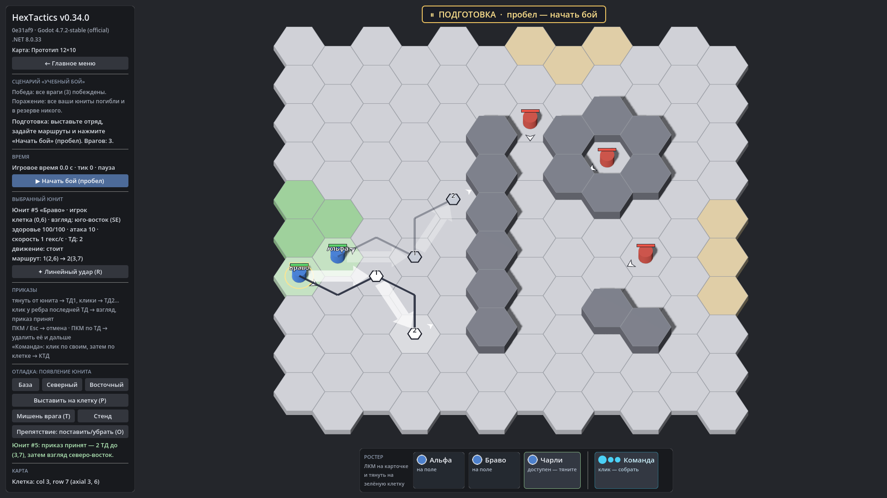

# HexTactics v0.34.0 — сценарии: обычный бой

**Дата:** 2026-11-09 · **Тег:** `v0.34.0` · **ТЗ:** часть 7 (`docs/GAME_SPEC_PART7.md`), §2 (архитектура сценариев), §3 (обычный
бой), §9.1, §9.3, §10, §12.1 (M7-01…M7-04), §12.6 (M7-51, M7-54, M7-59, M7-60), §13 (строка v0.31.0 → v0.34.0, D-150)
**Движок:** Godot 4.7.2 stable .NET · **.NET:** SDK 8.0.133, рантайм 8.0 (`net8.0`)
**Архив:** `release_archives/v0.34.0/HexTactics_v0.34.0_windows_x64.zip` (+ `.sha256`, `BUILD_INFO.txt`)

## Что сделано

- **«Сценарии»** — одна новая категория каталога: карта, тип (четыре карточки; выбирается «Обычный бой», остальные — со
  своими версиями), правила боя, отряд игрока (1–5 карточек нижней панели), враги, которые уже стоят на карте, автоатака,
  блок, подготовка на паузе, ограничение времени. Встроенный пример — «Учебный бой».
- **Редактор сценария**: карта посередине — ЛКМ по гексу ставит врага, ЛКМ по врагу выбирает, ПКМ убирает, Q / E
  поворачивают; отряд, правила, «✎ Открыть карту в редакторе», «Сценарий словами» с целями, проверка с картой и юнитами
  (враг на препятствии, нет юнита, нет гексов выставления — с объяснением), «▶ Тест сценария», Undo/Redo.
- **Бой сценария**: «Подготовка» на паузе — выставить отряд и задать маршруты прежним жестом, затем «▶ Начать бой»; победа —
  последний враг побеждён; поражение — отряд погиб и выставить некого (пустая панель при доступном резерве — не поражение)
  или вышло время. Итог сразу останавливает бой; баннер «ПОДГОТОВКА» / «ПОБЕДА» / «ПОРАЖЕНИЕ», цели и число врагов слева.
- **Стартовое меню**: список «Сценарий» (по умолчанию — свободная игра, как раньше).
- Пакет `.hxp` сценария несёт его карту и своих юнитов.

## Проверено

- `dotnet test`: Core 98, Simulation 292 (+4: `ScenarioObjectiveTests`), Interaction 98, Content 123 (+6:
  `ScenarioContentTests`), Editor 118 (+5: `ScenarioEditorTests`) — 729, все зелёные.
- Windows-сборка под Wine (1600 × 900): регрессия — **1058 проверок** (860 + 198: два запуска подряд, D-164) (все сценарии v0.5–v0.33 и сценарий v0.34:
  «Засада» в редакторе — враг щелчком, поворот на север, отказ на препятствии, отмена и возврат, отряд из одного; её тест от
  «Подготовки» до «Победы»; «Учебный бой» из меню — три врага и три карточки); второй запуск — **119** (сценарий
  сохранился и играется из меню); чистая установка — **35**.
- Карта приёмки — `docs/ACCEPTANCE_PART7.md` (M7-01…M7-04, M7-36…M7-51, M7-53…M7-55, M7-57, M7-59, M7-60; M7-05 — с
  простым ИИ в v0.37.0).

## Запуск

Распаковать ZIP, запустить `HexTactics.exe` (Windows 10/11 x64, OpenGL 3.3). Управление — `docs/CONTROLS.md`, редакторы —
`docs/EDITOR_GUIDE.md` («Сценарии: обычный бой»), форматы — `docs/CONTENT_FORMAT.md` (§3.15), миграции — `docs/MIGRATIONS.md`.

## Возврат к этой версии

- Сборка: `pwsh tools/restore_version.ps1 -Version 0.34.0`; исходники: `git checkout v0.34.0`.
- Новый вид `scenario` (схема 1); схемы прежних видов те же. v0.33.0 папку `scenarios/` не знает и не трогает — сценарии
  вернутся после обновления; пакет со сценарием v0.33.0 не установит.
