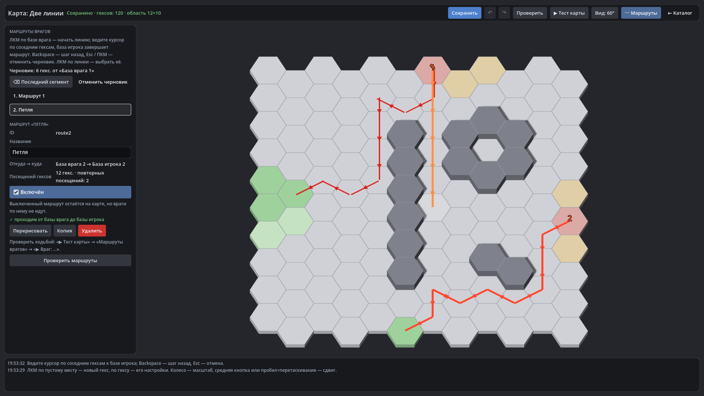

# HexTactics v0.35.0 — маршруты врагов: красная линия

**Дата:** 2026-11-09 · **Тег:** `v0.35.0` · **ТЗ:** часть 7 (`docs/GAME_SPEC_PART7.md`), §4.1–4.4 (базы, маршруты, редактор
линии, проверка, прохождение), §10, §11.2, §12.2 (M7-06…M7-13, M7-15, M7-16), §13 (строка v0.32.0 → v0.35.0, D-150)
**Движок:** Godot 4.7.2 stable .NET · **.NET:** SDK 8.0.133, рантайм 8.0 (`net8.0`)
**Архив:** `release_archives/v0.35.0/HexTactics_v0.35.0_windows_x64.zip` (+ `.sha256`, `BUILD_INFO.txt`)

## Что сделано

- **Маршруты врагов в карте**: устойчивый ID, название, база врага → база игрока, упорядоченные посещения гексов
  (повторы и пересечения разрешены). Базы нумеруются — у каждой стороны их может быть несколько.
- **«〰 Маршруты» в редакторе карт**: ЛКМ по базе врага, дальше линия тянется за курсором по соседним гексам (быстрое
  движение мыши — только соседи по пути курсора), база игрока завершает маршрут одним отменяемым шагом. Препятствие или
  пустое место останавливают черновик и называют гекс; Backspace, Esc, ПКМ меняют только черновик. Карточка: название,
  откуда → куда, повторы, «Включён», проблемы, «Перерисовать» (ID остаётся), «Копия», «Удалить»; «Проверить маршруты».
- **Проверка** той же проходимостью, что движение; удалённый под маршрутом гекс — предупреждение с шагом и гексом.
- **Прохождение**: враг идёт строго по посещениям, ждёт занятый гекс без обхода и не переходит на чужую линию; блок
  удерживает его; плавная траектория не выходит за гексы маршрута.
- **В игре** линии скрыты; в отладке — «Показать линии маршрутов» и «▶ Враг: …».

## Проверено

- `dotnet test`: Core 98, Simulation 298 (+6: `RouteFollowTests`), Interaction 98, Content 127 (+4: `RouteContentTests`),
  Editor 125 (+7: `RouteEditorTests`) — 746, все зелёные.
- Windows-сборка под Wine (1600 × 900): регрессия — **1098 проверок** (860 + 238: два запуска подряд, D-164) (все сценарии v0.5–v0.34 и сценарий v0.35: «Две линии» —
  две базы врага и две базы игрока, линия курсором, «Петля» с повторами, остановка на препятствии, Backspace/Esc/ПКМ,
  скачок мыши; в тесте карты линии скрыты до «Показать», враги проходят обе линии до баз); второй запуск — **125**
  (маршруты сохранились); чистая установка — **35**.
- Карта приёмки — `docs/ACCEPTANCE_PART7.md` (M7-06…M7-13, M7-15, M7-16; M7-14 — с волнами в v0.36.0).

## Запуск

Распаковать ZIP, запустить `HexTactics.exe` (Windows 10/11 x64, OpenGL 3.3). Управление — `docs/CONTROLS.md`, редакторы —
`docs/EDITOR_GUIDE.md` («Маршруты врагов»), форматы — `docs/CONTENT_FORMAT.md` (§3.2: `routes`, `bases`, `base`), миграции —
`docs/MIGRATIONS.md`.

## Возврат к этой версии

- Сборка: `pwsh tools/restore_version.ps1 -Version 0.35.0`; исходники: `git checkout v0.35.0`.
- Схемы те же (новые поля карты необязательные). v0.34.0 сохраняет `routes` и `bases` как незнакомые поля, но номер базы в
  гексе при пересохранении карты в v0.34.0 теряется (все базы — №1).
