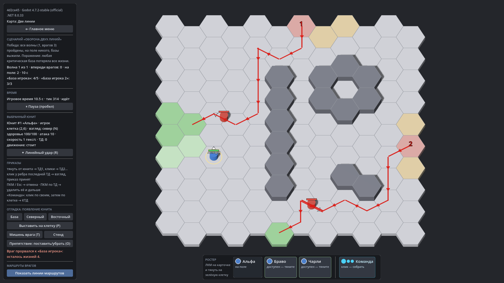

# HexTactics v0.36.0 — Tower Defense: волны, очереди, жизни баз

**Дата:** 2026-11-09 · **Тег:** `v0.36.0` · **ТЗ:** часть 7 (`docs/GAME_SPEC_PART7.md`), §4.5–4.7 (волны и тайминги, базы и
утечки, экран боя), §10, §11, §12.3 (M7-17…M7-25), §13 (строка v0.33.0 → v0.36.0, D-150)
**Движок:** Godot 4.7.2 stable .NET · **.NET:** SDK 8.0.133, рантайм 8.0 (`net8.0`)
**Архив:** `release_archives/v0.36.0/HexTactics_v0.36.0_windows_x64.zip` (+ `.sha256`, `BUILD_INFO.txt`)

## Что сделано

- **Режим «Tower Defense»** в сценариях: волны (старт после окончания предыдущей, в секунду боя или после начала предыдущей,
  задержка) из групп — маршрут карты, юнит, число, задержка первого, интервал, сдвиг; суммы врагов считаются сами; копия,
  перестановка, выключение волн. На поле редактора — красные линии маршрутов карты.
- **Очереди входов**: враги ждут свободного первого гекса маршрута по одному, без наложений; время — игровые секунды, пауза
  останавливает таймеры и очереди.
- **Жизни баз**: у каждой базы игрока свои жизни и «критическая»; прорвавшийся враг снимает жизнь только своей базы и исчезает;
  политика поражения выбирается явно.
- **Победа** — все волны пройдены и врагов нет; сценарий с удалённым или сломанным маршрутом не запускается и называет волну и
  группу.
- **В бою** — номер волны, враги впереди и на поле, жизни баз, сообщения о прорывах.

## Проверено

- `dotnet test`: Core 98, Simulation 307 (+9: `WaveTests`), Interaction 98, Content 131 (+4: `TowerDefenseContentTests`),
  Editor 128 (+3: `TowerDefenseEditorTests`) — 762, все зелёные.
- Windows-сборка под Wine (1600 × 900): регрессия — **@SMOKE@ проверок** (все сценарии v0.5–v0.35 и сценарий v0.36: «Оборона двух
  линий» — волна из двух групп на «Маршрут 1» и «Петля», копия выключена, жизни 5 и 3; в тесте трое врагов прорываются каждый к
  своей базе (5 → 3, 3 → 2), волна пройдена — «Победа»); второй запуск — **@RESTART@** (волны и жизни сохранились); чистая
  установка — **@CLEAN@**.
- Карта приёмки — `docs/ACCEPTANCE_PART7.md` (M7-14, M7-17…M7-25).

## Запуск

Распаковать ZIP, запустить `HexTactics.exe` (Windows 10/11 x64, OpenGL 3.3). Управление — `docs/CONTROLS.md`, редакторы —
`docs/EDITOR_GUIDE.md` («Tower Defense: волны и базы»), форматы — `docs/CONTENT_FORMAT.md` (§3.15), миграции — `docs/MIGRATIONS.md`.

## Возврат к этой версии

- Сборка: `pwsh tools/restore_version.ps1 -Version 0.36.0`; исходники: `git checkout v0.36.0`.
- Схемы те же (поля волн необязательные). v0.35.0 сохраняет волны как незнакомые поля, но сценарий Tower Defense там не
  запускается до обновления; обычный бой работает.
