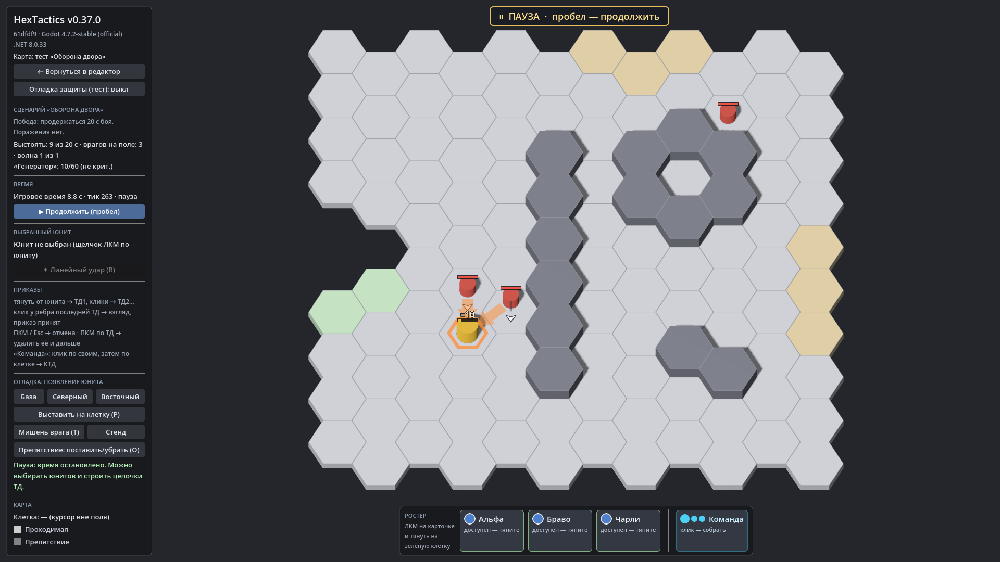

# HexTactics v0.37.0 — «Оборона»: простой ИИ, объекты миссии

**Дата:** 2026-11-10 · **Тег:** `v0.37.0` · **ТЗ:** часть 7 (`docs/GAME_SPEC_PART7.md`), §3.3 (охранник в обычном бою), §5
(оборона: источники без маршрута, простой ИИ, победа и поражение, редактор), §10, §11, §12.1 (M7-05), §12.4 (M7-26…M7-30,
M7-35 для обороны), §12.6 (M7-60), §13 (строка v0.34.0 → v0.37.0, D-150)
**Движок:** Godot 4.7.2 stable .NET · **.NET:** SDK 8.0.133, рантайм 8.0 (`net8.0`)
**Архив:** `release_archives/v0.37.0/HexTactics_v0.37.0_windows_x64.zip` (+ `.sha256`, `BUILD_INFO.txt`)

## Что сделано

- **Режим «Оборона»** без базы игрока: волны выходят из баз врага и зон появления карты (или идут по маршруту); победа —
  выстоять заданное время боя или отбить все волны; поражение — потеря критических объектов (все должны уцелеть или хотя бы
  один), гибель всего отряда (по выбору), время.
- **Простой ИИ** — пять пресетов: к объекту, атаковать юнитов, сначала юниты — потом объект, сначала объект — потом юниты,
  охранник. Дальность обнаружения, приоритет, пересмотр цели и реакция на блок; без смены целей каждый тик, с запасной целью
  при гибели или без пути. Охранник ставится и в обычный бой.
- **Объекты миссии** — неподвижные защищаемые точки с здоровьем и флагом «критический», без приказов; урон — общий конвейер.
- **Редактор**: шаблоны «Выстоять время», «Защитить объект», «Отбить все волны»; объекты кистью; у группы «Откуда» и
  «Поведение»; редкие настройки ИИ — за «Дополнительно ▾».
- **В бою** — «Выстоять: X из Y с», здоровье объектов, баннеры итога.

## Проверено

- `dotnet test`: Core 98, Simulation 313 (+6: `AiTests`), Interaction 98, Content 131, Editor 134 (+6: `DefenseScenarioTests`) —
  774, все зелёные.
- Windows-сборка под Wine (1600 × 900): регрессия — **@SMOKE@ проверок** (все сценарии v0.5–v0.36 и сценарий v0.37: «Двор» —
  копия прототипа без базы игрока; оборона «Оборона двора» из шаблона «Защитить объект»: выстоять 20 с, «Генератор» 60 HP,
  охранник с радиусом 2, волна из двух врагов из зоны «Северный край» к объекту, «Дополнительно» ИИ; в первом тесте
  критический «Генератор» уничтожен — «Поражение», охранник на посту; некритический — «Победа» через 20 с); второй запуск —
  **@RESTART@** (объект, ИИ группы и охранника сохранились); чистая установка — **@CLEAN@**.
- Карта приёмки — `docs/ACCEPTANCE_PART7.md` (M7-05, M7-26…M7-30, M7-35, M7-60).

## Запуск

Распаковать ZIP, запустить `HexTactics.exe` (Windows 10/11 x64, OpenGL 3.3). Управление — `docs/CONTROLS.md`, редакторы —
`docs/EDITOR_GUIDE.md` («Оборона: объекты, источники и простой ИИ»), форматы — `docs/CONTENT_FORMAT.md` (§3.15), миграции —
`docs/MIGRATIONS.md`.

## Возврат к этой версии

- Сборка: `pwsh tools/restore_version.ps1 -Version 0.37.0`; исходники: `git checkout v0.37.0`.
- Схемы те же (поля обороны необязательные). v0.36.0 не запускает сценарий обороны; пересохранение в ней теряет источники и ИИ
  групп — перед откатом экспортируйте сценарий в `.hxp` (`docs/MIGRATIONS.md`).
