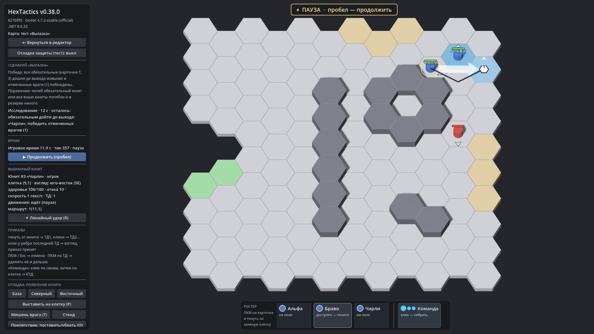

# HexTactics v0.38.0 — «Исследование»: вход, выход, правило победы

**Дата:** 2026-11-14 · **Тег:** `v0.38.0` · **ТЗ:** часть 7 (`docs/GAME_SPEC_PART7.md`), §6 (исследование: вход и выход, правило
победы, бои по пути, проверка, редактор), §10, §11, §12.4 (M7-31…M7-35), §12.6 (M7-51, M7-54, M7-60), §13 (строка v0.35.0 →
v0.38.0, D-150)
**Движок:** Godot 4.7.2 stable .NET · **.NET:** SDK 8.0.133, рантайм 8.0 (`net8.0`)
**Архив:** `release_archives/v0.38.0/HexTactics_v0.38.0_windows_x64.zip` (+ `.sha256`, `BUILD_INFO.txt`)

## Что сделано

- **Режим «Исследование»**: отряд выходит только на гексах входа и идёт к выходу; победа — ключевой юнит (по умолчанию),
  любой выживший или все обязательные дошли до выхода живыми; дошедший запоминается. Побеждать всех врагов не нужно, если это не
  выбрано задачей: «победить отмеченных врагов» или «зачистить карту». Поражение — гибель ключевого или обязательного, гибель
  всего отряда, время.
- **Проверка до теста**: вход и выход есть, выход достижим от входа по проходимым гексам, вход свободен, правило и задача
  выполнимы.
- **Редактор**: список шагов шаблона, кисти «Вход» / «Выход», правило победы, ключевой или обязательные, дополнительная
  задача, «Цель задачи» у врага.
- **В бою**: подсвеченные вход и выход, строка «осталось: …», сообщение, когда кто-то дошёл, а задача ещё не выполнена.
- Теперь исполняются все четыре типа сценариев: обычный бой, Tower Defense, оборона, исследование.

## Проверено

- `dotnet test`: Core 98, Simulation 319 (+6: `ExplorationTests`), Interaction 98, Content 137 (+6: `ExplorationContentTests`),
  Editor 137 (+3: `ExplorationEditorTests`) — 789, все зелёные.
- Windows-сборка под Wine (1600 × 900): регрессия — **@SMOKE@ проверок** (все сценарии v0.5–v0.37 и сценарий v0.38: «Вылазка»
  на «Двор» — вход из двух гексов выставления, выход кистью (повторный щелчок убирает гекс), враг на 10,4, «все обязательные»
  — карточки 1 и 3, задача «победить отмеченных» — ошибка до отметки; в тесте выставление вне входа отклонено, обе
  обязательные карточки дошли до выхода, бой идёт, пока жив отмеченный враг, затем «Победа»; сценарий доступен в стартовом
  меню); второй запуск — **@RESTART@** (вход, выход, правило, задача и цель сохранились); чистая установка — **@CLEAN@**.
- Карта приёмки — `docs/ACCEPTANCE_PART7.md` (M7-31…M7-35, M7-51, M7-54, M7-60).

## Запуск

Распаковать ZIP, запустить `HexTactics.exe` (Windows 10/11 x64, OpenGL 3.3). Управление — `docs/CONTROLS.md`, редакторы —
`docs/EDITOR_GUIDE.md` («Исследование: вход, выход и правило победы»), форматы — `docs/CONTENT_FORMAT.md` (§3.15), миграции —
`docs/MIGRATIONS.md`.

## Возврат к этой версии

- Сборка: `pwsh tools/restore_version.ps1 -Version 0.38.0`; исходники: `git checkout v0.38.0`.
- Схемы те же (поля исследования необязательные). v0.37.0 не запускает исследование; пересохранение в ней теряет отметки
  врагов-целей — перед откатом экспортируйте сценарий в `.hxp` (`docs/MIGRATIONS.md`).
