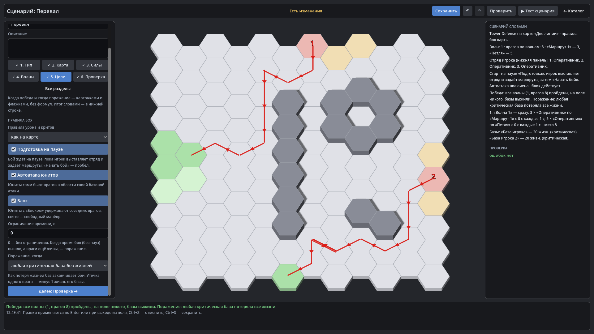

# HexTactics v0.39.0 — мастер сценария, перенос, сквозная регрессия

**Дата:** 2026-11-14 · **Тег:** `v0.39.0` · **ТЗ:** часть 7 (`docs/GAME_SPEC_PART7.md`), §9.1–9.3 (мастер, переходы, итог,
ошибки с переходом, перенос), §12.6 (M7-52, M7-54, M7-58…M7-60), §13 (строка v0.36.0 → v0.39.0, D-150); план части 7 выполнен
(D-195)
**Движок:** Godot 4.7.2 stable .NET · **.NET:** SDK 8.0.133, рантайм 8.0 (`net8.0`)
**Архив:** `release_archives/v0.39.0/HexTactics_v0.39.0_windows_x64.zip` (+ `.sha256`, `BUILD_INFO.txt`)

## Что сделано

- **Мастер сценария**: новый сценарий открывается шагами «Тип → Карта → Силы → Волны (или Волны и ИИ) → Цели → Проверка» —
  у каждого шага объяснение, ✓ без ошибок, «Далее →»; шаги, не нужные типу, скрыты; «Все разделы» — всё одним списком.
- **«Перейти и исправить»**: под ошибкой «Проверки» — кнопка, которая выбирает врага, объект, волну или кисть и открывает шаг.
- **Строка целей** — «Победа: … Поражение: …» всегда внизу редактора.
- **«✎ Юнит в библиотеке»** у врага и группы волны — редактор юнита поверх сценария.
- **Перенос**: сценарии всех четырёх типов уходят одним пакетом `.hxp` с картами и маршрутами и играются на другой установке.
- **В бою** отмеченные враги исследования — оранжевые.

## Проверено

- `dotnet test`: Core 98, Simulation 319, Interaction 98, Content 137, Editor 145 (+8: `ScenarioWizardTests`,
  `DefenseScenarioTests.M7_58`) — 797, все зелёные.
- Windows-сборка под Wine (1600 × 900): регрессия — **1235 проверок** (860 + 375: два запуска подряд, D-164) (все сценарии v0.5–v0.38 и сценарий v0.39: бой
  «Мастер» шагами мастера — «Далее», «Волны» скрыты, «Перейти и исправить» ведёт к «Силам», враг делает все шаги ✓, строка
  целей, «✎ Юнит в библиотеке» и обратно, «Все разделы»; экспорт «Засады», «Обороны двух линий», «Обороны двора» и «Вылазки»
  пакетом «Сценарии» — 6 объектов); второй запуск — **148** («Мастер» открывается на «Все разделы», все шаги ✓);
  чистая установка — **68** (прежние пакеты и «Сценарии.hxp»: все четыре сценария в меню, Tower Defense — «Победа» с теми
  же утечками, оборона — 20 с, исследование — до выхода и «Победы»).
- Карта приёмки — `docs/ACCEPTANCE_PART7.md`: M7-01…M7-60 приняты.

## Запуск

Распаковать ZIP, запустить `HexTactics.exe` (Windows 10/11 x64, OpenGL 3.3). Управление — `docs/CONTROLS.md`, редакторы —
`docs/EDITOR_GUIDE.md` («Мастер сценария»), форматы — `docs/CONTENT_FORMAT.md` (§3.15), миграции — `docs/MIGRATIONS.md`.

## Возврат к этой версии

- Сборка: `pwsh tools/restore_version.ps1 -Version 0.39.0`; исходники: `git checkout v0.39.0`.
- Схемы данных те же, что в v0.38.0: откат на v0.38.0 без потерь (меняется только редактор).
