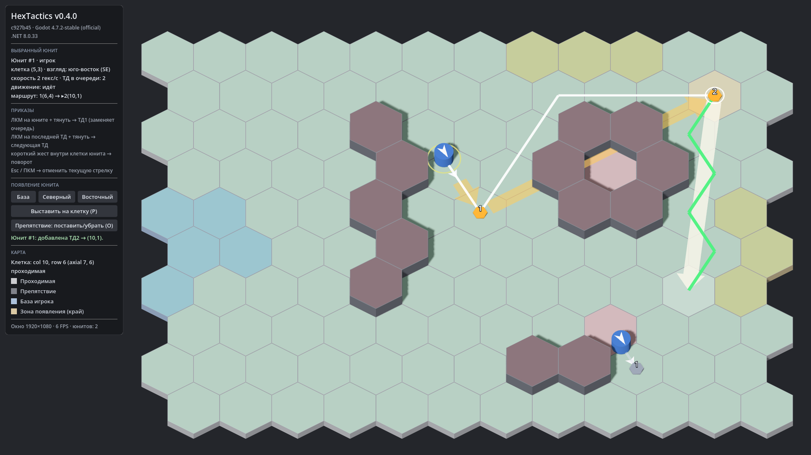

# HexTactics v0.4.0 — путь и подсветка

**Дата:** 2026-11-05 · **Тег:** `v0.4.0` · **Этап ТЗ:** 1, версия «путь и подсветка» (§1.1)
**Движок:** Godot 4.7.2 stable .NET (`4.7.2.stable.mono.official.ed1daf0bf`) · **.NET:** SDK 8.0.133, рантайм 8.0 (`net8.0`)
**Архив:** `release_archives/v0.4.0/HexTactics_v0.4.0_windows_x64.zip` (+ `.sha256`, `BUILD_INFO.txt` с коммитом и датой сборки)

## Функции

- **Кратчайший маршрут** (ТЗ §6.1): A* на шести соседях с эвристикой cube distance; стоимость перехода 1, поддержка весов.
  Непроходимые клетки и другие юниты — препятствия на всех шагах пути, своя клетка — нет. При нескольких равных путях
  результат повторяем и тяготеет к прямой линии.
- **Подсветка** (§6.2): при протягивании подсвечены все 120 клеток — зелёные (достижимы и свободны), красные
  (препятствие, занято, изолировано), жёлтая — исходная клетка. Заливка мягкая (α 0,15), поверхность видна.
  Множество достижимых клеток считается при начале протягивания и пересчитывается при изменении игрового состояния.
- **Запрет недостижимых ТД**: на свободную, но изолированную клетку (на карте — «карман» в кольце препятствий) ТД не ставится.
- **Предпросмотр**: тонкая зелёная линия кратчайшего пути к клетке под курсором (отдельно от толстой прямой стрелки);
  юнит предварительно смотрит по первому шагу пути, а не по прямой.
- **Движение по цепочке** (§6.3): юнит идёт текущее положение → ТД1 → ТД2 → … со скоростью 2 гекса/с, плавно между
  центрами гексов; достигнутая ТД удаляется из очереди; взгляд поворачивается по каждому шагу. Белая тонкая линия
  показывает оставшийся маршрут выбранного юнита.
- **Один юнит — одна логическая клетка**: переход логической занятости — ровно в середине шага; клетка шага резервируется.
- **Изменение препятствий**: маршрут перестраивается; если пути нет — юнит останавливается в центре гекса (красный «!»),
  приказы сохраняются, причина в панели; движение продолжается, когда путь появится.
- **Команды на ходу**: новое протягивание из идущего юнита заменяет очередь и начинается с клетки, в которую он шагает
  (текущий шаг не прерывается); из последней ТД — дополняет очередь.
- **Отладка**: «Препятствие (O)» — поставить/убрать препятствие щелчком, чтобы проверить перестроение.

## Ограничения

- Тактическая пауза (пробел) — v0.5.0. Сейчас время идёт постоянно, протягивать приказы можно и во время движения.
- Юниты не «уступают» друг другу дорогу специально: при встречном движении маршрут перестраивается вокруг занятых клеток.
- Разные стоимости местности поддержаны алгоритмом, но на карте пока все клетки стоят 1.

## Изменения относительно v0.3.0

- Core: `Pathfinder`, `UnitMotion`, резервирование клеток в `GameState`, `WaypointRules` с проверкой пути.
- Simulation: `SimulationClock` (1/30 с), `MovementSystem`, `Advance`/`Step`, `SetObstacle`, новые события движения.
- Interaction: достижимость, статус `Unreachable`, путь в `DragPreview`, `Refresh()` каждый кадр, режим препятствий.
- Клиент: подсветка всех клеток, тонкие линии путей, интерполяция движения, маркер остановки, сообщения о движении.
- Всё из v0.1–v0.3 сохранено (появление, выбор, стрелки, цепочки, поворот жестом, отмена).

## Проверено

- `dotnet test`: 143 теста (Core 53, Simulation 53, Interaction 37), в т. ч. сверка длины A* с эталонным BFS для всех пар
  клеток карты, детерминизм, изолированная цель, обход стены, веса; движение: 2 гекса/с (60 тиков на 4 гекса),
  середина шага, порядок ТД, обход, взгляд по шагу, остановка/возобновление, занятая ТД, встречное движение без
  наложения, команды на ходу, одинаковое состояние при 30/60/144 FPS.
- Сценарии в собранной игре: протягивание за стену (подсветка, путь, предпросмотр взгляда), движение двух юнитов по
  цепочкам, блокировка цели препятствиями во время движения (остановка с «!» и причиной).
- Экспорт «Windows Desktop», смоук-запуск `HexTactics.console.exe` (`tools/verify_release.ps1 -Run`).

## Запуск

Распаковать ZIP, запустить `HexTactics.exe` (Windows 10/11 x64, OpenGL 3.3). .NET устанавливать не нужно.

## Внутренняя архитектура

- Поток кадра: `GameSimulation.Advance(delta)` (целые тики) → события движения → `InputStateMachine.Refresh()` →
  `UnitsView` (интерполяция), `OrdersView` (стрелки, ТД, пути), `HexFillLayer` (подсветка).
- Подробно: `docs/ARCHITECTURE.md` §7.2, решения D-024…D-029.

## Возврат к этой версии

- Сборка: `pwsh tools/restore_version.ps1 -Version 0.4.0` или вручную распаковать ZIP из `release_archives/v0.4.0/`.
- Исходники: `git checkout v0.4.0` или `pwsh tools/restore_version.ps1 -Version 0.4.0 -Mode Source`.
- Предыдущие версии: v0.3.0, v0.2.0, v0.1.0 (`release_archives/`).
