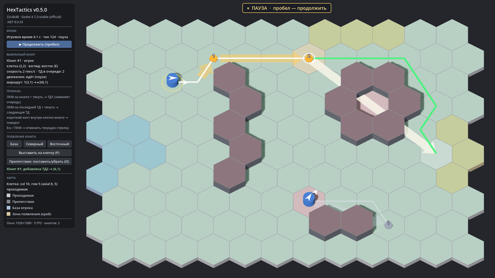

# HexTactics v0.5.0 — тактическая пауза и техническая стабилизация

**Дата:** 2026-11-05 · **Тег:** `v0.5.0` · **Этап ТЗ:** 1, версия «тактическая пауза и техническая стабилизация» (§1.1) —
**последняя версия этапа 1**
**Движок:** Godot 4.7.2 stable .NET (`4.7.2.stable.mono.official.ed1daf0bf`) · **.NET:** SDK 8.0.133, рантайм 8.0 (`net8.0`)
**Архив:** `release_archives/v0.5.0/HexTactics_v0.5.0_windows_x64.zip` (+ `.sha256`, `BUILD_INFO.txt` с коммитом и датой сборки)

## Функции

- **Тактическая пауза** (ТЗ §7): пробел или кнопка в панели. Останавливаются движение, действия юнитов и игровой
  таймер; камера, мышь, выбор, подсветка и создание цепочек ТД продолжают работать. После снятия юниты выполняют
  приказы из сохранённого состояния: время паузы не накапливается, скачка нет.
- **Игровое время отделено от времени отрисовки**: фиксированный шаг 1/30 с, не более 8 тиков за кадр;
  в панели — игровое время и номер тика. Над полем — баннер «ПАУЗА».
- **Точка расширения правил**: `ISimulationSystem` — способности, атаки, волны и эффекты будут подключаться отдельными
  системами и событиями, не вмешиваясь в обработку мыши.
- **Регрессия**: приёмочные тесты по §8 ТЗ, тесты паузы; сквозной сценарий с проверками в самой Windows-сборке.
- Все функции этапа 1: поле 12×10 и камера 60° (v0.1), юниты и три способа появления (v0.2), стрелки-приказы,
  цепочки ТД и поворот жестом (v0.3), кратчайший путь, подсветка и движение (v0.4).

## Ограничения

- Боевая система, здоровье, способности, классы, ИИ, волны, экономика, редактор карт, мультиплеер — вне этапа 1 (ТЗ §9).
- Удаление/перестроение отдельных ТД и продолжение цепочки из промежуточной ТД — отдельный этап (D-019).
- Зум/панорамирование камеры не реализованы (выбор клеток к ним готов).
- Q/E (поворот) и «Препятствие (O)» — отладочные средства.

## Изменения относительно v0.4.0

- Simulation: пауза (`SetPaused`, `TogglePause`, `IsPaused`, `PauseChanged`), `ISimulationSystem`/`SimulationContext`.
- Клиент: действия InputMap (`hx_toggle_pause` — пробел, `hx_cancel_order` — Esc), баннер паузы, игровое время.
- Автоматизация: `pause`, `mark`, `ticks`, `waitidle`, `expect:*`, код выхода при провале.
- `tools/verify_release.ps1 -Run`: сквозной регрессионный сценарий в экспортированной сборке (для v0.5.0+).

## Проверено

- `dotnet test`: **160 тестов** (Core 53, Simulation 59, Interaction 48). Минимальный набор из ТЗ §8 покрыт:
  offset ↔ cube; число и симметрия соседей; расстояние; проходимость; A* на пустой карте; кратчайший обход препятствия;
  изолированная цель; детерминизм; валидация ТД; последовательность ТД; шесть ориентаций; работа паузы; три способа спавна.
- Приёмочные тесты A01–A12 (§8): 120 гексов; крайние клетки; три способа появления и безопасный отказ; 6 направлений и
  поворот жестом; ТД1 по удержанию; ТД1→ТД2→ТД3 строго по порядку; обход препятствия между ТД; красная изолированная
  клетка; повторяемость путей и безопасность неверных целей; отмена без потери ТД; пауза + изменение приказа + продолжение.
- Сквозной сценарий в собранной игре (13 проверок `expect:`): появление, ТД, пауза замораживает тик, ТД2 на паузе, после
  снятия юнит проходит обе ТД, поворот жестом на юго-запад, выставление, отказ на изолированную клетку.
- Визуально: 1920×1080, 1600×900, 1366×768, 1280×600; пауза с построением цепочки.
- Экспорт «Windows Desktop», проверка архива и сценарий в `HexTactics.console.exe` (`tools/verify_release.ps1 -Run`).

## Запуск

Распаковать ZIP, запустить `HexTactics.exe` (Windows 10/11 x64, OpenGL 3.3). .NET устанавливать не нужно.
`HexTactics.console.exe` — то же с консолью (лог).

## Внутренняя архитектура

- `HexTactics.Core` → `HexTactics.Simulation` → `HexTactics.Interaction` → клиент Godot `HexTactics` (только отображение и ввод).
- Подробно: `docs/ARCHITECTURE.md` §7.3, решения D-030…D-032.

## Возврат к этой версии

- Сборка: `pwsh tools/restore_version.ps1 -Version 0.5.0` или вручную распаковать ZIP из `release_archives/v0.5.0/`.
- Исходники: `git checkout v0.5.0` или `pwsh tools/restore_version.ps1 -Version 0.5.0 -Mode Source`.
- Предыдущие версии: v0.4.0 … v0.1.0 (`release_archives/`).
