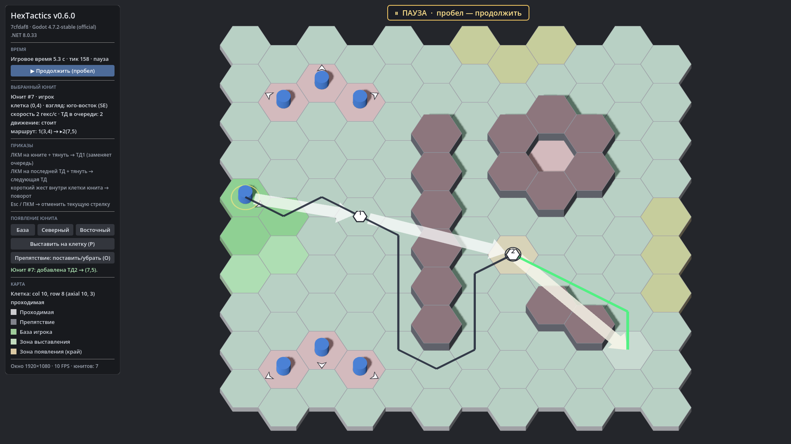

# HexTactics v0.6.0 — flat-top поле, указатель взгляда у ребра, стрелки поверх сцены

**Дата:** 2026-11-06 · **Тег:** `v0.6.0` · **ТЗ:** часть 2 (редакция 0.2), §2, §3; план версий — DECISIONS D-033
**Движок:** Godot 4.7.2 stable .NET (`4.7.2.stable.mono.official.ed1daf0bf`) · **.NET:** SDK 8.0.133, рантайм 8.0 (`net8.0`)
**Архив:** `release_archives/v0.6.0/HexTactics_v0.6.0_windows_x64.zip` (+ `.sha256`, `BUILD_INFO.txt`)

## Функции

- **Геометрия flat-top** (ТЗ ч.2 §2): 12 × 10 = 120 правильных гексов с горизонтальными верхним и нижним рёбрами,
  хранение odd-q (нечётные колонки ниже на половину гекса), правила — axial/cube, ровно шесть соседей. Колонка — прямая
  вертикальная линия гексов. Бледные границы без щелей, полупрозрачные подсветки, ортографическая камера 60° сохранены.
- **Шесть направлений по рёбрам**: север (верхнее ребро), северо-восток, юго-восток, юг, юго-запад, северо-запад.
  Поворот, поиск пути, попадание мышью и сектора жестов считаются в плоскости карты, не по экранному углу.
- **Указатель взгляда** (§3.2): маленькая белая стрелка у ребра гекса юнита, в которое он смотрит, с тёмной обводкой;
  видна всегда, при движении показывает направление текущего шага.
- **Стрелки поверх сцены** (§3.1): толстые белые стрелки приказов (ширина ½ стороны гекса в плоскости поля), линии маршрутов
  и маркеры ТД рисуются без теста глубины — их не перекрывают ни юниты, ни препятствия.
- **Карта прототипа** под flat-top: прямая стена (колонка 5), изолированный «карман» (8,3), скала, зелёная база,
  светло-зелёная зона выставления (для ростера в v0.8.0), северная и восточная зоны появления.
- Всё из v0.1–v0.5 работает на новой геометрии: появление тремя способами, выбор, стрелки и цепочки ТД, поворот жестом,
  A* с подсветкой всех клеток, движение по цепочке, остановка без пути, тактическая пауза.

## Ограничения

- Схема ввода пока как в v0.5.0 (протягивание из последней ТД). Непрерывная прокладка ТД кликами, обязательный финальный
  взгляд по секторам и новые правила отмены — v0.7.0; ростер — v0.8.0; команды — v0.9.0–v0.10.0.
- Старые версии v0.1.0–v0.5.0 остаются pointy-top (их архивы не меняются).

## Изменения относительно v0.5.0

- Core: `HexDirection` (flat-top), `HexCoord` (odd-q), `HexLayout` (flat-top), `TileType.DeployZone`, `@layout` в формате карты.
- Клиент: обход вершин мешей, указатель у ребра, материалы верхнего слоя (`NoDepthTest`), белые стрелки/маркеры, легенда.
- Миграция и решения: DECISIONS D-033…D-037, раздел «Миграции».

## Проверено

- `dotnet test`: 167 тестов (Core 59, Simulation 60, Interaction 48); новые проверки flat-top (odd-q эталоны, соседи по
  направлениям, плоский верх, рёбра ↔ направления, размеры поля, квантование), сверка A* с BFS на новой карте.
- Сквозной регрессионный сценарий (13 проверок) в собранной игре и в Windows-сборке (`verify_release.ps1 -Run`).
- Визуально: 1920×1080 и 1366×768, крайняя клетка (11,9), все шесть указателей взгляда, стрелки поверх стены.

## Запуск

Распаковать ZIP, запустить `HexTactics.exe` (Windows 10/11 x64, OpenGL 3.3).

## Возврат к этой версии

- Сборка: `pwsh tools/restore_version.ps1 -Version 0.6.0`; исходники: `git checkout v0.6.0`.
- Последняя pointy-top версия — v0.5.0 (`release_archives/v0.5.0/`).
