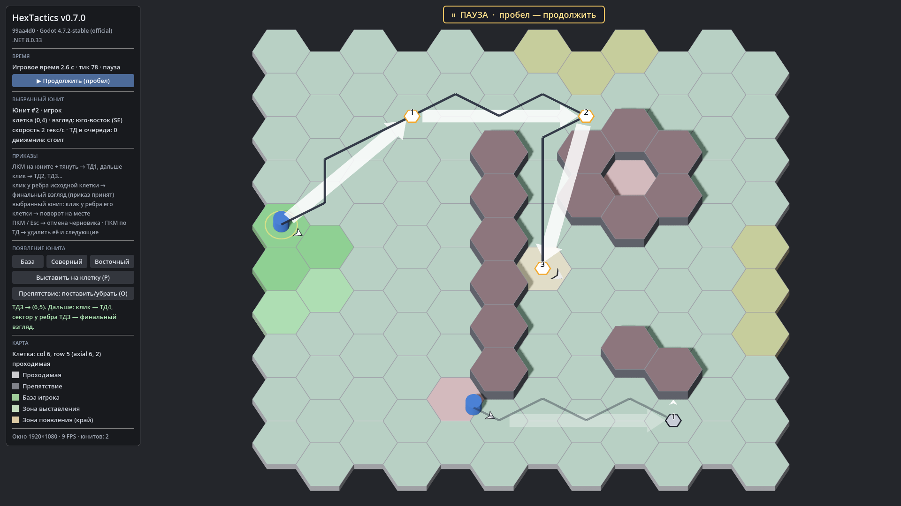

# HexTactics v0.7.0 — непрерывная прокладка ТД и обязательный финальный взгляд

**Дата:** 2026-11-06 · **Тег:** `v0.7.0` · **ТЗ:** часть 2, §4, §7, §8, §9 (план версий — DECISIONS D-033)
**Движок:** Godot 4.7.2 stable .NET · **.NET:** SDK 8.0.133, рантайм 8.0 (`net8.0`)
**Архив:** `release_archives/v0.7.0/HexTactics_v0.7.0_windows_x64.zip` (+ `.sha256`, `BUILD_INFO.txt`)

## Функции

- **ТД1 протягиванием, дальше — кликами.** После ТД1 режим прокладки не заканчивается: белая стрелка сама тянется от
  последней ТД к курсору, каждый клик ЛКМ по зелёной клетке ставит следующую ТД (без повторного захвата).
- **Обязательный финальный взгляд.** Шесть секторов у рёбер исходной клетки (юнита или последней ТД), нейтральный центр.
  Наведение — белая мини-стрелка у ребра; клик — приказ принят целиком. Без ТД — поворот на месте. Выбранного юнита
  можно повернуть кликом у ребра его клетки.
- **Транзакция.** До подтверждения взгляда юнит ничего не делает; подтверждение заменяет его очередь целиком, а если
  маршрут за это время стал невозможным — приказ не принимается и прежний маршрут сохраняется.
- **Финальный взгляд по прибытии** — независимо от направления последнего шага; в движении указатель показывает шаг.
- **Отмена.** ПКМ/Esc — весь черновик; клик по красной клетке — тоже; наведение — нет. ПКМ по ТД черновика или по
  принятой ТД выбранного юнита — удаление этой и следующих ТД.
- **Движущийся юнит.** Выбирается по корпусу или клетке; на паузе — новая цепочка от ближайшего центра гекса,
  после подтверждения она заменяет старые ТД; при снятии паузы текущий шаг продолжается плавно, отменённые ТД не исполняются.
- **Атака — резерв.** Клик по врагу при прокладке распознаётся как будущий `AttackTarget` (оранжевая стрелка), без исполнения.

## Ограничения

- Ростер и выставление перетаскиванием — v0.8.0; команды и КТД — v0.9.0–v0.10.0; боевые механики — отдельное ТЗ.
- Поворот «на промежуточной ТД с продолжением движения» — отдельный будущий тип приказа (§4.2).

## Проверено

- `dotnet test`: все тесты зелёные (Core 59, Simulation 68, Interaction 58), включая приёмочные A01–A12 (ч.1) в новых
  жестах и P01, P04–P07, P15–P18, P20 (ч.2 §12).
- Регрессионный сценарий в собранной игре и в Windows-сборке: 22 проверки (`verify_release.ps1 -Run`).
- Визуально: черновик из трёх ТД, предпросмотр сектора, сохранённый финальный взгляд, стрелки поверх препятствий.

## Запуск

Распаковать ZIP, запустить `HexTactics.exe` (Windows 10/11 x64, OpenGL 3.3). Управление — `docs/CONTROLS.md`.

## Возврат к этой версии

- Сборка: `pwsh tools/restore_version.ps1 -Version 0.7.0`; исходники: `git checkout v0.7.0`.
- Предыдущая схема управления (без финального взгляда) — v0.6.0.
