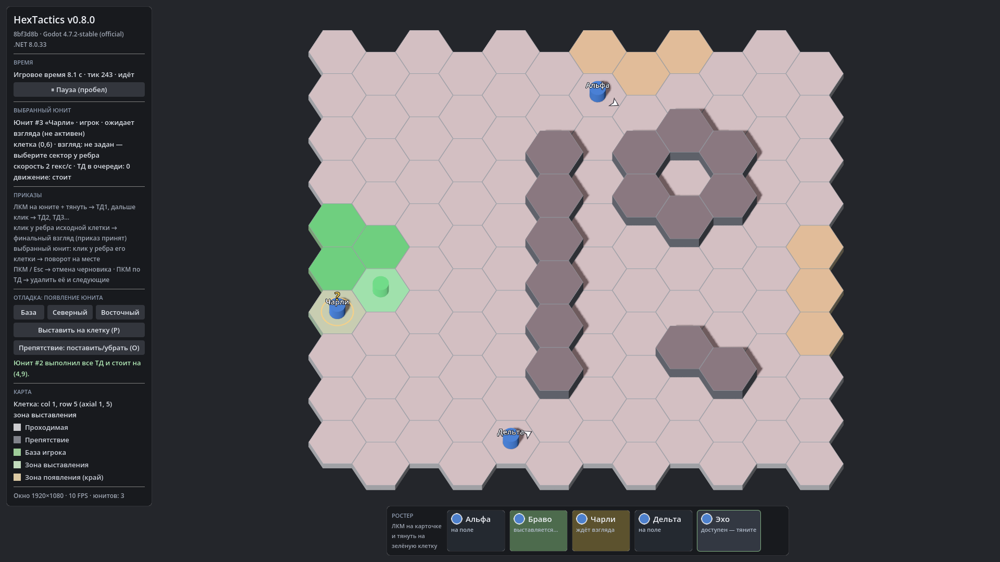

# HexTactics v0.8.0 — ростер и выставление перетаскиванием

**Дата:** 2026-11-06 · **Тег:** `v0.8.0` · **ТЗ:** часть 2, §5, §12.7–12.9 (план версий — DECISIONS D-033)
**Движок:** Godot 4.7.2 stable .NET · **.NET:** SDK 8.0.133, рантайм 8.0 (`net8.0`)
**Архив:** `release_archives/v0.8.0/HexTactics_v0.8.0_windows_x64.zip` (+ `.sha256`, `BUILD_INFO.txt`)

## Функции

- **Нижняя панель ростера.** Пять карточек оперативников (Альфа, Браво, Чарли, Дельта, Эхо): значок, имя, состояние.
  Панель не перекрывает поле — камера вписывает карту над ней.
- **Выставление перетаскиванием.** ЛКМ на карточке + протягивание: база и зона выставления карты зелёные, остальные
  клетки мягко-красные, под курсором — полупрозрачный юнит. Отпускание на зелёной клетке выставляет юнита и **сразу
  открывает белую стрелку приказа** от него — без повторного клика.
- **Возврат карточки.** Красная клетка, отпускание над панелью, ПКМ или Esc — карточка возвращается, на карте ничего
  не появляется, юнит не расходуется.
- **Взгляд обязателен.** Выставленный юнит без взгляда (жёлтый «?») не двигается и не действует. Первый принятый приказ
  (ТД… + финальный взгляд) или клик у ребра его клетки делает его активным. Отменённая стрелка оставляет его ждать;
  клик по юниту или по его карточке снова открывает стрелку.
- **Состояния** `AvailableInRoster`, `PlacementPreview`, `PlacedPendingFacing`, `Active`, `Unavailable` — в модели
  (`RosterState`) и на карточках.
- Разрешённые клетки — только из данных карты (база `B` и зона выставления `D`); краевые зоны появления игроку не
  разрешены автоматически. Отладочное появление (кнопки «База», «Северный», «Восточный», клавиша P) сохранено.

## Ограничения

- Ресурсы/лимиты оперативников не моделируются (будущий этап, §5.7); состояние `Unavailable` зарезервировано.
- Режим «Команда», голубые стрелки и КТД — v0.9.0–v0.10.0; боевые механики — отдельное ТЗ.

## Проверено

- `dotnet test`: Core 59, Simulation 86 (+18: `RosterTests`), Interaction 70 (+12: `RosterInteractionTests`, сценарии
  P07–P09), все зелёные.
- Регрессионный сценарий в собранной игре и в Windows-сборке: 42 проверки (`verify_release.ps1 -Run`) — сценарий v0.7 и
  выставление из ростера настоящими нажатиями на карточки панели.
- Визуально (1920×1080): перетаскивание карточки с подсветкой и «призраком», юнит с «?», активные юниты с подписями.

## Запуск

Распаковать ZIP, запустить `HexTactics.exe` (Windows 10/11 x64, OpenGL 3.3). Управление — `docs/CONTROLS.md`.

## Возврат к этой версии

- Сборка: `pwsh tools/restore_version.ps1 -Version 0.8.0`; исходники: `git checkout v0.8.0`.
- Предыдущая версия без ростера — v0.7.0 (`pwsh tools/restore_version.ps1 -Version 0.7.0`).
