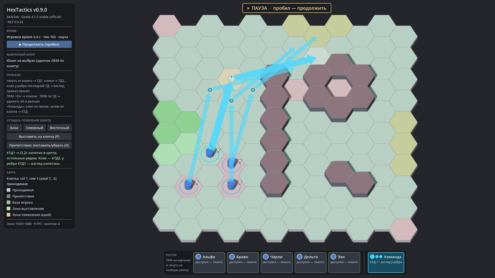

# HexTactics v0.9.0 — режим «Команда»

**Дата:** 2026-11-06 · **Тег:** `v0.9.0` · **ТЗ:** часть 2, §6, §8, §11, §12.10–12.16 (план версий — DECISIONS D-033, D-051)
**Движок:** Godot 4.7.2 stable .NET · **.NET:** SDK 8.0.133, рантайм 8.0 (`net8.0`)
**Архив:** `release_archives/v0.9.0/HexTactics_v0.9.0_windows_x64.zip` (+ `.sha256`, `BUILD_INFO.txt`)

## Функции

- **Карточка «Команда»** справа в нижней панели — отдельный явный инструмент: без Shift, рамок и меню.
- **Сбор команды.** Первый клик по своему юниту — капитан (голубой ромб), следующие — участники (голубые кольца). От
  **каждого** участника к курсору тянется своя голубая стрелка. Повторный клик по участнику ничего не меняет, капитан всегда
  первый. До 7 участников.
- **КТД.** Клик по клетке, вокруг которой помещается вся команда, — КТД1; дальше клики — КТД2, КТД3… без повторного захвата.
  Над такой клеткой стрелки показывают, кто куда встанет: капитан — в КТД, остальные — на соседние клетки.
- **Подсветка:** зелёные клетки — капитан дойдёт и рядом хватает свободных достижимых мест для всех; красные — нет.
- **Взгляд капитана** — клик у ребра последней КТД; приказ применяется ко всем сразу (транзакция). Спутники в этой версии
  смотрят туда же (ТЗ §14.5).
- **Построение** стабильное и детерминированное: минимум суммарной длины путей, при равенстве — порядок сторон.
- **Отмена:** ПКМ/Esc/повторное нажатие «Команда» — весь командный черновик; клик по красной клетке — тоже; ПКМ по КТД —
  удалить её и следующие. Приказы остальных юнитов не трогаются.
- Принятый командный приказ виден голубыми цепочками: номерные КТД капитана и маленькие маркеры мест спутников.
- Участник, чьё место временно занято другим участником, спокойно ждёт (без красного «!»).

## Ограничения

- Этапы цепочки не синхронизированы: каждый участник идёт по своим местам сам; ожидание отстающих на каждой КТД, выбор
  взглядов спутников из трёх сторон с seed и уступание прохода — v0.10.0.
- Команды больше 7 юнитов не поддерживаются (ТЗ §14.8).

## Проверено

- `dotnet test`: Core 59, Simulation 99 (+13: `GroupOrderTests`), Interaction 81 (+11: `GroupInteractionTests` — P10–P12,
  P14–P16), все зелёные.
- Регрессионный сценарий в собранной игре и в Windows-сборке: 57 проверок (`verify_release.ps1 -Run`) — сценарии v0.7/v0.8
  и командный режим настоящими нажатиями на карточку «Команда».
- Визуально (1920×1080): сбор команды со стрелками от каждого участника, предпросмотр мест у КТД, движение команды.

## Запуск

Распаковать ZIP, запустить `HexTactics.exe` (Windows 10/11 x64, OpenGL 3.3). Управление — `docs/CONTROLS.md`.

## Возврат к этой версии

- Сборка: `pwsh tools/restore_version.ps1 -Version 0.9.0`; исходники: `git checkout v0.9.0`.
- Предыдущая версия без команд — v0.8.0 (`pwsh tools/restore_version.ps1 -Version 0.8.0`).
